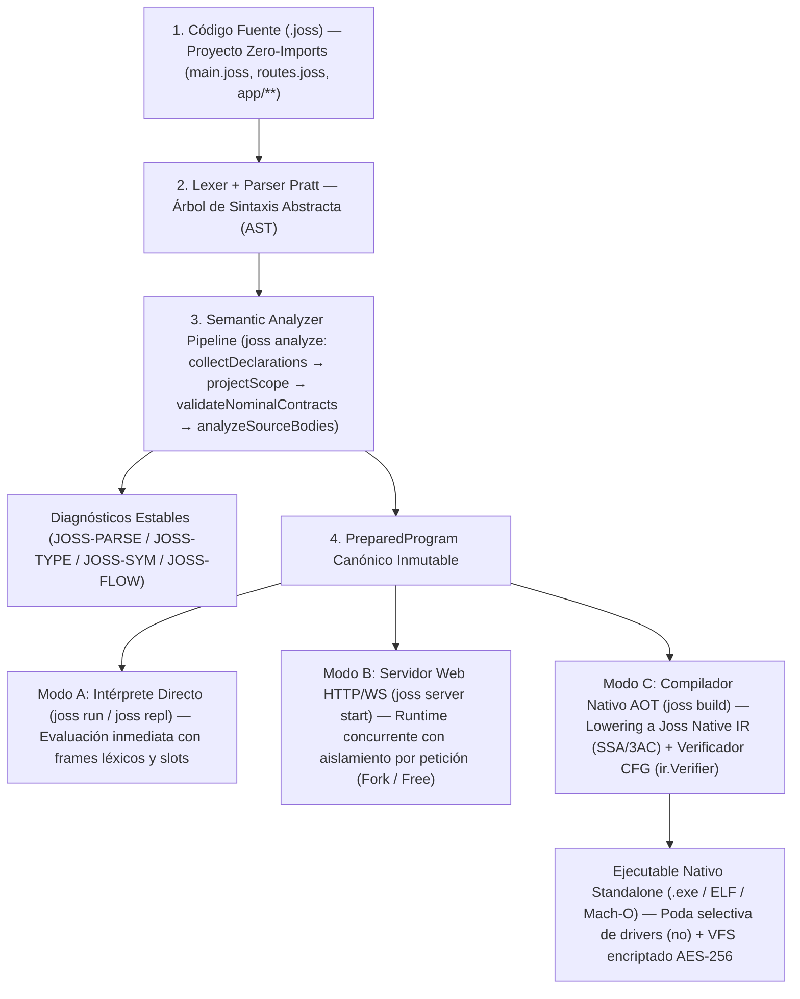
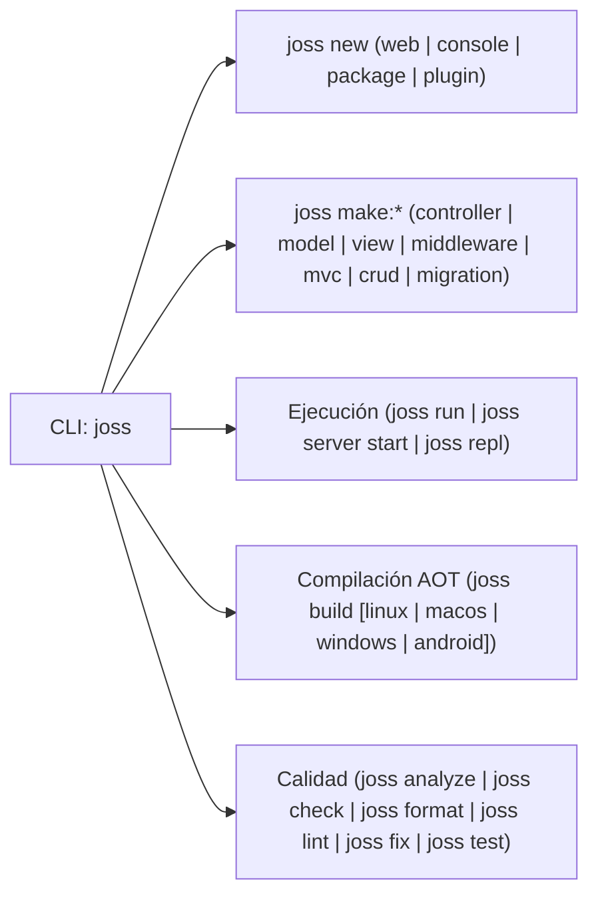

<p align="center">
  
</p>

<h1 align="center">El Lenguaje de Programación Joss</h1>

<p align="center">
  <b>Un solo lenguaje · Una sola semántica · Ejecución interpretada, Servidor Web Nativo y Compilación AOT</b>
</p>

<p align="center">
  <a href="https://goreportcard.com/report/github.com/joss-language/Joss-Programming-Language"></a>
  <a href="LICENSE"></a>
  <a href="https://astriom.org/docs"></a>
  <a href="https://github.com/joss-language/Joss-Programming-Language/actions"></a>
</p>

---

## 🌟 ¿Qué es Joss y qué hace?

**Joss** es un lenguaje de programación moderno, fuertemente tipado y un ecosistema de desarrollo completo (*batteries-included*) escrito en Go.

En el desarrollo de software tradicional, los equipos suelen verse obligados a elegir entre dos extremos:
1. **Lenguajes dinámicos o de scripting** (rápidos para prototipar, pero propensos a errores en producción, lentos y dependientes de cientos de paquetes externos para levantar un servidor web o conectarse a una base de datos).
2. **Lenguajes de sistemas compilados** (veloces y seguros, pero con curvas de aprendizaje empinadas, ciclos de compilación lentos y sin herramientas integradas para construir aplicaciones web o de negocio rápidamente).

**Joss une ambos mundos bajo un único diseño coherente**:
- Permite escribir código limpio, expresivo y sin ceremonias innecesarias (sin `;` obligatorios, sin cadenas interminables de `import` manuales).
- Analiza estáticamente todo tu proyecto antes de ejecutar una sola línea (`joss analyze`), detectando errores de tipos, rutas sin retorno, contratos de interfaces y mutaciones inválidas con diagnósticos precisos (`JOSS-*`).
- Ejecuta ese mismo programa validado (`PreparedProgram`) al instante en modo intérprete (`joss run`), como un servidor HTTP de alta concurrencia (`joss server start`), o lo compila directamente a un **ejecutable binario nativo independiente** (`joss build`) para Windows, Linux, macOS y Android sin que tengas que cambiar una sola línea de código.

---

## 🎯 Misión, Visión y Filosofía de Diseño

### Misión
Democratizar la creación de software robusto, seguro y de alto rendimiento, entregando en **un solo binario (`joss`)** todo lo que una persona —desde quien escribe su primera línea de código hasta un arquitecto de sistemas senior— necesita para diseñar, verificar, probar, servir en la web y compilar aplicaciones nativas listas para producción sin depender de ecosistemas fragmentados.

### Visión
Convertirse en el lenguaje de referencia bajo el principio **"Un solo lenguaje, una sola semántica, múltiples modos de ejecución"** (*Feature Once, Execute Everywhere*), donde la experiencia pedagógica de aprendizaje, la productividad del desarrollo web empresarial y la eficiencia de la compilación nativa AOT convergen sin compromisos.

### Los 5 Pilares Filosóficos de Joss
1. **Paridad Semántica Total**: Lo que funciona en `joss run` funciona exactamente igual en `joss server` y en el binario compilado con `joss build`. No existen "subconjuntos" ni dialectos distintos.
2. **Seguridad Estática con Ergonomía Moderna**: Tipado estático e inferencia estricta (`var $x = 10`), tipos unión (`int|null` / `int?`), aritmética financiera exacta de base 10 (`decimal`) y dinamismo explícito solo cuando el programador lo solicita deliberadamente (`mixed`).
3. **Cero Fricción Arquitectónica (*Zero-Imports*)**: El compilador descubre y enlaza automáticamente todas las declaraciones de tu proyecto (`main.joss`, `routes.joss`, `api.joss` y `app/**/*.joss`). Tu estructura de carpetas es tu arquitectura, sin burocracia de encabezados.
4. **Autonomía del Toolchain (*Batteries-Included*)**: Servidor HTTP, motor de plantillas HTML con protección anti-XSS nativa, ORM relacional (`GranDB` / `Model`), constructor de esquemas y migraciones (`Schema`), generadores de código (`joss make:*`), formateador, linter, suite de tests y gestor de paquetes (`pub`) viven dentro del propio lenguaje.
5. **Distribución Ultraligera y Segura**: Compilación AOT a binarios CLI puros de apenas ~5.5 KB - 32 KB, o aplicaciones completas con servidor/DB que podan automáticamente los motores no utilizados (`no<driver>`) y sellan sus vistas y variables de entorno encriptadas con **AES-256** (`env.enc`) dentro de un único ejecutable.

---

## 🏗️ Arquitectura: Un solo lenguaje, múltiples modos de ejecución

Todo archivo `.joss` atraviesa el mismo pipeline frontal antes de ejecutarse o compilarse:



---

## 🔍 Análisis Estático, Sistema de Tipos y Mejoras Clave

Joss ha evolucionado hacia un sistema de verificación estática y ejecución de grado industrial. Estas son las capacidades y mejoras técnicas que distinguen al motor actual:

### 1. Analizador Semántico de 4 Fases y Diagnósticos `JOSS-*`
Antes de ejecutar cualquier instrucción, `pkg/analyzer` realiza cuatro pasadas deterministas sobre todas las unidades fuente (`SourceUnit`) del proyecto:
- **Fase 1 (`collectDeclarations`)**: Registra firmas de funciones, clases, constructores (`Init`), interfaces, `record` y `enum` en todo el proyecto sin importar el orden de los archivos.
- **Fase 2 (`projectScope`)**: Construye la tabla de símbolos global e inyecta el catálogo de clases nativas y símbolos de plugins `.jp` firmados.
- **Fase 3 (`validateNominalContracts`)**: Verifica herencias (`extends`), implementación completa de `interface`, cumplimiento de métodos `abstract`, invariancia de tipos e inmutabilidad de `record` y `const`.
- **Fase 4 (`analyzeSourceBodies`)**: Comprueba tipos de cada expresión, estrechamiento de tipos por flujo (*Smart Cast Narrowing* tras `guard` o condicionales `!= null`), rutas de retorno garantizadas (`JOSS-TYPE-010`) y alcanzabilidad de código (`JOSS-FLOW-*`).

### 2. Sistema de Tipos con Precisión Financiera y Contratos Nominales
- **Inferencia fija (`var`) vs Dinamismo explícito (`mixed`)**: `var $total = 100` infiere y bloquea el tipo `int` para toda la vida de la variable. Si se requiere flexibilidad dinámica, se declara explícitamente `mixed $dato = ...`.
- **Protección contra pérdida de precisión numérica (`JOSS-ARITH-003`)**: Joss incorpora `decimal` nativo (`19.99m`) para cálculos monetarios exactos en base 10. La única promoción implícita permitida entre tipos numéricos distintos es `int → decimal`; mezclar `float` binario con `decimal` o `int` exige conversión explícita para evitar errores silenciosos de redondeo IEEE-754.
- **Referencias mutables seguras (`ref`)**: Soporte para paso por referencia explícito en la firma y en la llamada (`public func incrementar(ref int $n): void` → `incrementar(ref $contador)`), estrictamente invariante y sin fugas de memoria (*no escapable*).
- **Records inmutables y Genéricos**: Declaración concisa de estructuras de datos de valor con `public record Coordenada(int $x, int $y)` y clases parametrizadas `public class Caja<T>`.

### 3. Expresividad Funcional y Control de Recursos
- **Operador Pipeline (`|>`)**: Transforma datos encadenando funciones de izquierda a derecha de forma legible: `"  ada lovelace  " |> trim |> strtoupper`.
- **Cláusulas `guard` y `defer`**:
  - `guard (condición) : { return ... }` obliga estáticamente (`JOSS-FLOW-005`) a salir del ámbito si no se cumple una precondición, eliminando la anidación excesiva y refinando el tipo de las variables posteriores.
  - `defer { ... }` garantiza la liberación de recursos (archivos, conexiones, locks) en orden inverso (`LIFO`) al salir de la función, incluso ante excepciones.
- **Expresiones Ternarias de Bloque y `match`**: Evalúa condiciones con `(condición) ? { ... } : { ... }`, operador Elvis (`?:`), coalescencia nula (`??`), asignación nula (`??=`), navegación segura (`?->`) y coincidencia de patrones con `match ($estado) { ... }`.
- **Concurrencia con `async/await`, `Future` y `channel<T>`**: Ejecución asíncrona con propagación de contexto cancelable y comunicación segura entre tareas mediante canales tipados (`$ch->send(...)`, `$ch-> close()`, `foreach ($ch as $msg)` y multiplexación con `select`).

### 4. Stack Web MVC, ORM GranDB y Generadores Inteligentes (`joss make:*`)
- **Generación de código integrada**: Crea controladores (`joss make:controller`), modelos (`joss make:model`), vistas (`joss make:view`), middlewares (`joss make:middleware`), tríadas completas (`joss make:mvc`) o módulos administrativos completos inspeccionando la base de datos (`joss make:crud <tabla>`).
- **ORM GranDB multi-motor**: Consultas parametrizadas seguras contra inyección SQL, relaciones (`belongsTo`, `hasOne`, `hasMany`, `belongsToMany` con `attach`/`detach`/`sync` transaccional), *scopes*, *soft deletes*, *casts*, *accessors/mutators* y soporte transparente para **SQLite, MySQL, PostgreSQL y SQL Server**.
- **Compilación Cruzada Integrada**: Genera ejecutables nativos para cualquier plataforma desde una sola máquina con `joss build linux`, `joss build macos`, `joss build windows` o `joss build android`.

---

## 📦 Instalación Rápida

### Instalador automático oficial

En **Windows** (PowerShell):
```powershell
iwr -useb https://astriom.org/install | iex
```

En **Linux, macOS o Android (Termux)** (Terminal):
```bash
curl -fsSL https://astriom.org/install.sh | bash
```

### Compilar desde el código fuente

Si dispones de [Go](https://go.dev) (versión 1.25 o superior):
```bash
git clone https://github.com/joss-language/Joss-Programming-Language.git
cd Joss-Programming-Language
go build -o joss ./cmd/joss
```

Comprueba que la instalación sea correcta:
```bash
joss version
```

---

## ⚡ Tu primer proyecto en 30 segundos

### Opción A: Proyecto de consola (`joss new console`)

Crea un proyecto de consola completo usando el generador oficial de Joss:

```bash
joss new console mi-primer-joss
cd mi-primer-joss
joss run main.joss
```

O escribe un programa directo en `main.joss`:

<!-- joss-run: ["Hola, Joss!"] -->
```joss
print("Hola, Joss!")
```

Verifícalo estáticamente, ejecútalo al instante o compílalo a un ejecutable nativo:

```bash
joss analyze main.joss
joss run main.joss
joss build main.joss
```

Salida esperada:
```text
Hola, Joss!
```

### Opción B: Aplicación Web MVC (`joss new`)

Crea una aplicación web completa con servidor HTTP nativo, rutas, controladores y vistas:

```bash
joss new mi-web
cd mi-web
joss make:controller SaludoController
joss make:view saludo
joss server start
```

---

## 🎨 Un vistazo al lenguaje en acción

Joss combina claridad visual, tipado estático riguroso y expresividad funcional:

<!-- joss-run: ["Hola, ADA", "Total con impuesto: 145.49", "Puedes participar"] -->
```joss
public func formatearNombre(string $Texto): string {
    return $Texto |> trim |> strtoupper
}

public func saludar(string $nombre): string {
    return "Hola, " . formatearNombre($nombre)
}

var $edad = 20
decimal $subtotal = 125.50m
decimal $impuesto = 19.99m
decimal $total = $subtotal + $impuesto

print(saludar("  ada  "))
print("Total con impuesto: " . $total)
print(($edad >= 18) ? "Puedes participar" : "Aún debes esperar")
```

---

## 🛠️ Comandos Esenciales de la CLI y Generadores



| Comando | Descripción |
|---|---|
| `joss new [web\|console\|package\|plugin] <ruta>` | Crea un nuevo proyecto con la plantilla oficial indicada (`web` por defecto) |
| `joss make:<tipo> <Nombre>` | Genera componentes (`controller`, `model`, `view`, `middleware`, `mvc`, `crud`, `migration`) |
| `joss remove:crud <tabla>` | Revierte limpiamente un módulo CRUD generado (controlador, modelo, vistas y rutas) |
| `joss run <archivo.joss>` | Analiza semánticamente el proyecto y lo ejecuta en el intérprete de Joss |
| `joss build [archivo.joss] [--target=...]` | Compila el proyecto a un ejecutable binario nativo independiente dentro de `build/` |
| `joss server start` | Inicia el servidor web HTTP/WebSocket nativo de alto rendimiento |
| `joss repl` | Inicia la consola interactiva (`joss> `) para experimentar en vivo |
| `joss analyze [ruta]` | Ejecuta el analizador semántico de 4 fases y comprobación exhaustiva de tipos |
| `joss check [ruta]` | Ejecuta el pipeline completo de calidad: formato, sintaxis, análisis semántico y linter |
| `joss format [ruta] [--write\|--check]` | Formatea o verifica el código fuente conservando comentarios (*trivia*) |
| `joss fix [ruta] [--dry-run]` | Aplica migraciones sintácticas automáticas léxicamente seguras |
| `joss test [--filter=...] [ruta]` | Ejecuta la suite de pruebas unitarias y de integración (`*_test.joss`) |
| `joss migrate` / `joss migrate:fresh` / `joss db:seed` | Ejecuta migraciones versionadas de base de datos y pobladores de datos (*seeders*) |
| `joss pub [add\|remove\|install\|publish]` | Administra dependencias, paquetes y plugins firmados (`.jp`) del ecosistema Joss |

---

## 🗺️ Mapa de la Documentación Oficial (50 Guías en 3 Idiomas)

Toda la documentación de Joss se mantiene sincronizada y verificada automáticamente mediante contratos ejecutables en **Español** (`docs/`), **Inglés** (`docs/en/`) y **Portugués** (`docs/pt/`):


### 1. Aprender Joss desde cero (Curso guiado paso a paso)
- 0. [Primeros pasos: De cero a tu primer proyecto con `joss new`](docs/PRIMEROS_PASOS.md)
- 1. [Valores, variables y operaciones fundamentales](docs/FUNDAMENTOS.md)
- 2. [Control de flujo, decisiones y bucles](docs/CONTROL_FLUJO.md)
- 3. [Colecciones: Arrays, Maps y texto Unicode](docs/COLECCIONES.md)
- 4. [Funciones, ámbito (scope), `guard`, `defer`, closures, `ref` y pipelines](docs/FUNCIONES.md)
- 5. [Manejo de errores, diagnósticos `JOSS-...` y excepciones `try/catch`](docs/ERRORES.md)
- 6. [Clases, objetos, métodos, interfaces, `record` y genéricos](docs/CLASES.md)
- 7. [Concurrencia, asincronía, `Future` y canales (`channel`)](docs/CONCURRENCIA.md)
- 8. [Proyecto práctico: Aplicación de consola con persistencia JSON y `joss build`](docs/PROYECTO_CONSOLA.md)
- 9. [Proyecto práctico: Aplicación web MVC con `joss new` y `joss make:*`](docs/PROYECTO_WEB.md)
- [Glosario completo de términos de programación](docs/GLOSARIO.md)

### 2. Referencia técnica exhaustiva
- [Sistema de tipos, inferencia, uniones y conversiones](docs/SISTEMA_TIPOS.md)
- [Sintaxis, tokens y precedencia de operadores](docs/SINTAXIS.md)
- [Gramática EBNF formal y correspondencia con el AST](docs/GRAMATICA.md)
- [Catálogo y referencia de diagnósticos (`JOSS-*`)](docs/DIAGNOSTICOS.md)
- [Guía de funciones globales integradas](docs/FUNCIONES_GLOBALES.md)
- [Clases nativas y servicios del runtime](docs/MODULOS_NATIVOS.md)
- [Catálogo nativo generado por `docgen`](docs/CATALOGO_NATIVO.md)
- [Referencia completa de comandos de la CLI (`joss`)](docs/CLI.md)
- [Soporte móvil: Android e iOS](docs/MOBILE.md)
- [Extensión oficial para Visual Studio Code (LSP)](docs/VSCODE_EXTENSION.md)
- [Estado real de implementación y límites del sistema](docs/ESTADO_IMPLEMENTACION.md)
- [Analizador semántico y flujo de diagnósticos](docs/ANALIZADOR.md)
- [Recursión, frames y límites de llamadas](docs/RECURSION.md)

### 3. Desarrollo de aplicaciones reales
- [Estructura de proyectos y generadores `joss make:*`](docs/ESTRUCTURA_PROYECTO.md)
- [Configuración y variables de entorno (`env.joss`)](docs/CONFIGURACION.md)
- [Carga automática y arquitectura Zero-Imports](docs/MODULOS_IMPORTS.md)
- [Arquitectura de plugins y paquetes binarios `.jp`](docs/PLUGINS.md)
- [Servidor HTTP nativo de alto rendimiento](docs/SERVIDOR.md)
- [Controladores web y peticiones HTTP](docs/CONTROLADORES.md)
- [Middlewares y capas de seguridad](docs/MIDDLEWARE.md)
- [Motor de vistas y plantillas HTML dinámicas](docs/VISTAS.md)
- [Gestión y compilación de assets](docs/ASSETS.md)
- [WebSockets y comunicación en tiempo real](docs/WEBSOCKETS.md)
- [Modelos relacionales y consultas GranDB](docs/MODELOS.md)
- [Schema Builder y migraciones versionadas](docs/SCHEMA_BUILDER.md)
- [Guía práctica de migraciones](docs/MIGRACIONES.md)
- [Sistema de autenticación, sesiones y MFA](docs/AUTENTICACION.md)
- [SEO y generación de sitemaps](docs/SEO_SITEMAP.md)

### 4. Arquitectura interna, auditorías y contribución
- [Arquitectura del compilador, analizador y runtime](docs/ARQUITECTURA.md)
- [Guía para contribuidores del núcleo](docs/CONTRIBUIR.md)
- [Informe de auditoría integral y reconstrucción documental](docs/DOCUMENTATION_AUDIT.md)
- [Auditoría técnica y optimización del runtime](docs/AUDITORIA_TECNICA_2026.md)
- [Auditoría integral del lenguaje 2026](docs/JOSS_LANGUAGE_AUDIT_2026.md)
- [Evaluación crítica y comparativa de Joss 2026](docs/JOSS_LANGUAGE_REVIEW_2026.md)
- [Evolución de Joss 2026: fases 0 y 1](docs/JOSS_EVOLUTION_PHASE_0_1_2026.md)
- [Auditoría del ORM GranDB 2026](docs/GRANDB_ORM_AUDIT_2026.md)
- [Auditoría de optimización del runtime](docs/RUNTIME_OPTIMIZATION_AUDIT.md)
- [Novedades históricas de Joss 3.6.7](docs/NOVEDADES_367.md)

---

## 🤝 Cómo Contribuir

¡Toda contribución es bienvenida! Antes de comenzar a trabajar en cambios al compilador, analizador o documentación:

1. Lee la [Guía de arquitectura y reglas operativas (AGENTS.md)](AGENTS.md) y la [Guía de contribución](docs/CONTRIBUIR.md).
2. Utiliza las **plantillas oficiales de GitHub**:
   - **Reportar un error**: Completa el formulario de [Reporte de Error (.github/ISSUE_TEMPLATE/bug_report.yml)](.github/ISSUE_TEMPLATE/bug_report.yml) incluyendo obligatoriamente la versión de Joss (`joss version`), sistema operativo y un código mínimo reproducible en `.joss`.
   - **Proponer una mejora**: Utiliza la plantilla de [Propuesta de Mejora (.github/ISSUE_TEMPLATE/feature_request.yml)](.github/ISSUE_TEMPLATE/feature_request.yml) describiendo la motivación y ejemplos de sintaxis.
   - **Enviar un Pull Request**: Cumple con la lista de verificación en [.github/PULL_REQUEST_TEMPLATE.md](.github/PULL_REQUEST_TEMPLATE.md).

### Ejecutar validaciones locales obligatorias

```bash
# Formateo canónico
gofmt -w <archivos-modificados>

# Verificación de generadores automáticos
go run ./tools/cataloggen --check
go run ./tools/docgen --check

# Pruebas y análisis estático
go vet ./...
go test ./...
go test -race ./pkg/parser ./pkg/typesystem ./pkg/analyzer ./pkg/core ./pkg/server

# Verificación de contratos, documentación e i18n
go test ./pkg/core -run TestDocumentation -v
go run ./tools/docsi18n --check
```

---

## 📜 Licencia y Seguridad

Joss es software libre publicado bajo los términos de la [Licencia MIT](LICENSE). Para reportar vulnerabilidades de seguridad de forma privada y responsable, consulta la directriz en [SECURITY.md](SECURITY.md).

---

## ☕ Apoya el proyecto / Support

Si este proyecto te ha sido de utilidad o deseas apoyar mi trabajo, ¡puedes invitarme un café!

[](https://buymeacoffee.com/jossestrely)
