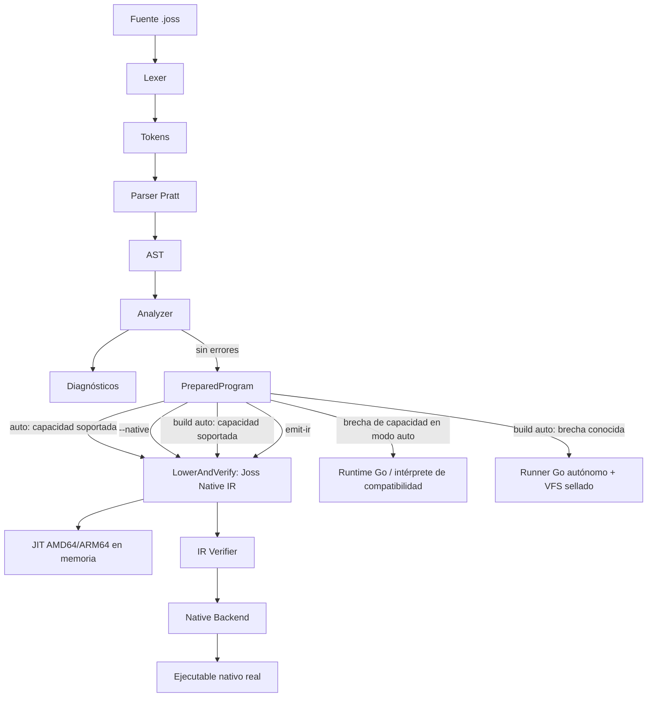

# Arquitectura del lenguaje Joss

[Índice](README.md) · Antes: [estado](ESTADO_IMPLEMENTACION.md) · Después: [contribuir](CONTRIBUIR.md)

## Pipeline real

```text
fuentes .joss
  → lexer (`pkg/parser/lexer.go`)
  → parser Pratt (`pkg/parser`)
  → AST (`pkg/parser/ast*.go`)
  → análisis semántico (`pkg/analyzer`)
    (collectDeclarations → projectScope → validateNominalContracts → analyzeSourceBodies)
  → diagnósticos (`pkg/diagnostics`)
  → PreparedProgram (Canónico)
  ┌───────────────────────┼──────────────────────────┐
  ▼                       ▼                          ▼
`joss run`             `joss server/program`     `joss build`
Auto: JIT o Go         Auto: JIT o Go            Auto: AOT o runner Go
`--native` estricto    `--native` estricto       `--native` estricto
```



Los comandos normales usan selección automática. Los programas sin servidor
HTTP intentan JIT/AOT si el backend los soporta. Cuando el análisis resuelve
`Server::start`, `HttpServer::start` o `HttpServer::run`, `run` y `program`
ejecutan el runtime Go; `server start` usa Go por defecto y `build` empaqueta el
runner Go. Esto mantiene HTTP concurrente aunque el backend nativo soporte el
programa. Las brechas nativas conocidas también seleccionan el runtime Go; los
errores de análisis, IR o emisión no activan fallback. `--native` exige la ruta
nativa y nunca cambia de motor; `joss emit-ir` siempre usa el pipeline nativo.

Los cuatro comandos seleccionan automáticamente el servidor Go `pkg/server`
con `net/http` para aplicaciones HTTP, que procesa requests concurrentemente y
admite conexiones WebSocket de larga duración. `joss server start --native`,
`joss run --native`, `joss program start --native` y `joss build --native`
fuerzan la ruta nativa. El bucle TCP de
`std/http/server.joss`, que atiende una conexión a la vez y se conserva para
validar el backend nativo. La selección de `server start` se conserva durante
hot reload.

El runner de compatibilidad actual todavía incluye el intérprete Go completo;
no es el host Go mínimo de la arquitectura híbrida objetivo. Los builds puros
que el backend soporta siguen generando AOT standalone sin runtime Go. La poda
por capacidades produce tags deterministas y puede compilar un runner de perfil
en un checkout con Go; una distribución instalada necesita incluir el runner
precompilado correspondiente. La frontera ABI para llamar adaptadores Go desde
código Joss nativo sigue pendiente, por lo que los servicios no se presentan
como híbrido AOT hasta contar con esa implementación.

La ruta nativa centraliza lowering y verificación en `ir.LowerAndVerify`.
`joss run --native`, `joss build --native` y `joss emit-ir` usan esa misma
entrada y sus errores de lowering/verificación conservan la etapa. En
AMD64, JIT y AOT comparten ahora la emisión de instrucciones y solo separan la
publicación en memoria o en el contenedor ejecutable. ARM64 Unix también tiene
el destino JIT en memoria, con relocaciones a la dirección asignada y páginas
de código RX separadas de los datos RW; su prueba de ejecución se activa en un
host ARM64. En Windows ARM64 el invocador acepta por ahora solo IR puro:
aritmética, control de flujo y llamadas directas a funciones Joss. Built-ins,
llamadas indirectas, excepciones, operaciones de heap, servicios del host y
primitivas de runtime se rechazan con `JOSS-NATIVE-001` hasta que se emita su
ABI de Windows; así se evita ejecutar syscalls de Unix.
El ABI de sockets nativo cubre Windows AMD64, Linux/Android AMD64 y Linux,
Android y macOS ARM64; Windows ARM64 y macOS AMD64 fallan explícitamente al
compilar un servicio `Socket` que aún no tiene emisor de plataforma.
`joss server` mantiene el backend HTTP Go durante los reinicios supervisados.
`--native` fuerza el servidor Joss y termina con diagnóstico si JIT no soporta
una capacidad requerida.

El lowering poda funciones IR inalcanzables en proyectos de consola y web. Los
puntos de entrada son `main` y, cuando existe, `__joss_http_dispatch`; los
helpers de vistas y assets se conservan solo si son alcanzables desde ellos.
Así, una operación pura como `GranDB::toSql` no arrastra consultas DB de otros
métodos. `json_decode` y `JSON::parse/decode` usan el parser canónico de
`std/json/decoder.joss` y se bajan a llamadas Joss compartidas por intérprete,
JIT y AOT cuando el argumento tiene tipo estático `string`. Los emisores AMD64
y ARM64 compilan el parser; los mapas homogéneos de strings tienen helpers
tipados. Los mapas dinámicos heterogéneos aún pierden la etiqueta de tipo en el
IR/backend nativo, por lo que los argumentos `mixed` y leer un string de un
objeto JSON en AOT/JIT no tienen paridad completa y siguen pendientes.
Los emisores tampoco fabrican adaptadores vacíos para métodos faltantes de
`Router`, `Schema`, `Plugin`, `GranDB` o `HttpServer`: cada llamada debe tener
una implementación Joss o una primitiva nativa real, o la compilación falla con
`JOSS-NATIVE-001`.

Cuando un servicio está declarado como llamada de plataforma pero el módulo
fuente ofrece `__joss_host_<Clase>_<metodo>`, el lowering común solo reemplaza
`CallHostService` por una llamada Joss directa si coinciden cantidad y tipos de
argumentos, receptor y tipo de retorno. El receptor de instancia se pasa como
primer argumento del owner. Los emisores JIT y AOT consumen esa misma función;
si el contrato no coincide, la llamada de plataforma se conserva y la
validación del backend debe demostrar que esa ruta está implementada.

`semanticanalyzer.LoadProject` conserva cada archivo como una `analyzer.SourceUnit` (incluyendo `main.joss`, `routes.joss`, `api.joss` y todos los archivos `.joss` bajo `app/`); no concatena ASTs perdiendo el origen. Primero registra declaraciones globales de funciones, clases, interfaces y enums, después valida contratos nominales y finalmente analiza cada método con un scope léxico independiente. Las clases nativas provienen de `Runtime.RegisterNativeClasses`; los plugins aportan sus índices de símbolos JP v2.

## Responsabilidades

| Paquete | Responsabilidad |
|---|---|
| `pkg/parser` | Tokens, lexer, precedencias, parser y nodos AST. |
| `pkg/typesystem` | Nombres canónicos, inferencia, coerción explícita, métodos primitivos y compatibilidad de asignación. |
| `pkg/analyzer` | Unidades fuente, scopes, símbolos, inferencia de expresiones, firmas, flujo alcanzable y generación de `PreparedProgram`. Nunca importa `pkg/core`. |
| `pkg/diagnostics` | Modelo común: código, severidad, mensaje, archivo, rango, explicación y sugerencia. |
| `pkg/core` | Adaptación de catálogos reales al analizador, intérprete (`ExecutePrepared`) y primitivas integradas. |
| `pkg/runtime/errors` | Error runtime estructurado y frames de stack Joss, sin dependencias de framework. |
| `pkg/runtime/value` | Semántica de valores independiente del evaluator, incluida indexación Unicode. |
| `pkg/runtime/plan`, `pkg/runtime/frame` | Planes de callables, slots y representación etiquetada usados para acelerar resolución local; no forman bytecode portable. |
| `pkg/pluginruntime`, `pkg/pluginpkg` | Carga aislada, verificación y resolución de símbolos de plugins JP v2. |
| `pkg/bytecode` | Serialización comprimida del AST (formato `JOSSBC2Z` exclusivo para plugins `.jp`, nunca para binarios nativos AOT). |
| `pkg/ir` | Joss Native IR canónico: CFG, bloques básicos, instrucciones SSA/3AC tipadas, lowerer desde `PreparedProgram` y verifier. |
| `pkg/backend/native` | Backend de compilación nativa: generador de código máquina real y emisión LLVM para ejecutables autónomos. |
| `cmd/joss` | CLI, análisis de proyecto, ejecución (`run`), servidor (`server start`), compilación nativa (`build`) con poda selectiva (`no<driver>`) y herramientas. |
| `vscode-joss` | LSP/editor. Consume el catálogo generado del núcleo. |

## Fuentes de verdad

- Keywords y símbolos: `pkg/parser/token.go`; `parser.KeywordNames()` y `parser.SymbolDefinitions()` son las proyecciones para lexer, formatter y generadores.
- Tipos y compatibilidad: `pkg/typesystem`, incluidas clasificaciones semánticas como `Type.IsNumeric()`.
- Métodos de primitivas: nombre y retorno en `pkg/typesystem/primitive_methods.go`. `pkg/analyzer` proyecta esa metadata y `pkg/core/primitives.go` conserva únicamente la implementación runtime. Toda definición debe quedar cubierta por `TestPrimitiveMethodCatalogHasRuntimeImplementations`.
- Built-ins globales: `pkg/core/builtins.go` declara una sola vez nombre, dominio de dispatcher y retorno. El runtime despacha directamente por ese descriptor y rechaza nombres fuera del catálogo.
- Clases/métodos nativos: llamadas a `registerNative` dentro de `Runtime.RegisterNativeClasses()`; sus retornos se tipan en `pkg/core/native_signatures.go`.
- Símbolos de plugins: `pluginpkg.SymbolIndex` incluido en cada `.jp`.
- Diagnósticos: `pkg/diagnostics.Diagnostic` y códigos emitidos por `pkg/analyzer`.
- Catálogo de VS Code: `vscode-joss/src/server/generated/languageCatalog.json`, generado mediante `go run ./tools/cataloggen`.
- Catálogo nativo de documentación: `docs/CATALOGO_NATIVO.md`, generado mediante `go run ./tools/docgen`.

CI ejecuta `go run ./tools/cataloggen --check` y `go run ./tools/docgen --check`; editar a mano los catálogos generados no es válido.

## Scopes y símbolos

- Cada función, método, `Init` y closure tiene un scope propio.
- Los parámetros pertenecen únicamente a su callable.
- Los bloques de control usan el scope del callable para reflejar el runtime actual.
- El binding de `foreach` puede reutilizarse en otro loop; el runtime lo trata como asignación.
- Las clases y funciones top-level se resuelven a nivel de proyecto.
- Si una clase declarada en Joss comparte nombre con un handler nativo, sus contratos nativos no sobrescritos permanecen visibles al analyzer; los métodos estáticos con cuerpo fuente se ejecutan desde Joss y los métodos sin implementación fuente conservan el fallback nativo. Las propiedades estáticas Joss se inicializan una vez por runtime raíz, se comparten entre sus forks de request y se limpian al liberar el runtime propietario.
- Los globals nativos y símbolos de plugins se inyectan mediante `analyzer.Environment`.
- Una función con nombre no hereda variables fuente del caller ni variables top-level: recibe parámetros, locales, `this` y bindings del host/plugin. Una closure sí captura léxicamente.
- Los parámetros requieren tipo explícito; `mixed` nunca se introduce silenciosamente.
- Un parámetro `ref` recibe un alias temporal al binding mutable del caller. Analyzer y runtime exigen marca bilateral, l-value, no-constancia y tipo exactamente invariante.
- La visibilidad no tiene default: parser, analyzer y runtime conservan y validan `public`, `private` y `protected`.

## Build y ejecución

Los emisores de esta versión cubren AMD64 y ARM64. La selección de arquitectura no puede caer por defecto en AMD64: targets desconocidos y ARM de 32 bits se rechazan explícitamente porque no tienen emisor implementado.

El modo de desarrollo interpreta el `PreparedProgram` (`Runtime.ExecutePrepared`). Cada invocación de callable crea un frame léxico independiente; no existe scope dinámico entre caller y callee. Esto evita que una llamada recursiva lea o sobrescriba locales del caller. El runtime limita la profundidad a 1024 frames por defecto y las closures escriben únicamente sobre su entorno capturado. Los tipos de retorno anotados se validan en analyzer/runtime y el analyzer exige terminación exhaustiva demostrable.

Antes de ejecutar un callable, `pkg/runtime/plan` puede asignar slots a parámetros
y locales. `frame_runtime.go` usa esos slots y conserva un fallback para bindings
que no caben en el plan. Metadatos de clase, accesos y scopes se cachean; cualquier
cambio semántico debe comparar la ruta rápida con la ruta general. Los controles
de loops buscan saltos directos en el AST planificado y hoy no atraviesan todos
los ternarios/match, un límite registrado en la auditoría.

Las referencias seguras no exponen punteros de Go: `core.VariableReference` conserva el binding de valor/tipo/constancia durante una llamada y el evaluator desreferencia automáticamente. Una referencia no es un valor Joss almacenable ni cruza fronteras async/plugin.

`joss build` usa runner Go para aplicaciones que inician HTTP o tienen una brecha de capacidad nativa conocida; para programas puros intenta AOT automáticamente. `joss build --native` exige AOT puro. La ruta AOT transforma el `PreparedProgram` analizado y validado hacia **Joss Native IR** (`pkg/ir`), con CFG, basic blocks e instrucciones de tipado estricto. Tras la verificación formal (`ir.VerifyProgram`), el **Native Backend** (`pkg/backend/native`) genera ejecutables nativos reales autocontenidos (PE `.exe`, ELF, Mach-O) en `build/` sin serializar AST:
- **Programas CLI puros**: Se compilan a código máquina puro (~5.5 KB - 32 KB) sin `joss_host.dll` y sin trailer VFS (`JOSS_RUNNER_DATA`).
- **Aplicaciones con servicios web/DB**: El binario standalone no enlaza `_joss_host_bridge` ni una DLL complementaria. Cada servicio debe resolverse a código Joss o a una primitiva nativa emitida; si falta esa implementación, el backend rechaza la compilación. Los build tags `no<driver>` podan los drivers no utilizados y el VFS puede sellarse con AES-256 (`env.enc`).

Un símbolo global de runtime sin implementación para el target detiene la compilación con un error de símbolo no resuelto. La CLI ejecuta la validación de capacidades AOT antes de preparar CSS o consultar datos externos; así un target incompleto falla antes de esos efectos. Los adaptadores transitorios de paso se reservan a las familias `Router`, `Schema`, `Plugin`, `GranDB` y `HttpServer`; no sustituyen funciones de la Standard Library ni prueban paridad funcional de esos servicios. Los placeholders de `Auth`, `SEO` y `Turnstile` ya no pueden ocultar lógica ausente: esas llamadas requieren una implementación Joss y, si falta, se rechazan con `JOSS-NATIVE-001`. La paridad AOT de `strpos`, `substr`, `urldecode` y otras primitivas debe verificarse por separado en AMD64 y ARM64 antes de declarar completo un flujo HTTP.

Las primitivas nativas `Socket::listen`, `Socket::accept`, `Socket::receive`, `Socket::send` y `Socket::close` se validan según su ABI: AMD64 en Windows y Linux; ARM64 en Linux y macOS. El compilador rechaza esas llamadas para las demás combinaciones hasta que exista una implementación del sistema operativo correspondiente. En JIT, los callbacks de HostBridge siguen limitados a Windows AMD64; los programas sin callbacks pueden usar las primitivas de socket nativas en los targets compatibles.

Del mismo modo, JPBC sólo define ejecución de plugins. Al documentar
“compilación” indique cuál de las representaciones se está usando.

## Regla de dependencia

Las capas de lenguaje (`parser`, `typesystem`, `diagnostics`, `analyzer`) no importan `core`. `core` adapta sus registros al analizador. Esta dirección evita que el type checker dependa de efectos secundarios del servidor o de la base de datos.

El servidor mantiene sus adaptadores HTTP fuera del intérprete: `request_data.go` traduce `net/http` al mapa estable consumido por Joss y `rate_limiter.go` encapsula el estado de limitación. `handler.go` continúa como orquestador y no debe volver a absorber estas responsabilidades.

## Fronteras internas del evaluator

Las llamadas conservan una sola ruta evaluada. `call_arguments.go` transforma expresiones fuente y aplica binding posicional/nombrado/default/ref; `call_method.go` instala parámetros, administra el frame, recursión, defers y contrato de retorno; `callable_dispatch.go` adapta closures, métodos ligados, plugins y funciones Go a esa ruta; `evaluator_call.go` sólo resuelve una llamada fuente y el dominio del built-in. Los entry points públicos históricos delegan, no reimplementan reglas.

Los infijos se coordinan en `evaluator_infix.go` porque el orden observable —coalescencia, pipeline, short-circuit, entrada, evaluación derecha y salida— debe permanecer explícito. Sus conductas viven por dominio en `evaluator_control.go`, `evaluator_pipeline.go`, `evaluator_numeric.go`, `evaluator_stream.go` y `evaluator_update.go`. No se debe volver a añadir un operador directamente al coordinador salvo que afecte el orden de evaluación.

En el analyzer, `infer_nominal.go` amplía `typesystem.Assignable` con clases/interfaces del proyecto; `infer_narrowing.go` crea scopes refinados por `is` y comparaciones con null. Estas reglas permanecen separadas del runtime: comparten tipos y metadata, no ejecución ni estado.

## Tercera fase de arquitectura — septiembre de 2026

El analyzer tiene un pipeline semántico explícito: recolección de declaraciones, scope de proyecto, contratos nominales, cuerpos/callables y diagnósticos. Las responsabilidades se separan en archivos del mismo package para conservar encapsulación y evitar APIs públicas artificiales. `call_resolution.go` y `member_resolution.go` proyectan funciones, métodos, nativos, primitivos y plugins a la firma semántica de `Callable`; la ejecución continúa en `core`.

Antes de cambiar infraestructura se añadieron caracterizaciones de runtime (fork/reset/reuse), HTTP (503, CORS, sesiones, CSRF y respuesta) y publicación (ZIP, traversal, lockfile y registry). Estas pruebas ya encontraron y corrigieron un caso real de estado residual en `Runtime.Free`. El handler y el CLI siguen siendo coordinadores grandes: la extracción queda condicionada a completar WebSocket, response mapping y más casos registry.

Las reglas negativas se mantienen: analyzer no importa core, parser no conoce runtime, server no redefine semántica, formatter no descarta trivia para reutilizar lexer y VM no define semántica publicada. `@json` y `NativeMethodDefinition` siguen como deudas P1 hasta disponer de una representación común mantenible.

## Cuarta fase de arquitectura — septiembre de 2026

El lifecycle de runtime vive en `runtime_lifecycle.go`: construcción, pool, adquisición, bindings host y reset. `Runtime.Free` elimina todo estado per-request/per-execution y caches; no cierra `DB`, porque el pool SQL es un recurso externo compartido cuyo owner es la aplicación. `Fork` copia mapas mutables, reinicia cursores/caches y comparte únicamente AST/planes/configuración inmutable, plugin registry y recursos externos. Tests concurrentes y de aislamiento protegen estas reglas.

`MainHandler` adquiere el fork y registra inmediatamente un cleanup único. La adaptación de resultados reside en `response_writer.go`; request decoding continúa en `request_data.go`, rate limiting en `rate_limiter.go`, y session/CSRF permanece en el handler hasta completar sus backends. La frontera publicada reconoce string, JSON, RAW, FILE, STREAM y REDIRECT; otros valores continúan al fallback de archivo/404.

`NativeMethodDefinition` es metadata semántica, no reflection runtime. Publica sólo nombre, retorno y parámetros confiables, distinguiendo aridad desconocida. Stack, Queue y Math son la migración inicial; las demás clases usan el adaptador legacy. Todas se proyectan finalmente a `analyzer.Callable` y catálogos generados.

`pkg/viewtemplate` posee la sintaxis mínima compartida de directivas. El scanner reconoce rangos, quotes y paréntesis anidados; runtime y linter comparten la interpretación de `@json`. Rendering, acceso a archivos y políticas de lint permanecen en sus dominios.

La autoridad se divide explícitamente: syntax truth en parser, type truth en typesystem/analyzer, runtime truth en Interpreter/core y tooling como proyección. La VM sólo participa en un corpus diferencial declarado para features soportadas; nunca define semántica publicada.

## Quinta fase de arquitectura — septiembre de 2026

La quinta fase consolida ownership, concurrencia segura, contratos de sesión y ciclo de vida de plugins y WebSockets:

- **Ownership de Plugins y Drivers Nativos**: El registro de plugins comparte catálogos y ASTs tratados como inmutables; cada `Runtime` implementa `PluginAwareHost` y mantiene engines AST y namespaces ligados a su ejecución. Los drivers dinámicos usan ownership contado: el runtime cargador posee el handle, cada `Fork()` lo retiene y cada `Free()` lo libera. El último propietario ejecuta `FreeLibrary`/`dlclose`; `Unload()` rechaza una descarga explícita mientras existan borrowers y se serializa con las llamadas activas.
- **Contratos de Sesión y Flash en Respuestas**: `memory`, `file` y `redis` son los únicos backends aceptados; un nombre desconocido falla explícitamente. Cada request recibe un snapshot que clona recursivamente mapas y slices JSON para impedir aliasing antes de `saveSession`. Todo fallo al persistir flash cancela `Location` y produce HTTP 500.
- **Aislamiento y Callbacks WebSocket**: La conexión ejecuta actualmente `onMessage` y `onClose`; el handler recibe el socket seguido de los parámetros de ruta posicionales. `onConnect`, `onError` y una variable `$params` no forman parte todavía del contrato implementado. El servidor proporciona un runtime forkeado por request, mientras las pruebas protegen cleanup, panic isolation y mensajería concurrente.
- **Defensa del Pool de Runtimes**: `Runtime.Free()` usa `atomic.Bool.CompareAndSwap` para que sólo un caller pueda limpiar y devolver una instancia a `sync.Pool`. La inicialización global de assets se serializa independientemente para que adquisiciones concurrentes no escriban el singleton simultáneamente.
- **Expansión de Metadata Nativa**: Nueve clases usan `NativeMethodDefinition` (`Stack`, `Queue`, `Math`, `JSON`, `Markdown`, `UUID`, `Lang`, `Console`, `Zip`). Las operaciones sobre texto se exponen como funciones globales; la metadata nativa publica los nombres y retornos de las clases restantes.
- **Posicionamiento Rune-Aware en View Templates**: El scanner y linter de directivas (`pkg/viewtemplate`) computa columnas exactas contando runas UTF-8, garantizando consistencia absoluta en diagnostics frente a caracteres multibyte.
