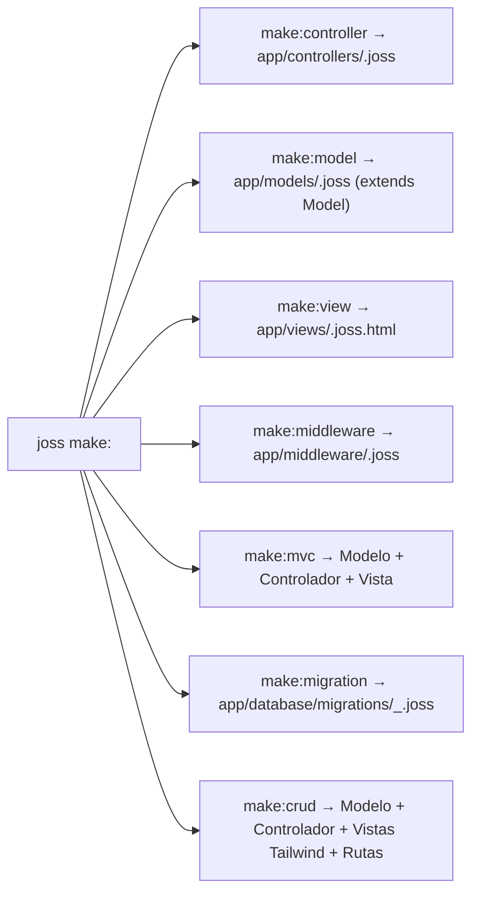

# CLI de Joss — Referencia Completa de Comandos

[Índice](README.md) · Antes: [primeros pasos](PRIMEROS_PASOS.md) · Después: [analizador](ANALIZADOR.md)

La fuente canónica de comandos es `cmd/joss/main.go`. `joss help` muestra la ayuda interactiva instalada y `joss version` la versión actual del runtime (`3.6.8.0`).

La CLI es el programa que recibe comandos en la terminal. Incorpora un entorno REPL
interactivo (`joss repl`), ejecución directa de scripts (`joss run`), servidor web de alto
rendimiento (`joss server start` / `joss server`), compilación nativa AOT (`joss build`) y un conjunto completo de herramientas de calidad de código y gestión de paquetes (`pub`).

---

## 1. Ejecución, REPL y Build Nativo

```bash
joss run archivo.joss
joss repl
joss server start
joss program start
joss build [archivo.joss] [opciones]
joss emit-ir [archivo.joss] [-o salida.ir]
joss analyze [archivo.joss]
joss update [-f|--canary|--stable]
```

- `run [archivo]`: Ejecuta un script `.joss` después de analizar el proyecto (`LoadProject`) y validar su `PreparedProgram` con el intérprete de Joss. Los errores semánticos bloquean la ejecución; los warnings no.
- `repl`: Inicia la consola interactiva (Read-Eval-Print Loop) con prompt `joss> ` para evaluar expresiones, probar funciones y experimentar con código en tiempo real. Escribe `exit` o presiona `Ctrl+C` para salir.
- `server start` (o `joss server`): Requiere el punto de entrada `main.joss` e inicia el servidor HTTP multinivel de alto rendimiento interpretado por el runtime de servidor. Presiona `q` o `Ctrl+C` para detenerlo de manera segura.
- `program start`: Inicia la aplicación en modo escritorio.
- `build [archivo.joss]`: **Compilador nativo oficial de Joss**. Compila el programa a un ejecutable binario nativo real autocontenido (PE `.exe` en Windows, ELF en Linux, Mach-O en macOS) depositándolo por defecto dentro de la carpeta `build/`. Realiza análisis semántico exhaustivo (`PreparedProgram`), análisis de alcance (*Reachability Analysis*), lowering a Joss Native IR (`pkg/ir`), verificación de IR (`ir.Verifier`) y generación de código nativo (`pkg/backend/native`).
  - **Binarios CLI puros**: Se compilan a código máquina puro ultracompacto (~5.5 KB - 32 KB) sin `joss_host.dll` ni trailer VFS.
  - **Aplicaciones completas con servicios web/DB**: Enlazan selectivamente `_joss_host_bridge` (podando motores no utilizados mediante tags `no<driver>`) y sellan el sistema de archivos virtual encriptado (`env.enc` con AES-256) dentro del ejecutable.
  - `-o <salida>`: Nombre o ruta personalizada del binario ejecutable final.
  - `--target=<os>-<arch>` (o atajos directos `joss build linux`, `joss build macos`, `joss build android`): Compilación cruzada integrada para `windows-amd64`, `windows-arm64`, `linux-amd64`, `linux-arm64`, `darwin-arm64` (Apple Silicon), `darwin-amd64` y `android-arm64` (Termux).
  - `--release`: Compilación optimizada para producción sin símbolos de depuración.
  - `--debug`: Compilación con información de depuración.
  - `--trace`: Emite y conserva artefactos intermedios del pipeline nativo (`.ir`, `.ll`, `.standalone.go`).
  - `build package [ruta]`: Empaqueta extensiones y plugins en paquetes `.jp` (v2) firmados con Ed25519 conteniendo bytecode puro.
  - `build web`: Prepara assets y distribución estática para despliegue web.
- `emit-ir [archivo.joss] [-o salida.ir]`: Emite la representación intermedia canónica (Joss Native IR) en formato textual determinista tras el análisis semántico y lowering.
- `analyze [archivo]`: Analiza el proyecto a través de `semanticanalyzer.LoadProject` (incluyendo la entrada, `routes.joss`, `api.joss` y `app/**/*.joss`). Devuelve código distinto de cero si existen errores y conserva archivo/línea/columna. Consulte [ANALIZADOR.md](ANALIZADOR.md).
- `update`: Usa el actualizador implementado por el CLI (`--canary`, `--stable`, `-f`).

---

## 2. Creación de Proyectos (`new`)

```bash
joss new mi_proyecto
joss new web mi_proyecto
joss new console mi_cli
joss new package mi_paquete
joss new plugin mi_plugin
```

- `new web` / `new`: Genera la estructura MVC completa de una aplicación web con motor de vistas, rutas, middleware y ORM.
- `new console`: Genera una plantilla ligera para herramientas de línea de comandos (`main.joss`, `env.joss`, `joss.yaml` y `app/`).
- `new package`: Crea una estructura declarativa de paquete para el gestor `pub`.
- `new plugin`: Crea un proyecto de plugin multilenguaje oficial traducible a bytecode binario `.jp`.

---

## 3. Generadores de Código (`make:*` y `remove:*`)

```bash
joss make:controller UsersController
joss make:controller admin/DashboardController
joss make:middleware AuthGuard
joss make:model User
joss make:view users/index
joss make:mvc Product
joss make:crud products
joss remove:crud products
joss make:migration create_products
```



- `make:controller [Nombre]`: Crea un controlador en `app/controllers/<Nombre>.joss` (admite subdirectorios como `admin/DashboardController`). En proyectos web genera `index(): mixed` retornando `view(...)`; en consola genera `index(): void` con `print(...)`.
- `make:model [Nombre]`: Crea un modelo en `app/models/<Nombre>.joss` que hereda de `Model` con `$table` pluralizada automáticamente y `$fillable = []`.
- `make:view [Nombre]`: Crea una plantilla en `app/views/<Nombre>.joss.html` extendiendo `@extends('layouts.master')` (exclusivo para proyectos web).
- `make:middleware [Nombre]`: Crea un middleware en `app/middleware/<Nombre>.joss` con `Router::registerMiddleware(...)`.
- `make:mvc [Nombre]`: Ejecuta en un solo paso `make:model <Nombre>`, `make:controller <Nombre>Controller` y `make:view <nombre>/index`.
- Si el archivo destino ya existe, los generadores lo omiten de forma segura salvo que pases el flag `--force`.

### 🛠️ `make:crud [Tabla]` (Generador Relacional Inteligente)
Conecta a la base de datos configurada en `env.joss`, inspecciona el esquema de la tabla y genera automáticamente un módulo administrativo completo:
1. **Inspección de Claves Foráneas (`_id`)**: Detecta relaciones con otras tablas, infiere nombres de modelos relacionales y auto-detecta columnas visibles (`username`, `name`, `title`).
2. **Modelo y Modelos Relacionados**: Genera `app/models/Model.joss` y cualquier modelo relacional faltante.
3. **Controlador CRUD completo**: Genera `app/controllers/ModelController.joss` con métodos `index`, `create`, `store`, `edit`, `update` y `delete` que incluyen `joins` y `selects` automáticos.
4. **Vistas Tailwind CSS**: Genera `app/views/model/index.joss.html`, `create.joss.html` y `edit.joss.html` con formularios dinámicos y menús desplegables `<select>` para relaciones.
5. **Inyección en Navbar y Rutas**: Inyecta la opción en `app/views/layouts/master.joss.html` e inserta las rutas protegidas dentro del grupo `Router::middleware("auth")` en `routes.joss`.

El comando sólo se admite en proyectos web y requiere que la tabla ya exista.
Los nombres de tabla/columnas se validan como identificadores antes de consultar
el esquema. El controlador generado acepta únicamente las columnas editables
descubiertas (no hace asignación masiva), el borrado usa `POST` con CSRF y volver
a ejecutar el generador no duplica rutas ni enlaces de navegación.

### 🗑️ `remove:crud [Tabla]`
Deshace limpiamente la generación: elimina el controlador, modelo, carpeta de vistas y remueve las rutas inyectadas en `routes.joss` y el enlace del navbar.

---

## 4. Base de Datos y Migraciones

```bash
joss make:migration create_users_table
joss migrate
joss migrate:fresh
joss db:seed
joss change db mysql
joss change db sqlite
joss change db prefix app_
joss change db migrate --host=HOST --port=3306 --database=DB --user=USER --password=PASS
```

- `make:migration`: Genera una nueva migración con timestamp en `app/database/migrations/`. `create_users`, `create_users_table` y `user` se normalizan a la tabla lógica `users`; `make:miggrate` no es un alias y muestra la corrección sugerida.
- `migrate`: Ejecuta las migraciones pendientes en orden cronológico.
- `migrate:fresh`: Elimina todas las tablas de la base de datos y vuelve a ejecutar todas las migraciones desde cero.
- `db:seed`: Ejecuta los seeders pobladores definidos en `app/database/seeders/`.
- `change db`: Cambia el motor configurado (`mysql`, `postgres`, `sqlserver` o `sqlite`) o modifica el prefijo global de tablas (`DB_PREFIX`).
- `change db migrate`: Migra en caliente los datos y estructura de la conexión actual hacia un nuevo servidor remoto.

---

## 5. Compilación y Gestión de Plugins (`.jp`)

```bash
joss plugin compile .
joss plugin compile script.py --lang=python --name=mi_plugin --exports=calcular
joss plugin inspect mi_plugin.jp
joss plugin verify mi_plugin.jp
```

- `plugin compile`: Produce JPBC firmado desde backends parciales. Python/PHP/Java traducen subconjuntos; la ruta Wasm sólo valida la cabecera y genera stubs de demostración. Consulte [Plugins](PLUGINS.md).
- `plugin inspect`: Muestra metadatos, permisos declarados y tabla de símbolos del paquete `.jp`.
- `plugin verify`: Comprueba la firma digital Ed25519 y la integridad estructural del contenedor `.jp`.

---

## 6. Gestor de Paquetes (`pub`)

```bash
joss pub add paquete ^1.2.0
joss pub remove paquete
joss pub install
joss pub install --offline
joss pub update
joss pub search termino
joss pub info paquete
joss pub publish
joss pub login
joss pub logout
joss pub cache clean
```

Si no se especifica `PUB_REGISTRY_URL`, Pub resuelve las dependencias utilizando el registro oficial en `https://astriom.org`.

---

## 7. Calidad de Código y Tooling (`check`, `format`, `lint`, `fix`, `test`)

```bash
joss check [ruta]
joss format [ruta] [--write|--check]
joss lint [ruta] [--json]
joss fix [ruta] [--dry-run]
joss test [--filter=nombre] [ruta]
```

- `check`: Ejecuta formato, sintaxis, análisis y linter. Revisa su salida: un problema de formato se comunica como warning en este pipeline.
- `format`: En un archivo, modifica por defecto salvo que uses `--check`; en un directorio sólo escribe con `--write`. Usa siempre `joss format ruta --check` en CI.
- `lint`: Ejecuta análisis estático con reglas de consistencia de tipos, estilo y detección de secretos o credenciales en código duro (`--json` para integración estructurada).
- `fix`: Aplica correcciones automáticas léxicamente seguras (migraciones de `let`/`nil`, visibilidad requerida, formateo) sin tocar strings ni comentarios, con soporte para `--dry-run`.
- `test`: Ejecuta archivos `*_test.joss` con `test`/`it`, `assert`, `assertTrue`, `assertFalse`, `assertEqual`, `assertNotEqual`, `assertNull`, `assertNotNull` y `assertThrows`. Coloca `--filter` antes de la ruta: el parser de flags deja de leer opciones tras el primer argumento posicional.

---

## 8. Comandos de Plugins y Ayuda Dinámica

```bash
joss help plugins
joss help plugins [nombre_plugin]
joss ai:activate
joss brevo:config [--enable|--disable] [--api-key=CLAVE]
joss backup:create [destino]
joss backup:restore <archivo.zip>
joss bg:remove <input.jpg> [output.png]
joss notify:send <canal> <mensaje>
```

- `help plugins`: Muestra todos los plugins instalados y disponibles junto con sus comandos CLI expuestos y su estado (`[protegido]`).
- `help plugins [nombre_plugin]`: Muestra la ficha técnica, repositorio, opciones y comandos específicos del plugin seleccionado.
- **Comandos de plugins**: Los plugins instalados en `plugins/` o declarados en `joss.yaml` pueden registrar y despachar comandos CLI autónomos y protegidos.

---

## 9. Almacenamiento y Servicios en la Nube (`userstorage`, `doctor` e `indexnow`)

```bash
joss userstorage local
joss userstorage oci
joss userstorage sync-oci
joss userstorage sync-local
joss doctor storage
joss indexnow generate
```

- `userstorage`: Conmuta el proveedor de almacenamiento entre disco local y **Oracle Cloud Infrastructure (OCI)**, permitiendo sincronización bidireccional mediante `sync-oci` y `sync-local`.
- `doctor storage`: Diagnostica por capas el almacenamiento declarado en `STORAGE` (`local` u `OCI`) sin imprimir secretos. Para OCI comprueba las variables `OCI_*`, el formato de los OCIDs, la llave PEM, que su fingerprint coincida con `OCI_FINGERPRINT`, la autenticación real, el namespace del tenancy y la existencia del bucket (si no existe, lista los que sí hay). Para `local` verifica que `./storage` sea escribible. Cada hallazgo usa un código `JOSS-STORAGE-...` ([Diagnósticos](DIAGNOSTICOS.md)) y el comando termina con código 1 si hay errores. `STORAGE=s3` todavía no tiene driver y se reporta como `JOSS-STORAGE-009`.
- `indexnow generate`: Genera y configura la clave para indexación instantánea IndexNow en el entorno del proyecto.
