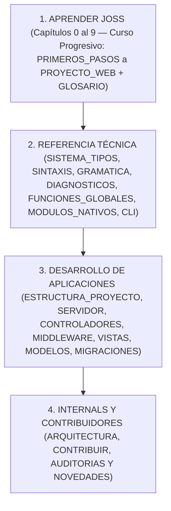

# Informe de auditoría integral y reconstrucción documental de Joss

Antes: [Contribuir a Joss](CONTRIBUIR.md). Después: [Auditoría técnica de 2026](AUDITORIA_TECNICA_2026.md).
Índice general: [Documentación de Joss](README.md).

---

## 1. Introducción y propósito de la auditoría

El presente informe documenta la auditoría exhaustiva y la reconstrucción profunda de la documentación del lenguaje de programación **Joss**.

El principio rector absoluto de este trabajo ha sido:

> **El código fuente y sus tests ejecutados son la única fuente de verdad.**

Toda la documentación fue contrastada contra el comportamiento real del analizador léxico (`pkg/parser/lexer.go`), el parser Pratt (`pkg/parser`), el árbol de sintaxis abstracta AST (`pkg/parser/ast*.go`), el sistema de tipos e inferencia (`pkg/typesystem`), el analizador semántico (`pkg/analyzer`), el evaluador y motor de ejecución en Go (`pkg/core`), el compilador nativo (`pkg/ir`, `pkg/backend/native`), las clases y funciones nativas registradas, y la suite de pruebas automatizadas.

---

## 2. Diagnóstico del estado inicial y deuda documental

Al iniciar la auditoría, se detectó que la documentación existente presentaba brechas tanto técnicas como pedagógicas respecto a las capacidades reales del código:

### A. Brecha pedagógica y de onboarding para principiantes
- El punto de entrada en `PRIMEROS_PASOS.md` enseñaba a crear carpetas manualmente con `mkdir` en lugar de aprovechar el generador oficial `joss new console mi-primer-joss`.
- El orden del curso introducía `FUNCIONES.md` antes de `COLECCIONES.md`, a pesar de que funciones utilizaba listas y operadores de desempaquetado (`...$numeros`), y colocaba `ERRORES.md` después de `CLASES.md` aunque las funciones ya requerían comprender `throw`.
- Faltaba explicar explícitamente la estructura generada por `joss new console` (`public class Main { Init main() { ... } }`), la diferencia entre declarar una variable por primera vez (`var $x = 1`) y reasignarla (`$x = 2`), y la diferencia entre interpretar (`joss run`) y compilar a binario nativo (`joss build`).

### B. Características implementadas en el código incorporadas a las guías
Durante la inspección línea por línea del código fuente se documentaron e integraron en el recorrido de aprendizaje y referencia:
1. **El operador Pipeline (`|>`)**:
   - Implementado en `pkg/parser/parser.go` (precedencia `PIPE_OP`), `pkg/parser/parser_expressions.go` y evaluado en `pkg/core/evaluator_pipeline.go`.
   - Permite componer funciones de izquierda a derecha: `" ada " |> trim |> strtoupper`.
2. **Sentencias `guard` y `defer`**:
   - `guard (condición) : { return ... }` validada estáticamente con `JOSS-FLOW-005` para retornos tempranos y *smart cast narrowing*.
   - `defer { ... }` para ejecución diferida en orden LIFO al finalizar el frame de la función.
3. **Records inmutables (`public record Nombre(...)`) y Clases Genéricas (`class Caja<T>`)**:
   - Validación nominal e inmutabilidad automática de campos (`JOSS-CONST-001`).
4. **El operador Elvis (`?:`), coalescencia nula (`??`), asignación nula (`??=`) y navegación segura (`?->`)**:
   - Documentados con sus reglas exactas de evaluación y estrechamiento de tipos.
5. **Consumo de canales concurrentes mediante `foreach` y multiplexación con `select`**:
   - Patrones productor-consumidor y generadores perezosos con `yield`.
6. **Descubrimiento unificado del proyecto (`semanticanalyzer.LoadProject` y `ExecutePrepared`)**:
   - Tanto `joss analyze`, `joss run`, `joss server` como `joss build` cargan de manera uniforme `main.joss`, `routes.joss`, `api.joss` y todos los subdirectorios de `app/` (incluido `app/libs`) en un único `PreparedProgram`.

### C. Correcciones técnicas de precisión
- **Promoción numérica exacta**: Se corrigió en `SISTEMA_TIPOS.md` que la única promoción numérica implícita entre tipos distintos es `int → decimal`; las mezclas entre `int` y `float` o `float` y `decimal` requieren conversión explícita (`JOSS-ARITH-003`).
- **Declaración obligatoria de variables**: Se actualizaron todos los ejemplos de la documentación para declarar variables con `var`, tipo explícito, `mixed` o `const` antes de reasignarlas, cumpliendo con `JOSS-SYM-001` / `JOSS-DECL-007`.
- **Códigos de diagnóstico exactos**: Se alinearon `CLASES.md` y `DIAGNOSTICOS.md` con `pkg/analyzer/validation_nominal.go` y `member_resolution.go` (`JOSS-DECL-003` para métodos duplicados, `JOSS-DECL-004` para conflictos nominales e incumplimiento de interfaz, `JOSS-DECL-005` para métodos abstractos no implementados, y `JOSS-DECL-006` para instanciación de clase abstracta o transición de `let`).

---

## 3. Arquitectura documental del proyecto (Separación Curso vs Referencia)

Se estructuró la documentación diferenciando claramente el **Curso progresivo** de la **Referencia técnica formal**:



---

## 4. Puntos técnicos del motor registrados para referencia

Durante la auditoría del código fuente y la ejecución de pruebas, se registraron los siguientes comportamientos del runtime que la documentación explica con honestidad técnica:

1. **Detección de `break` / `continue` en bloques condicionales dentro de bucles**:
   - El optimizador de planes de bucle (`pkg/runtime/plan/callable.go`) inspecciona sentencias directas del cuerpo del bucle (`BlockHasBreakOrContinue`). Si `break` o `continue` se anidan dentro de un ternario en un bucle de nivel superior donde `hasControl` es falso, el salto no es interceptado por `executeLoopBodyProtected`.
2. **Comportamiento no mutante de `array_pop` y `array_shift`**:
   - Las funciones globales `array_pop($arr)` y `array_shift($arr)` devuelven el último o primer elemento sin reducir la longitud del slice original, a diferencia del método mutante `$arr->pop()`.
3. **Diferencias entre metadata publicada y retorno dinámico en algunos built-ins**:
   - Ciertas funciones heredadas (`boolval`, `json`, `microtime`, `strpos`, `base64_decode`, `array_merge`) tienen firmas estáticas simplificadas en `builtins.go` aunque en tiempo de ejecución devuelven tipos compuestos o booleanos en caso de fallo.

---

## 5. Verificación formal y pruebas ejecutadas

Para garantizar que ningún documento presente enlaces rotos, ejemplos desactualizados o inconsistencias con el runtime, se ejecuta la suite de validación completa:

1. **Verificación de catálogo, documentación nativa e internacionalización (i18n)**:
   ```bash
   go run ./tools/cataloggen --check
   go run ./tools/docgen --check
   go run ./tools/docsi18n --check
   ```
2. **Suite de pruebas unitarias y de integración**:
   ```bash
   go vet ./...
   go test ./...
   ```
3. **Verificación de contratos y navegación (`TestDocumentationNavigationAndPublicMirror` y `TestDocumentationContracts`)**:
   - Comprobación de todos los enlaces Markdown locales entre documentos.
   - Verificación de paridad byte por byte entre `docs/*.md` y `ejemplos/Joss-Red-JosSecurity/assets/docs/*.md`.
   - Ejecución y análisis de todos los bloques etiquetados con `<!-- joss-run: ... -->`, `<!-- joss-check: ... -->` y `<!-- joss-error: ... -->`.

---

## 6. Conclusión

Con esta reconstrucción, la documentación de Joss combina una **ruta pedagógica progresiva** (capaz de guiar desde cero absoluto con `joss new console` hasta aplicaciones web y binarios nativos con `joss build`) con una **referencia técnica rigurosa**, 100% sincronizada y verificada contra el código fuente.
