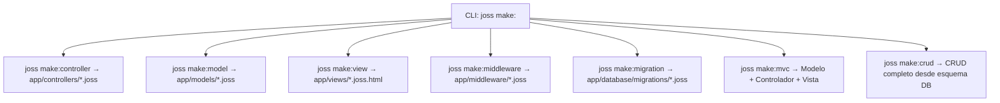

# Estructura de proyectos

[Índice](README.md)

## Web

`joss new web mi_app` y `joss new mi_app` crean la plantilla web real del paquete `pkg/template/files`.

Las cuatro variantes de `joss new` se validan en CI: web y consola deben parsear y analizar sin errores; consola además debe ejecutar; package y plugin deben compilar a un JP v2 firmado, verificable, con bytecode decodificable e índice de símbolos.

```text
mi_app/
├── main.joss
├── env.joss
├── routes.joss
├── api.joss
├── joss.yaml
├── AGENTS.md                 # Guía y sintaxis para asistentes de IA
├── config/
├── app/
│   ├── controllers/          # Subcarpetas por dominio (web/, auth/, api/)
│   │   ├── web/
│   │   ├── auth/
│   │   └── api/
│   ├── models/               # Modelos GranDB (auth/, etc.)
│   │   └── auth/
│   ├── services/             # Servicios en segundo plano e integraciones
│   ├── middleware/           # Middleware de peticiones
│   ├── libs/                 # Librerías y utilidades del proyecto
│   └── database/migrations/
├── assets/
├── public/
├── storage/
├── package.json
└── README.md
```

La plantilla también puede incluir rutas, archivos de autenticación, recursos frontend y colecciones de API. La lista exacta puede crecer; el generador y sus pruebas son la referencia ejecutable.

`main.joss` es obligatorio para `joss server start`. `env.joss` contiene la configuración de entorno del proyecto (`PORT="80"` por defecto en la plantilla web) y no es código ejecutable con `joss run`.

## Descubrimiento unificado del proyecto (`PreparedProgram`)

Tanto `joss analyze`, `joss check`, `joss run`, `joss server` como `joss build` utilizan el cargador unificado `semanticanalyzer.LoadProject("main.joss", "app")`, que descubre e integra en un único `PreparedProgram`:
- El punto de entrada (`main.joss`).
- Los archivos de rutas en la raíz (`routes.joss` y `api.joss`, si existen).
- Todos los archivos `.joss` recursivamente bajo `app/` (incluyendo `controllers/`, `models/`, `services/`, `middleware/`, `libs/` y `database/`).

El intérprete (`Runtime.ExecutePrepared`), el servidor HTTP y el compilador nativo registran todas las clases, interfaces, enums y funciones directamente desde ese `PreparedProgram` canónico sin re-escanear ni omitir subdirectorios de `app/`.

## Consola

`joss new console mi_cli` crea `main.joss`, configuración, controladores, modelos, librerías y migraciones; no crea rutas, vistas, `public/` ni assets web.

```bash
cd mi_cli
joss run main.joss
```

## Paquete / Plugin

`joss new package mi_plugin` (o `joss new plugin mi_plugin`) crea:

```text
mi_plugin/
├── joss.yaml
├── README.md
└── src/plugin.joss
```

Compílalo con `joss build package .`. Consulta [Plugins](PLUGINS.md).

## Convenciones efectivas y generadores (`joss make:*`)

- Controladores: `app/controllers/NameController.joss` (o subcarpetas `web/`, `auth/`, `api/`), generados con `joss make:controller NameController` (o `joss make:controller web/NameController`).
- Modelos: `app/models/Name.joss` (`extends Model`), generados con `joss make:model Name`.
- Vistas: `app/views/name.joss.html` o `.html`, generadas con `joss make:view name` (o `joss make:view carpeta/vista`).
- Middlewares: `app/middleware/Name.joss`, generados con `joss make:middleware Name`.
- Tríada MVC completa: `joss make:mvc Name` genera simultáneamente el modelo (`app/models/Name.joss`), el controlador (`app/controllers/NameController.joss`) y la vista (`app/views/name/index.joss.html`).
- Migraciones: timestamp, nombre descriptivo y extensión `.joss` en `app/database/migrations/`, generadas con `joss make:migration create_tabla`.
- Módulo CRUD relacional: `joss make:crud tabla` inspecciona la tabla existente y genera modelo, controlador, vistas y rutas; `joss remove:crud tabla` revierte esos artefactos.
- Sintaxis generada: `func`, `::` para estáticos y `->` para instancias.



Los generadores se validan con una prueba que crea proyectos web y consola y pasa todos sus archivos `.joss` por el parser y el analizador semántico.
