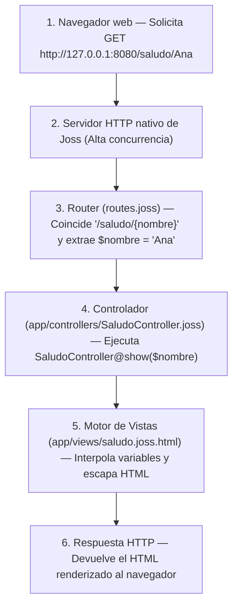
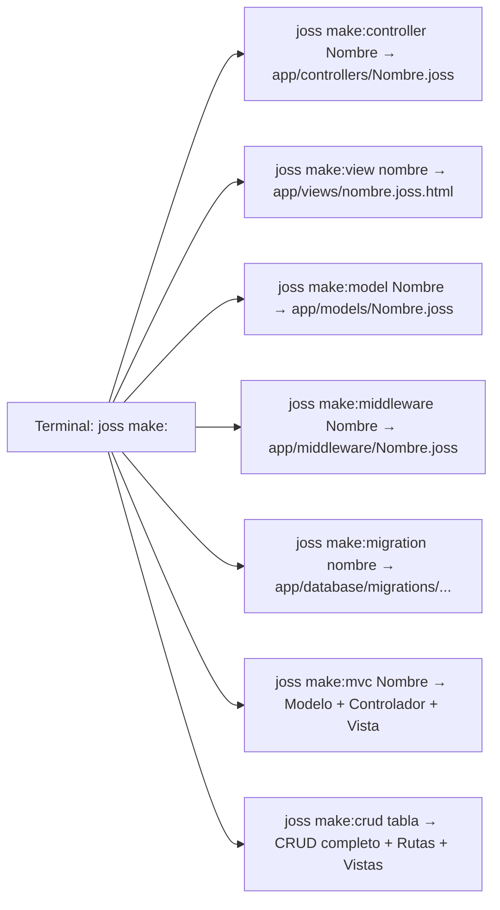

# Proyecto web completo: Arquitectura MVC con el stack nativo

Antes: [Proyecto de consola](PROYECTO_CONSOLA.md). Después: [Controladores y HTTP](CONTROLADORES.md).
Referencia técnica: [Motor de vistas](VISTAS.md), [Servidor nativo](SERVIDOR.md), [Modelos GranDB](MODELOS.md).

---

## ¿Qué vas a construir aquí?

Una **aplicación web** es un programa que corre en un servidor escuchando peticiones de red (generalmente de un navegador o una aplicación móvil) y responde con páginas HTML interactivas o datos en formato JSON.

A diferencia de otros lenguajes donde necesitas instalar servidores externos complejos (como Apache, Nginx o paquetes pesados de Node.js), **Joss incluye su propio servidor HTTP de alto rendimiento, router dinámico y motor de plantillas HTML**.

En este tutorial guiado construirás tu primera aplicación web basada en el patrón arquitectónico **MVC (Modelo - Vista - Controlador)**:
1. Crear la estructura del proyecto usando el generador de plantillas `joss new` (`joss new web`).
2. Comprender el flujo de una petición web en Joss.
3. Conocer el sistema de generadores de código `joss make:<componente>` para crear piezas del proyecto sin hacerlo desde cero.
4. Configurar el puerto en `env.joss` y definir una ruta con parámetros dinámicos en `routes.joss`.
5. Generar y programar un controlador en `app/controllers/` con `joss make:controller`.
6. Generar y diseñar una vista HTML segura en `app/views/` con `joss make:view` y escape automático contra inyecciones XSS.
7. Poner en marcha el servidor con `joss server start` y probar la aplicación en el navegador.

---

## 1. El flujo de una petición web en Joss

Cuando un usuario escribe una dirección en su navegador, ocurre la siguiente secuencia:



---

## 2. Generar el proyecto web y conocer los comandos `joss make:*`

Abre tu terminal y ejecuta el generador oficial (puedes escribir `joss new saludo_web` o explícitamente `joss new web saludo_web`):

```bash
joss new web saludo_web
cd saludo_web
```

Este comando creará la estructura estándar de una aplicación web Joss:
- `main.joss`: Punto de entrada del proyecto.
- `env.joss`: Variables de configuración (puerto, base de datos, claves secretas).
- `routes.joss` y `api.joss`: El mapa de URLs web y endpoints API de la aplicación.
- `app/controllers/`: Dónde residen los controladores (organizados en `web/`, `auth/`, `api/`).
- `app/models/`: Modelos de base de datos con GranDB.
- `app/views/`: Plantillas HTML dinámicas (`.joss.html`).
- `public/`: Archivos estáticos directos (hojas de estilo CSS, scripts JS, imágenes).

### El diseño de generadores `joss make:<componente>`

En lugar de crear archivos manualmente uno por uno, Joss proporciona la familia de comandos `joss make:<componente>`, que genera automáticamente las clases y plantillas en la carpeta correcta siguiendo las convenciones del framework:



| Comando | ¿Qué crea automáticamente? | Ejemplo de uso |
|---|---|---|
| `joss make:controller <Nombre>` | Un controlador en `app/controllers/<Nombre>.joss` (admite subcarpetas como `web/SaludoController`) | `joss make:controller SaludoController` |
| `joss make:view <nombre>` | Una plantilla HTML en `app/views/<nombre>.joss.html` (admite subcarpetas como `usuarios/perfil`) | `joss make:view saludo` |
| `joss make:model <Nombre>` | Un modelo GranDB en `app/models/<Nombre>.joss` conectado a su tabla pluralizada | `joss make:model Producto` |
| `joss make:middleware <Nombre>` | Un middleware HTTP en `app/middleware/<Nombre>.joss` | `joss make:middleware VerificarSesion` |
| `joss make:mvc <Nombre>` | La tríada completa de una vez: Modelo + Controlador (`<Nombre>Controller`) + Vista (`<nombre>/index`) | `joss make:mvc Producto` |
| `joss make:migration <nombre>` | Una migración de base de datos con fecha/hora en `app/database/migrations/` | `joss make:migration create_productos` |
| `joss make:crud <tabla>` | Inspecciona la tabla en la base de datos y genera Modelo, Controlador, Vistas Tailwind y Rutas (se revierte con `joss remove:crud <tabla>`) | `joss make:crud productos` |

---

## 3. Configurar el puerto del servidor

Abre el archivo `env.joss` en la raíz del proyecto. Por defecto la plantilla genera `PORT="80"`. Para desarrollar localmente sin permisos de administrador, cámbialo a un puerto libre como `"8080"`:

```joss
PORT="8080"
APP_NAME="Mi Web Joss"
```

> [!NOTE]
> `env.joss` es un archivo de configuración de entorno que Joss carga automáticamente al arrancar; no es un script ejecutable para correr con `joss run env.joss`.

---

## 4. Definir la ruta dinámica

Abre el archivo `routes.joss` y agrega la siguiente definición:

<!-- joss-check: fragmento de routes.joss -->
```joss
Router::get("/saludo/{nombre}", "SaludoController@show")
```

### ¿Qué significa esta línea?
- `Router::get(...)`: Indica que responderemos a peticiones HTTP de tipo `GET` (las que hace el navegador al abrir un enlace).
- `"/saludo/{nombre}"`: El patrón de la URL. `{nombre}` es un **segmento dinámico**: cualquier texto que el usuario escriba en esa posición de la URL será capturado.
- `"SaludoController@show"`: El destinatario. Le indica al router que debe instanciar la clase `SaludoController` y ejecutar su método `show`.

---

## 5. Crear el controlador con `joss make:controller`

En tu terminal, dentro de la carpeta `saludo_web`, ejecuta el generador de controladores:

```bash
joss make:controller SaludoController
```

Verás la confirmación en consola:

```text
Created: app/controllers/SaludoController.joss
```

Joss habrá creado el archivo `app/controllers/SaludoController.joss` con una estructura inicial lista para usar:

<!-- joss-check: plantilla generada por joss make:controller -->
```joss
public class SaludoController {
    public func index(): mixed {
        return view("saludo/index")
    }
}
```

Ahora abre `app/controllers/SaludoController.joss` y añade o reemplaza el método por `show(string $nombre)` para recibir el parámetro de nuestra ruta:

<!-- joss-check: fragmento de controlador web -->
```joss
public class SaludoController {
    public func show(string $nombre) {
        var $nombreLimpio = trim($nombre)
        return view("saludo", {"nombre": $nombreLimpio})
    }
}
```

### Anatomía del controlador:
1. `public class SaludoController`: Clase pública que Joss descubre automáticamente dentro de `app/` sin necesidad de `import`.
2. `public func show(string $nombre)`: El método recibe el parámetro dinámico `{nombre}` capturado por la ruta. En Joss, los parámetros del controlador deben declarar su tipo (`string $nombre`).
3. `var $nombreLimpio = trim($nombre)`: Limpia posibles espacios en blanco en los extremos.
4. `return view("saludo", {"nombre": $nombreLimpio})`:
   - Llama a la función nativa `view(...)`.
   - El primer argumento es el nombre del archivo de plantilla (buscará `app/views/saludo.joss.html`).
   - El segundo argumento es un mapa asociativo con los datos que queremos inyectar dentro del HTML.

---

## 6. Generar y diseñar la vista HTML con `joss make:view`

Genera el archivo de vista desde tu terminal ejecutando:

```bash
joss make:view saludo
```

Verás la confirmación:

```text
Created: app/views/saludo.joss.html
```

Por defecto, `joss make:view` crea una plantilla conectada al layout maestro (`@extends('layouts.master')`). Para este primer ejemplo autocontenido, abre `app/views/saludo.joss.html` y reemplaza su contenido por esta tarjeta HTML completa:

```html
<!doctype html>
<html lang="es">
<head>
    <meta charset="utf-8">
    <meta name="viewport" content="width=device-width, initial-scale=1">
    <title>Saludo - Mi Web Joss</title>
    <style>
        body { font-family: system-ui, sans-serif; margin: 40px; background: #f8fafc; color: #1e293b; }
        .card { background: white; padding: 30px; border-radius: 12px; box-shadow: 0 4px 6px -1px rgb(0 0 0 / 0.1); max-width: 500px; }
        h1 { color: #0f766e; margin-top: 0; }
    </style>
</head>
<body>
    <div class="card">
        <h1>¡Hola, {{ $nombre }}!</h1>
        <p>Bienvenido a tu primera aplicación web construida con <strong>Joss</strong>.</p>
    </div>
</body>
</html>
```

### Seguridad nativa contra ataques XSS:
Nota la sintaxis `{{ $nombre }}`:
- El motor de plantillas de Joss **escapa automáticamente caracteres HTML peligrosos** como `<`, `>`, `"` o `&`.
- Si un usuario malicioso intenta ingresar como nombre `<script>alert('hack')</script>`, Joss lo convertirá a entidades seguras (`&lt;script&gt;...`), protegiendo a tus visitantes de vulnerabilidades de Cross-Site Scripting (XSS).

---

## 7. Iniciar y probar el servidor

En tu terminal, ubicado en la raíz del proyecto `saludo_web`, escribe:

```bash
joss server start
```

(O bien su atajo equivalente `joss server`). Verás el mensaje de confirmación del servidor HTTP:

```text
[CLI] Ejecutando script de inicio (main.joss)...
[Joss Server] Servidor HTTP escuchando en http://127.0.0.1:8080
[Joss Server] Presiona 'q' o Ctrl+C para detener el servidor.
```

Abre tu navegador web y visita:

`http://127.0.0.1:8080/saludo/Ana`

Verás la tarjeta estilizada saludando a Ana. Ahora prueba a cambiar la URL a:

`http://127.0.0.1:8080/saludo/Carlos`

El servidor responderá al instante con el nuevo saludo.

Para detener el servidor en cualquier momento, presiona simplemente la tecla **`q`** o `Ctrl + C` en tu terminal.

---

## 8. Verificación y comprobación estática

Antes de desplegar a producción, puedes auditar todo el proyecto con los comandos de verificación de Joss:

```bash
joss analyze main.joss
joss check .
```

---

## 9. Ejercicios prácticos

### Nivel 1 — Prueba rápida
Pasa un segundo dato desde `SaludoController@show` hacia la vista agregando `"rol": "Desarrollador Joss"` al mapa de `view(...)` y muéstralo dentro de `saludo.joss.html` debajo del título usando `<p>Rol: {{ $rol }}</p>`.

### Nivel 2 — Ejercicio guiado
1. Abre `api.joss` (o `routes.joss`) y registra una ruta `Router::get("/api/estado", "SaludoController@estado")`.
2. Añade en `SaludoController` el método `public func estado()` que retorne `Response::json({"ok": true, "servidor": "Joss HTTP"})`.
3. Visita `http://127.0.0.1:8080/api/estado` en tu navegador y comprueba la respuesta JSON.

### Nivel 3 — Reto
1. Registra una ruta con dos parámetros dinámicos: `Router::get("/calcular/{a}/{b}", "SaludoController@sumar")`.
2. Implementa `public func sumar(string $a, string $b)` en `SaludoController`, convierte ambos parámetros con `intval($a)` e `intval($b)`, calcula su suma y renderiza una vista o respuesta JSON con el detalle de la operación.

---

## Siguiente paso

Ahora que conoces el ciclo completo de una petición web, puedes explorar las capacidades avanzadas del stack web de Joss y el sistema de tipos completo del lenguaje:

Continúa con: [Sistema de tipos y coerción](SISTEMA_TIPOS.md), [HTTP y Controladores](CONTROLADORES.md), [Middlewares y Seguridad](MIDDLEWARE.md) y [Modelos GranDB](MODELOS.md).
