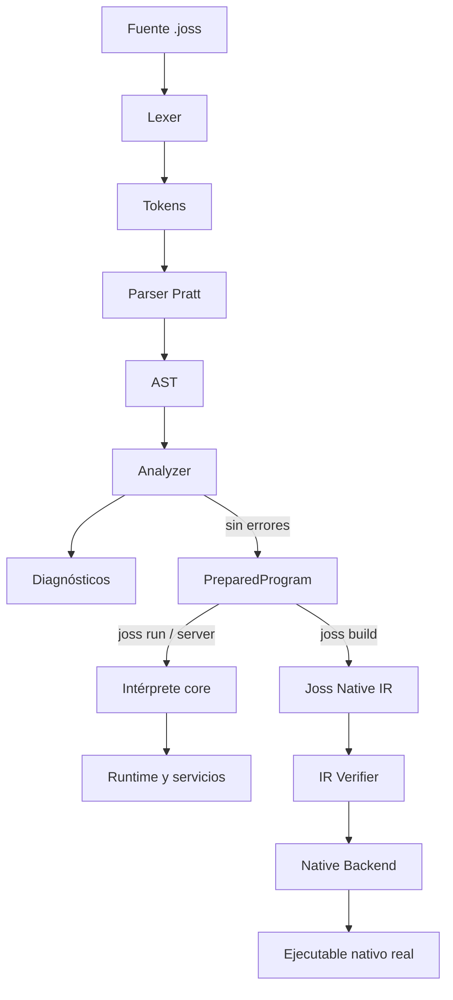

# Joss Language Architecture

[Index](README.md) · Before: [status](ESTADO_IMPLEMENTACION.md) · After: [contributing](CONTRIBUIR.md)

## Real pipeline

```text
fuentes .joss
  → lexer (`pkg/parser/lexer.go`)
  → parser Pratt (`pkg/parser`)
  → AST (`pkg/parser/ast*.go`)
  → análisis semántico (`pkg/analyzer`)
    (collectDeclarations → projectScope → validateNominalContracts → analyzeSourceBodies)
  → diagnósticos (`pkg/diagnostics`)
  → PreparedProgram (Canónico)
  ┌───────────────────────┼───────────────────────┐
  ▼                       ▼                       ▼
`joss run`             `joss server`           `joss build`
Intérprete AST         Servidor HTTP           Joss Native IR (`pkg/ir`)
(`pkg/core`)           (`pkg/server`)            → IR Verifier (`ir.Verifier`)
                                                 → Native Backend (`pkg/backend/native`)
                                                 → Ejecutable Nativo (.exe, ELF, Mach-O)
```



`semanticanalyzer.LoadProject` preserves each file as an `analyzer.SourceUnit` (including `main.joss`, `routes.joss`, `api.joss`, and all `.joss` files under `app/`); it does not concatenate ASTs and lose their origin. First it registers global declarations of functions, classes, interfaces, and enums, then validates nominal contracts, and finally analyzes each method with an independent lexical scope. Native classes come from `Runtime.RegisterNativeClasses`; plugins contribute their JP v2 symbol indices.

## Responsibilities

| Package | Responsibility |
|---|---|
| `pkg/parser` | Tokens, lexer, precedences, parser, and AST nodes. |
| `pkg/typesystem` | Canonical names, inference, explicit coercion, primitive methods, and assignment compatibility. |
| `pkg/analyzer` | Source units, scopes, symbols, expression inference, signatures, reachable flow, and `PreparedProgram` generation. Never imports `pkg/core`. |
| `pkg/diagnostics` | Common model: code, severity, message, file, range, explanation, and suggestion. |
| `pkg/core` | Adaptation of real catalogs to the analyzer, interpreter (`ExecutePrepared`), and built-in primitives. |
| `pkg/runtime/errors` | Structured runtime error and Joss stack frames, with no framework dependencies. |
| `pkg/runtime/value` | Evaluator-independent value semantics, including Unicode indexing. |
| `pkg/runtime/plan`, `pkg/runtime/frame` | Callable plans, slots, and tagged representation used to accelerate local resolution; they do not form portable bytecode. |
| `pkg/pluginruntime`, `pkg/pluginpkg` | Isolated loading, verification, and symbol resolution for JP v2 plugins. |
| `pkg/bytecode` | Compressed AST serialization (`JOSSBC2Z` format exclusively for `.jp` plugins, never for AOT native binaries). |
| `pkg/ir` | Canonical Joss Native IR: CFG, basic blocks, typed SSA/3AC instructions, lowerer from `PreparedProgram`, and verifier. |
| `pkg/backend/native` | Native compilation backend: real machine-code generator and LLVM emission for standalone executables. |
| `pkg/vm` | Independent experimental compiler/VM. The CLI and `pkg/core` do not use them as the default path. |
| `cmd/joss` | CLI, project analysis, execution (`run`), server (`server start`), native compilation (`build`) with selective pruning (`no<driver>`), and tools. |
| `vscode-joss` | LSP/editor. Consumes the generated core catalog. |

## Sources of truth

- Keywords and symbols: `pkg/parser/token.go`; `parser.KeywordNames()` and `parser.SymbolDefinitions()` are the projections for the lexer, formatter, and generators.
- Types and compatibility: `pkg/typesystem`, including semantic classifications such as `Type.IsNumeric()`.
- Primitive methods: name and return type in `pkg/typesystem/primitive_methods.go`. `pkg/analyzer` projects that metadata and `pkg/core/primitives.go` keeps only the runtime implementation. Every definition must be covered by `TestPrimitiveMethodCatalogHasRuntimeImplementations`.
- Global built-ins: `pkg/core/builtins.go` declares name, dispatcher domain, and return type in a single place. The runtime dispatches directly through that descriptor and rejects names outside the catalog.
- Native classes/methods: calls to `registerNative` inside `Runtime.RegisterNativeClasses()`; their return types are typed in `pkg/core/native_signatures.go`.
- Plugin symbols: `pluginpkg.SymbolIndex` embedded in each `.jp`.
- Diagnostics: `pkg/diagnostics.Diagnostic` and codes emitted by `pkg/analyzer`.
- VS Code catalog: `vscode-joss/src/server/generated/languageCatalog.json`, generated via `go run ./tools/cataloggen`.
- Native documentation catalog: `docs/CATALOGO_NATIVO.md`, generated via `go run ./tools/docgen`.

CI runs `go run ./tools/cataloggen --check` and `go run ./tools/docgen --check`; manually editing generated catalogs is invalid.

## Scopes and symbols

- Every function, method, `Init`, and closure has its own scope.
- Parameters belong solely to their callable.
- Control blocks use the callable's scope to reflect the current runtime.
- The `foreach` binding can be reused in another loop; the runtime treats it as assignment.
- Top-level classes and functions are resolved at the project level.
- Native globals and plugin symbols are injected via `analyzer.Environment`.
- A named function does not inherit caller source variables or top-level variables: it receives parameters, locals, `this`, and host/plugin bindings. A closure does capture lexically.
- Parameters require an explicit type; `mixed` is never introduced silently.
- A `ref` parameter receives a temporary alias to the caller's mutable binding. Both analyzer and runtime require bilateral marking, an l-value, non-constness, and an strictly invariant type.
- Visibility has no default: parser, analyzer, and runtime preserve and validate `public`, `private`, and `protected`.

## Build and execution

Development mode interprets the `PreparedProgram` (`Runtime.ExecutePrepared`). Each callable invocation creates an independent lexical frame; there is no dynamic scope between caller and callee. This prevents a recursive call from reading or overwriting caller locals. The runtime limits depth to 1024 frames by default, and closures write only to their captured environment. Annotated return types are validated in both analyzer and runtime, and the analyzer requires provably exhaustive termination.

Before executing a callable, `pkg/runtime/plan` may assign slots to parameters
and locals. `frame_runtime.go` uses those slots and keeps a fallback for bindings
that do not fit the plan. Class metadata, accesses, and scopes are cached; any
semantic change must compare the fast path against the general path. Loop
controls scan for direct jumps in the planned AST and currently do not traverse every
ternary/match, a limitation recorded in the audit.

Safe references do not expose Go pointers: `core.VariableReference` preserves the value/type/constness binding during a call and the evaluator dereferences automatically. A reference is not a storable Joss value and cannot cross async/plugin boundaries.

Official native compilation (`joss build`) transforms the analyzed and validated `PreparedProgram` into **Joss Native IR** (`pkg/ir`), with a CFG, basic blocks, and strictly typed instructions. After formal verification (`ir.VerifyProgram`), the **Native Backend** (`pkg/backend/native`) generates real self-contained native executables (PE `.exe`, ELF, Mach-O) in `build/` without serializing the AST:
- **Pure CLI programs**: Compiled to pure machine code (~5.5 KB - 32 KB) without `joss_host.dll` and without a VFS trailer (`JOSS_RUNNER_DATA`).
- **Applications with web/DB services**: Selectively link `_joss_host_bridge` (applying automatic pruning via `no<driver>` build tags to exclude engines such as SQLite, MySQL, PostgreSQL, SQL Server, Redis, or OCI when unused by the project) and seal the AES-256 encrypted VFS (`env.enc`).

The `pkg/vm` tree contains opcodes and an experimental VM. Its arithmetic and
errors do not define published semantics while it is not connected to the pipeline
above. Likewise, JPBC only defines plugin execution. When documenting
“compilation”, state which of the three representations is being used.

## Dependency rule

Language layers (`parser`, `typesystem`, `diagnostics`, `analyzer`) do not import `core`. `core` adapts its registries to the analyzer. This direction prevents the type checker from depending on server or database side effects.

The server keeps its HTTP adapters outside the interpreter: `request_data.go` translates `net/http` into the stable map consumed by Joss, and `rate_limiter.go` encapsulates rate-limiting state. `handler.go` remains an orchestrator and must not re-absorb these responsibilities.

## Internal evaluator boundaries

Calls maintain a single evaluated path. `call_arguments.go` transforms source expressions and applies positional/named/default/ref binding; `call_method.go` installs parameters and manages the frame, recursion, defers, and return contract; `callable_dispatch.go` adapts closures, bound methods, plugins, and Go functions to that path; `evaluator_call.go` only resolves a source call and the built-in domain. Historical public entry points delegate rather than reimplementing rules.

Infix operators are coordinated in `evaluator_infix.go` because observable order —coalescing, pipeline, short-circuit, entry, right-hand evaluation, and exit— must remain explicit. Their domain behaviors live in `evaluator_control.go`, `evaluator_pipeline.go`, `evaluator_numeric.go`, `evaluator_stream.go`, and `evaluator_update.go`. A new operator must not be added directly to the coordinator unless it affects evaluation order.

In the analyzer, `infer_nominal.go` extends `typesystem.Assignable` with project classes/interfaces; `infer_narrowing.go` creates scopes refined by `is` and null comparisons. These rules remain separate from the runtime: they share types and metadata, not execution or state.

## Third architecture phase — September 2026

The analyzer has an explicit semantic pipeline: declaration collection, project scope, nominal contracts, bodies/callables, and diagnostics. Responsibilities are split across files in the same package to preserve encapsulation and avoid artificial public APIs. `call_resolution.go` and `member_resolution.go` project functions, methods, natives, primitives, and plugins into the semantic signature of `Callable`; execution remains in `core`.

Before changing infrastructure, characterizations were added for runtime (fork/reset/reuse), HTTP (503, CORS, sessions, CSRF, and response), and publishing (ZIP, traversal, lockfile, and registry). These tests already found and fixed a real residual-state bug in `Runtime.Free`. The handler and CLI remain large coordinators: further extraction is conditioned on completing WebSocket, response mapping, and additional registry cases.

Negative rules hold: analyzer does not import core, parser knows nothing of runtime, server does not redefine semantics, formatter does not discard trivia to reuse the lexer, and VM does not define published semantics. `@json` and `NativeMethodDefinition` remain P1 debt items until a maintainable shared representation is in place.

## Fourth architecture phase — September 2026

Runtime lifecycle lives in `runtime_lifecycle.go`: construction, pool, acquisition, host bindings, and reset. `Runtime.Free` clears all per-request/per-execution state and caches; it does not close `DB`, because the SQL pool is a shared external resource owned by the application. `Fork` copies mutable maps, resets cursors/caches, and shares only immutable AST/plans/configuration, plugin registry, and external resources. Concurrent and isolation tests protect these rules.

`MainHandler` acquires the fork and immediately registers a single cleanup. Result adaptation resides in `response_writer.go`; request decoding continues in `request_data.go`, rate limiting in `rate_limiter.go`, and session/CSRF remains in the handler until its backends are completed. The published boundary recognizes string, JSON, RAW, FILE, STREAM, and REDIRECT; other values fall through to the file/404 fallback.

`NativeMethodDefinition` is semantic metadata, not runtime reflection. It publishes only reliable name, return type, and parameters, distinguishing unknown arity. Stack, Queue, and Math are the initial migration; other classes use the legacy adapter. All of them ultimately project to `analyzer.Callable` and generated catalogs.

`pkg/viewtemplate` owns the minimal shared directive syntax. The scanner recognizes ranges, quotes, and nested parentheses; runtime and linter share `@json` interpretation. Rendering, file access, and lint policies remain in their respective domains.

Authority is explicitly divided: syntax truth in parser, type truth in typesystem/analyzer, runtime truth in Interpreter/core, and tooling as a projection. The VM participates only in a declared differential corpus for supported features; it never defines published semantics.

## Fifth architecture phase — September 2026

The fifth phase consolidates ownership, safe concurrency, session contracts, and the lifecycle of plugins and WebSockets:

- **Plugin and Native Driver Ownership**: The plugin registry shares catalogs and ASTs treated as immutable; each `Runtime` implements `PluginAwareHost` and keeps AST engines and namespaces bound to its execution. Dynamic drivers use reference-counted ownership: the loading runtime owns the handle, each `Fork()` retains it, and each `Free()` releases it. The last owner executes `FreeLibrary`/`dlclose`; `Unload()` rejects explicit unloading while borrowers exist and serializes against active calls.
- **Session and Flash Response Contracts**: `memory`, `file`, and `redis` are the only accepted backends; an unknown name fails explicitly. Each request receives a snapshot that recursively clones JSON maps and slices to prevent aliasing before `saveSession`. Any failure persisting flash data cancels `Location` and produces HTTP 500.
- **WebSocket Isolation and Callbacks**: The connection currently executes `onMessage` and `onClose`; the handler receives the socket followed by positional route parameters. `onConnect`, `onError`, and a `$params` variable are not yet part of the implemented contract. The server provides a forked runtime per request, while tests protect cleanup, panic isolation, and concurrent messaging.
- **Runtime Pool Defense**: `Runtime.Free()` uses `atomic.Bool.CompareAndSwap` so only one caller can clean up and return an instance to `sync.Pool`. Global asset initialization is serialized independently so concurrent acquisitions do not write the singleton simultaneously.
- **Native Metadata Expansion**: Ten classes use `NativeMethodDefinition` (`Stack`, `Queue`, `Math`, `JSON`, `Markdown`, `Str`, `UUID`, `Lang`, `Console`, `Zip`). The projection publishes reliable names and return types; their arity remains explicitly unknown until verified contracts are available.
- **Rune-Aware Positioning in View Templates**: The directive scanner and linter (`pkg/viewtemplate`) compute exact columns by counting UTF-8 runes, guaranteeing absolute consistency in diagnostics in the presence of multibyte characters.
