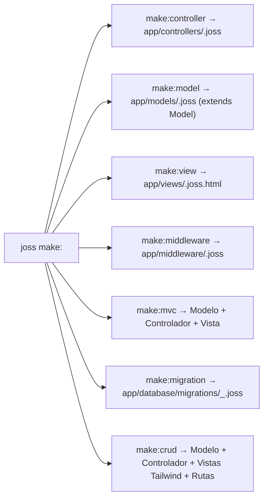

# Joss CLI — Complete Command Reference

[Index](README.md) · Before: [getting started](PRIMEROS_PASOS.md) · After: [analyzer](ANALIZADOR.md)

The canonical source of commands is `cmd/joss/main.go`. `joss help` displays the installed interactive help and `joss version` shows the current runtime version (`3.6.8.0`).

The CLI is the program that receives commands in the terminal. It includes an interactive
REPL environment (`joss repl`), direct script execution (`joss run`), a high-performance
web server (`joss server start` / `joss server`), AOT native compilation (`joss build`), and a complete suite of code quality and package management (`pub`) tools.

---

## 1. Execution, REPL, and Native Build

```bash
joss run archivo.joss
joss repl
joss server start
joss program start
joss build [archivo.joss] [opciones]
joss emit-ir [archivo.joss] [-o salida.ir]
joss analyze [archivo.joss]
joss update [-f|--canary|--stable]
```

- `run [archivo]`: Executes a `.joss` script after analyzing the project (`LoadProject`) and validating its `PreparedProgram` with the Joss interpreter. Semantic errors block execution; warnings do not.
- `repl`: Starts the interactive console (Read-Eval-Print Loop) with the `joss> ` prompt to evaluate expressions, test functions, and experiment with code in real time. Type `exit` or press `Ctrl+C` to quit.
- `server start` (or `joss server`): Requires the `main.joss` entry point and starts the high-performance multi-tier HTTP server interpreted by the server runtime. Press `q` or `Ctrl+C` to stop it safely.
- `program start`: Starts the application in desktop mode.
- `build [archivo.joss]`: **Official Joss native compiler**. Compiles the program into a real self-contained native binary executable (PE `.exe` on Windows, ELF on Linux, Mach-O on macOS), placing it by default inside the `build/` folder. Performs exhaustive semantic analysis (`PreparedProgram`), reachability analysis (*Reachability Analysis*), lowering to Joss Native IR (`pkg/ir`), IR verification (`ir.Verifier`), and native code generation (`pkg/backend/native`).
  - **Pure CLI binaries**: Compiled into ultra-compact pure machine code (~5.5 KB - 32 KB) without `joss_host.dll` or VFS trailer.
  - **Full applications with web/DB services**: Selectively link `_joss_host_bridge` (pruning unused engines via `no<driver>` tags) and seal the encrypted virtual file system (`env.enc` with AES-256) inside the executable.
  - `-o <salida>`: Custom name or path for the final executable binary.
  - `--target=<os>-<arch>` (or direct shortcuts `joss build linux`, `joss build macos`, `joss build android`): Built-in cross-compilation for `windows-amd64`, `windows-arm64`, `linux-amd64`, `linux-arm64`, `darwin-arm64` (Apple Silicon), `darwin-amd64`, and `android-arm64` (Termux).
  - `--release`: Production-optimized build without debug symbols.
  - `--debug`: Build with debugging information.
  - `--trace`: Emits and preserves intermediate artifacts from the native pipeline (`.ir`, `.ll`, `.standalone.go`).
  - `build package [ruta]`: Packages extensions and plugins into Ed25519-signed `.jp` (v2) packages containing pure bytecode.
  - `build web`: Prepares assets and static distribution for web deployment.
- `emit-ir [archivo.joss] [-o salida.ir]`: Emits the canonical intermediate representation (Joss Native IR) in deterministic textual format after semantic analysis and lowering.
- `analyze [archivo]`: Analyzes the project through `semanticanalyzer.LoadProject` (including the entry point, `routes.joss`, `api.joss`, and `app/**/*.joss`). Returns a non-zero exit code if errors exist and preserves file/line/column. See [ANALIZADOR.md](ANALIZADOR.md).
- `update`: Uses the updater implemented by the CLI (`--canary`, `--stable`, `-f`).

---

## 2. Project Creation (`new`)

```bash
joss new mi_proyecto
joss new web mi_proyecto
joss new console mi_cli
joss new package mi_paquete
joss new plugin mi_plugin
```

- `new web` / `new`: Generates the complete MVC structure of a web application with view engine, routes, middleware, and ORM.
- `new console`: Generates a lightweight template for command-line tools (`main.joss`, `env.joss`, `joss.yaml`, and `app/`).
- `new package`: Creates a declarative package structure for the `pub` manager.
- `new plugin`: Creates an official multi-language plugin project compilable to `.jp` binary bytecode.

---

## 3. Code Generators (`make:*` and `remove:*`)

```bash
joss make:controller UsersController
joss make:controller admin/DashboardController
joss make:middleware AuthGuard
joss make:model User
joss make:view users/index
joss make:mvc Product
joss make:crud products
joss remove:crud products
joss make:migration create_products
```



- `make:controller [Nombre]`: Creates a controller in `app/controllers/<Nombre>.joss` (supports subdirectories such as `admin/DashboardController`). In web projects it generates `index(): mixed` returning `view(...)`; in console projects it generates `index(): void` with `print(...)`.
- `make:model [Nombre]`: Creates a model in `app/models/<Nombre>.joss` that inherits from `Model` with automatically pluralized `$table` and `$fillable = []`.
- `make:view [Nombre]`: Creates a template in `app/views/<Nombre>.joss.html` extending `@extends('layouts.master')` (exclusive to web projects).
- `make:middleware [Nombre]`: Creates a middleware in `app/middleware/<Nombre>.joss` with `Router::registerMiddleware(...)`.
- `make:mvc [Nombre]`: Runs in a single step `make:model <Nombre>`, `make:controller <Nombre>Controller`, and `make:view <nombre>/index`.
- If the destination file already exists, the generators safely skip it unless you pass the `--force` flag.

### 🛠️ `make:crud [Tabla]` (Intelligent Relational Generator)
Connects to the database configured in `env.joss`, inspects the table schema, and automatically generates a complete administrative module:
1. **Foreign Key Inspection (`_id`)**: Detects relationships with other tables, infers relational model names, and auto-detects display columns (`username`, `name`, `title`).
2. **Model and Related Models**: Generates `app/models/Model.joss` and any missing relational models.
3. **Complete CRUD Controller**: Generates `app/controllers/ModelController.joss` with `index`, `create`, `store`, `edit`, `update`, and `delete` methods including automatic `joins` and `selects`.
4. **Tailwind CSS Views**: Generates `app/views/model/index.joss.html`, `create.joss.html`, and `edit.joss.html` with dynamic forms and `<select>` dropdowns for relationships.
5. **Navbar and Route Injection**: Injects the menu item into `app/views/layouts/master.joss.html` and inserts the protected routes inside the `Router::middleware("auth")` group in `routes.joss`.

The command is only supported in web projects and requires the table to already exist.
Table/column names are validated as identifiers before querying
the schema. The generated controller accepts only the discovered editable
columns (no mass assignment), deletion uses `POST` with CSRF, and re-running
the generator does not duplicate routes or navigation links.

### 🗑️ `remove:crud [Tabla]`
Cleanly undoes generation: deletes the controller, model, and views folder, and removes the injected routes in `routes.joss` as well as the navbar link.

---

## 4. Database and Migrations

```bash
joss make:migration create_users_table
joss migrate
joss migrate:fresh
joss db:seed
joss change db mysql
joss change db sqlite
joss change db prefix app_
joss change db migrate --host=HOST --port=3306 --database=DB --user=USER --password=PASS
```

- `make:migration`: Generates a new timestamped migration in `app/database/migrations/`. `create_users`, `create_users_table`, and `user` are normalized to the logical table `users`; `make:miggrate` is not an alias and prints the suggested correction.
- `migrate`: Runs pending migrations in chronological order.
- `migrate:fresh`: Drops all database tables and re-runs all migrations from scratch.
- `db:seed`: Runs the database seeders defined in `app/database/seeders/`.
- `change db`: Switches the configured engine (`mysql`, `postgres`, `sqlserver`, or `sqlite`) or modifies the global table prefix (`DB_PREFIX`).
- `change db migrate`: Hot-migrates the data and schema from the current connection to a new remote server.

---

## 5. Plugin Compilation and Management (`.jp`)

```bash
joss plugin compile .
joss plugin compile script.py --lang=python --name=mi_plugin --exports=calcular
joss plugin inspect mi_plugin.jp
joss plugin verify mi_plugin.jp
```

- `plugin compile`: Produces signed JPBC from partial backends. Python/PHP/Java translate subsets; the Wasm path only validates the header and generates demo stubs. See [Plugins](PLUGINS.md).
- `plugin inspect`: Displays metadata, declared permissions, and the symbol table of the `.jp` package.
- `plugin verify`: Verifies the Ed25519 digital signature and structural integrity of the `.jp` container.

---

## 6. Package Manager (`pub`)

```bash
joss pub add paquete ^1.2.0
joss pub remove paquete
joss pub install
joss pub install --offline
joss pub update
joss pub search termino
joss pub info paquete
joss pub publish
joss pub login
joss pub logout
joss pub cache clean
```

If `PUB_REGISTRY_URL` is not specified, Pub resolves dependencies using the official registry at `https://astriom.org`.

---

## 7. Code Quality and Tooling (`check`, `format`, `lint`, `fix`, `test`)

```bash
joss check [ruta]
joss format [ruta] [--write|--check]
joss lint [ruta] [--json]
joss fix [ruta] [--dry-run]
joss test [--filter=nombre] [ruta]
```

- `check`: Runs formatting, syntax, semantic analysis, and linter checks. Review its output: a formatting issue is reported as a warning in this pipeline.
- `format`: On a single file, modifies in place by default unless `--check` is used; on a directory, only writes when `--write` is passed. Always use `joss format ruta --check` in CI.
- `lint`: Runs static analysis with rules for type consistency, style, and detection of hardcoded secrets or credentials (`--json` for structured integration).
- `fix`: Applies lexically safe automatic fixes (`let`/`nil` migrations, required visibility, formatting) without touching strings or comments, with `--dry-run` support.
- `test`: Runs `*_test.joss` files with `test`/`it`, `assert`, `assertTrue`, `assertFalse`, `assertEqual`, `assertNotEqual`, `assertNull`, `assertNotNull`, and `assertThrows`. Place `--filter` before the path: the flag parser stops reading options after the first positional argument.

---

## 8. Plugin Commands and Dynamic Help

```bash
joss help plugins
joss help plugins [nombre_plugin]
joss ai:activate
joss brevo:config [--enable|--disable] [--api-key=CLAVE]
joss backup:create [destino]
joss backup:restore <archivo.zip>
joss bg:remove <input.jpg> [output.png]
joss notify:send <canal> <mensaje>
```

- `help plugins`: Lists all installed and available plugins along with their exposed CLI commands and status (`[protegido]`).
- `help plugins [nombre_plugin]`: Displays the technical datasheet, repository, options, and specific commands for the selected plugin.
- **Plugin commands**: Plugins installed in `plugins/` or declared in `joss.yaml` can register and dispatch autonomous, protected CLI commands.

---

## 9. Cloud Storage and Services (`userstorage`, `doctor` and `indexnow`)

```bash
joss userstorage local
joss userstorage oci
joss userstorage sync-oci
joss userstorage sync-local
joss doctor storage
joss indexnow generate
```

- `userstorage`: Switches the storage provider between local disk and **Oracle Cloud Infrastructure (OCI)**, enabling bidirectional synchronization via `sync-oci` and `sync-local`.
- `doctor storage`: Diagnoses declared storage in `STORAGE` (`local` or `OCI`) in layers without printing secrets. For OCI it checks `OCI_*` variables, OCID format, the PEM key, matching fingerprint against `OCI_FINGERPRINT`, real authentication, tenancy namespace, and bucket existence (listing existing buckets if not found). For `local` it checks that `./storage` is writable. Findings use a `JOSS-STORAGE-...` code ([Diagnostics](DIAGNOSTICOS.md)) and the command exits with code 1 on errors. `STORAGE=s3` does not have a driver yet and reports `JOSS-STORAGE-009`.
- `indexnow generate`: Generates and configures the instant indexing key for IndexNow in the project environment.
