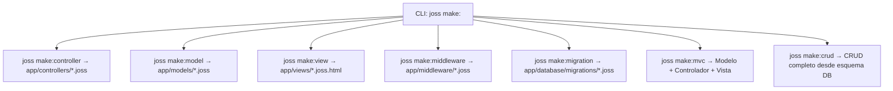

# Project Structure

[Index](README.md)

## Web

`joss new web mi_app` and `joss new mi_app` create the real web template from the `pkg/template/files` package.

All four variants of `joss new` are validated in CI: web and console must parse and analyze without errors; console must also execute; package and plugin must compile to a signed, verifiable JP v2 with decodable bytecode and a symbol index.

```text
mi_app/
├── main.joss
├── env.joss
├── routes.joss
├── api.joss
├── joss.yaml
├── AGENTS.md                 # Guía y sintaxis para asistentes de IA
├── config/
├── app/
│   ├── controllers/          # Subcarpetas por dominio (web/, auth/, api/)
│   │   ├── web/
│   │   ├── auth/
│   │   └── api/
│   ├── models/               # Modelos GranDB (auth/, etc.)
│   │   └── auth/
│   ├── services/             # Servicios en segundo plano e integraciones
│   ├── middleware/           # Middleware de peticiones
│   ├── libs/                 # Librerías y utilidades del proyecto
│   └── database/migrations/
├── assets/
├── public/
├── storage/
├── package.json
└── README.md
```

The template may also include routes, authentication files, frontend resources, and API collections. The exact list may grow; the generator and its tests are the executable reference.

`main.joss` is mandatory for `joss server start`. `env.joss` contains the project's environment configuration (`PORT="80"` by default in the web template) and is not executable code with `joss run`.

## Unified Project Discovery (`PreparedProgram`)

`joss analyze`, `joss check`, `joss run`, `joss server`, and `joss build` all use the unified loader `semanticanalyzer.LoadProject("main.joss", "app")`, which discovers and integrates into a single `PreparedProgram`:
- The entry point (`main.joss`).
- The root route files (`routes.joss` and `api.joss`, if they exist).
- All `.joss` files recursively under `app/` (including `controllers/`, `models/`, `services/`, `middleware/`, `libs/`, and `database/`).

The interpreter (`Runtime.ExecutePrepared`), the HTTP server, and the native compiler register all classes, interfaces, enums, and functions directly from that canonical `PreparedProgram` without re-scanning or skipping subdirectories of `app/`.

## Console

`joss new console mi_cli` creates `main.joss`, configuration, controllers, models, libraries, and migrations; it does not create routes, views, `public/`, or web assets.

```bash
cd mi_cli
joss run main.joss
```

## Package / Plugin

`joss new package mi_plugin` (or `joss new plugin mi_plugin`) creates:

```text
mi_plugin/
├── joss.yaml
├── README.md
└── src/plugin.joss
```

Compile it with `joss build package .`. See [Plugins](PLUGINS.md).

## Effective Conventions and Generators (`joss make:*`)

- Controllers: `app/controllers/NameController.joss` (or `web/`, `auth/`, `api/` subfolders), generated with `joss make:controller NameController` (or `joss make:controller web/NameController`).
- Models: `app/models/Name.joss` (`extends Model`), generated with `joss make:model Name`.
- Views: `app/views/name.joss.html` or `.html`, generated with `joss make:view name` (or `joss make:view carpeta/vista`).
- Middlewares: `app/middleware/Name.joss`, generated with `joss make:middleware Name`.
- Full MVC triad: `joss make:mvc Name` simultaneously generates the model (`app/models/Name.joss`), the controller (`app/controllers/NameController.joss`), and the view (`app/views/name/index.joss.html`).
- Migrations: timestamp, descriptive name, and `.joss` extension in `app/database/migrations/`, generated with `joss make:migration create_tabla`.
- Relational CRUD module: `joss make:crud tabla` inspects the existing table and generates model, controller, views, and routes; `joss remove:crud tabla` reverts those artifacts.
- Generated syntax: `func`, `::` for static members, and `->` for instances.



The generators are validated by a test that creates web and console projects and passes all their `.joss` files through the parser and semantic analyzer.
