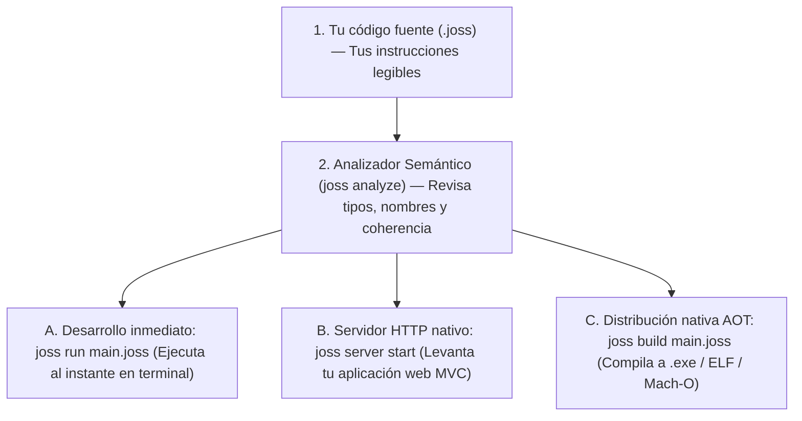
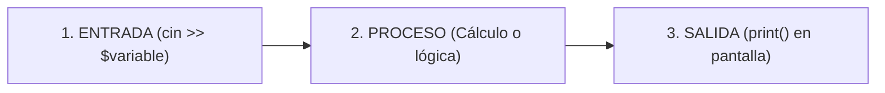

# First steps: from a file to a program

Before: [Index](README.md). Next: [Values, variables and operations](FUNDAMENTOS.md).
Quick reference: [Command line (CLI)](CLI.md).

---

## What will you learn here?

If you have never written a single line of code in your life, this is the right place to start. You do not need prior programming knowledge or experience in other languages.

In this guide you will learn:
1. What programming is and what an instruction is for a computer.
2. What the **Joss** language is and which components make up its ecosystem.
3. How to install Joss on your operating system (Windows, Linux or macOS).
4. How to write your first program ("Hello World"), analyze it and run it.
5. What happens internally from the moment you save the text file until the screen displays the result.
6. How to fix the most common mistakes when taking your first steps.

---

## 1. What is programming and what is a program?

A computer is extraordinarily fast at performing calculations, but it cannot guess what you want to do. It needs a clear, ordered and unambiguous sequence of commands. That sequence of instructions is called a **program** or **algorithm**.

Imagine a cooking recipe:
1. Weigh 200 grams of flour.
2. Add two eggs.
3. Mix for five minutes.

A computer program works under the same logic: it performs tasks step by step. The exact text you write to give those orders to the computer is called **source code**.

In **Joss**, source code is written in plain text and saved in files whose extension ends in `.joss` (for example, `hola.joss` or `app.joss`). You should not use rich text processors like Microsoft Word or Google Docs, because they add invisible formatting that the computer does not understand; instead, you use **code editors** such as Visual Studio Code.

---

## 2. What is Joss?

**Joss** is a modern programming language specially designed for backend applications, web development, command-line utilities and high-performance concurrent services.

Its design philosophy rests on four pillars:

1. **Zero imports in source code (Zero Imports)**: In many languages you must write dozens of lines like `import X from Y` at the top of every file. Joss automatically discovers and organizes the public files, classes and functions of your project and its plugins, allowing you to focus on business logic.
2. **Safety and rigorous static analysis**: Before executing a single instruction, the Joss **semantic analyzer** checks your variables, data types, return paths and visibilities to catch errors before they reach production.
3. **Full stack included (Batteries-Included)**: Joss natively includes a high-performance HTTP server, routing system, HTML template engine, ORM and schema builder for databases (GranDB / Schema), real-time WebSocket support, cryptographic hashing and asynchronous tasks.
4. **Clean concurrency and channels**: You can delegate heavy tasks to the background in a non-blocking way with `async` and communicate processes using safe channels (`channel`).

#### One language, two ways to run it: `joss run` and `joss build`

The code you write in Joss is defined once and has the exact same meaning across all modes:



- **The Joss language**: The writing rules, reserved words and syntax you will learn in this course.
- **The CLI tool (`joss`)**: The command-line program you use from your terminal to create projects, analyze them, run them immediately (`joss run`) or compile them into a standalone executable file (`joss build`).
- **The Runtime / Compiler**: The engine that takes your verified program and executes the real operations on your computer's processor and memory.

---

## 3. Step-by-step installation

A **terminal** (or console) is a text window where you communicate with the operating system by typing commands instead of clicking with the mouse.
- On **Windows**: Open **PowerShell** or the **Windows Terminal** app (search for it in the Start menu).
- On **Linux or macOS**: Open the application called **Terminal**.

### Option A: Official automatic installer (Recommended)

On **Windows** (open PowerShell):

```powershell
iwr -useb https://astriom.org/install | iex
```

On **Linux, macOS or Android (Termux)** (open your Terminal):

```bash
curl -fsSL https://astriom.org/install.sh | bash
```

This command will download the Joss executable, place it in a standard system folder and register it in your `PATH`.

> [!NOTE]
> **What is the `PATH`?**
> The `PATH` is an internal list of the operating system containing the folders where programs live that you can invoke by typing just their name. Thanks to it, you can type `joss` from any folder. If you just installed it and your terminal does not recognize it, **close the terminal and open it again**.

### Option B: Manual download from GitHub Releases

1. Go to the releases section: [Joss GitHub Releases](https://github.com/joss-language/Joss-Programming-Language/releases).
2. Download the compressed archive for your system (`windows_amd64`, `linux_amd64`, `darwin_arm64`, etc.).
3. Unzip the archive, place `joss` (or `joss.exe`) in a folder on your disk and add it to your `PATH`.

### Option C: Build from source with Go

If you already have [Go](https://go.dev) installed (version 1.22 or higher):

```bash
git clone https://github.com/joss-language/Joss-Programming-Language.git
cd Joss-Programming-Language
go build -o joss ./cmd/joss
```

### Verify that the installation works

Open your terminal and type:

```bash
joss version
```

You should see the installed version of Joss on screen:

```text
Joss v3.6.8.0 (powerbuilder Joss 3.6.8.0)
```

If you see that message, your environment is 100% ready!

---

## 4. Create and run your first project with `joss new console`

Instead of creating empty folders and files by hand, Joss includes an official generator that prepares your entire workspace in a second.

### Step 1: Generate the console project

In your terminal, type the following command and press **Enter**:

```bash
joss new console mi-primer-joss
```

You will see Joss confirm the creation of the project:

```text
Creando proyecto Joss Console en: mi-primer-joss

✓ Proyecto de consola creado exitosamente

Estructura creada:
  - main.joss           (Entry point)
  - env.joss            (Variables de entorno)
  - config/reglas.joss  (Constantes globales)
  - app/controllers/    (Lógica de negocio)
  - app/models/         (Acceso a datos)
  - app/libs/           (Librerías)
  - app/database/migrations/

Para ejecutar:
  cd mi-primer-joss
  joss run main.joss
```

### Step 2: Enter the project folder and run it

Enter the newly created folder with the `cd` (*change directory*) command and run the main file `main.joss`:

```bash
cd mi-primer-joss
joss run main.joss
```

Output in your terminal:

```text
=== Aplicación de Consola Joss ===

¡Hola desde Joss Console!

Este es un proyecto de consola backend-only.
Puedes agregar tu lógica en este archivo main.joss

Aplicación finalizada correctamente.
```

Congratulations! You have just created and executed your first complete project in Joss.

---

## 5. What did Joss just create? Understanding `main.joss`

Before modifying the program, let's understand three essential concepts:

1. **What is a project?**
   It is an organized folder (`mi-primer-joss`) where your source code, your configuration (`env.joss`) and subfolders (`app/`) live for when your program grows.
2. **What is `main.joss`?**
   It is the **front door** (*entry point*) of your program. When you run `joss run main.joss` or compile your project with `joss build`, Joss starts reading from this file.
3. **What is inside `main.joss`?**
   Open the `mi-primer-joss` folder in your code editor (for example, by typing `code .` if you use Visual Studio Code) and open the `main.joss` file. You will see this content:

<!-- joss-run: ["=== Aplicación de Consola Joss ===", "", "¡Hola desde Joss Console!", "", "Aplicación finalizada correctamente."] -->
```joss
public class Main {
    Init main() {
        print("=== Aplicación de Consola Joss ===")
        print("")
        print("¡Hola desde Joss Console!")
        print("")
        print("Aplicación finalizada correctamente.")
    }
}
```

### What do `public class Main` and `Init main()` mean?

Later on (in the [Classes and objects](CLASES.md) chapter) you will learn in detail what a class is. For now, you only need to know one very simple rule:

- `public class Main { Init main() { ... } }` is the official **"power button"** of your project.
- Everything you write **inside the braces `{` and `}` of `Init main()`** are the commands the computer will execute in order, from top to bottom, when you start the program.
- Lines starting with `//` are **comments**: notes for yourself that the computer completely ignores.

### Write your own minimal greeting

Replace the contents of `main.joss` with this minimal single-instruction example inside `Init main()`:

<!-- joss-run: ["Hola, Joss!"] -->
```joss
public class Main {
    Init main() {
        print("Hola, Joss!")
    }
}
```

> [!TIP]
> **Did you know you can also write direct instructions?**
> If for a quick experiment you write only `print("Hola, Joss!")` in `main.joss` (without wrapping it in `public class Main`), Joss will run it too. Throughout the course we will show short snippets like that to get straight to the point, while in your projects created with `joss new console` you can place all your code inside `Init main() { ... }`.

Save the file and run it again in your terminal:

```bash
joss run main.joss
```

Output:

```text
Hola, Joss!
```

### What does each part of `print("Hola, Joss!")` do?

1. `print`: It is a **built-in function** in Joss. Its job is to receive a piece of data and display it on your terminal screen, adding a line break at the end.
2. `(` and `)`: The parentheses tell Joss that you want to **execute** `print`. What you place inside the parentheses is the data you hand it to work with (called an **argument**).
3. `"Hola, Joss!"`: It is a **text** (`string`) value. The double quotes `"` mark where the text begins and ends. The quotes are not printed on screen; they only delimit the message.

### Test ideas immediately without editing files: `joss repl`

If at any moment you want to test an addition or a line of code live, type in your terminal:

```bash
joss repl
```

You will see the Joss interactive console:

```text
Joss REPL v3.6.8.0
Escribe 'exit' para salir.
joss> var $x = 10
joss> $x * 5
50
joss> print("Hola desde el REPL!")
Hola desde el REPL!
joss> exit
```

---

## 6. The `analyze` command: Your safety net before running

In Joss you do not have to wait for a program to fail halfway through to discover an error. You can ask the **semantic analyzer** to check your project by typing:

```bash
joss analyze main.joss
```

If your code meets all the rules, you will see:

```text
[Analyzer] Análisis completado sin errores.
```

What does `joss analyze` check for you?
- **Punctuation (syntax)**: That you have not forgotten to close quotes `"`, a parenthesis `)` or a brace `}`.
- **Names**: That you do not try to use a variable or function that was never created.
- **Data types**: That you do not try to store text where you promised to store an integer number.

In fact, every time you run `joss run main.joss` or compile with `joss build main.joss`, Joss passes this safety check automatically first.

---

## 7. Storing information in memory: Your first variable

A program that only prints fixed text always does the same thing. To remember a name, an age or a result, we use **variables**.

Imagine a variable as a **labeled box in the computer's memory** where you can store a piece of data to use later.

Update your `main.joss` file with the following code:

<!-- joss-run: ["Hola, Ada", "Bienvenida a Joss"] -->
```joss
public class Main {
    Init main() {
        var $nombre = "Ada"
        print("Hola, " . $nombre)
        print("Bienvenida a Joss")
    }
}
```

Save and run `joss run main.joss`:

```text
Hola, Ada
Bienvenida a Joss
```

### Line-by-line explanation:

1. `var $nombre = "Ada"`:
   - `var`: Tells Joss *"I am going to create a new variable; deduce its type from the initial value"*.
   - `$nombre`: Is the name of the variable. **In Joss, all variables must start with the `$` sign**.
   - `=`: Is the **assignment operator**. It takes the value on the right (`"Ada"`) and stores it inside `$nombre`.
2. `print("Hola, " . $nombre)`:
   - The dot `.` is the **text concatenation operator**. It joins the text `"Hola, "` with the content stored in `$nombre` (`"Ada"`), forming `"Hola, Ada"`.
   - You can also embed the variable directly inside double quotes by writing `print("Hola, ${nombre}")`.

> [!IMPORTANT]
> **Creating a variable (`var $nombre = ...`) vs Changing its value (`$nombre = ...`)**
> In Joss, the **first time** you create a variable you must declare it with `var` (or by specifying its type, such as `string $nombre = "Ada"`). If you try to write `$nombre = "Ada"` for the first time without declaring it first, Joss will alert you with the error `JOSS-SYM-001` (*Variable is not declared*). Once declared, you can change its value later by writing `$nombre = "Carlos"`.

---

## 8. Interacting with the user: Keyboard input with `cin >>`

Now let's make the program ask us questions, wait for us to type on the keyboard and answer us. Every interactive program follows three steps:



Write in your `main.joss`:

<!-- joss-check: lectura interactiva de datos por teclado -->
```joss
public class Main {
    Init main() {
        string $nombre = ""
        int $edad = 0

        print("¿Cómo te llamas?")
        cin >> $nombre

        print("¿Cuántos años tienes?")
        cin >> $edad

        print("¡Mucho gusto, " . $nombre . "! El próximo año tendrás " . ($edad + 1) . " años.")
    }
}
```

### How does this program work when you run it with `joss run main.joss`?

1. `string $nombre = ""` and `int $edad = 0`: We create two variables ready to receive data: one for text (`string`) initially empty `""`, and another for an integer number (`int`) initially set to `0`.
2. `cin >> $nombre`: Pauses the program and waits for you to type your name in the terminal and press **Enter**. Whatever you type is saved in `$nombre`.
3. `cin >> $edad`: Waits for you to type your age and automatically converts it into an integer number inside `$edad`.
4. `($edad + 1)`: Adds `1` to the age you typed and displays the complete greeting.

Example of a real session in your terminal:

```text
¿Cómo te llamas?
Ada
¿Cuántos años tienes?
20
¡Mucho gusto, Ada! El próximo año tendrás 21 años.
```

---

## 9. Quick summary of your first chapter

Keep this table as a reference for what you already master:

| What do you want to do? | Command or code in Joss | Real example |
|---|---|---|
| **Create a console project** | `joss new console <nombre>` | `joss new console mi-primer-joss` |
| **Create a web MVC project** | `joss new <nombre>` | `joss new mi-web` |
| **Generate project components** | `joss make:<tipo> <Nombre>` | `joss make:controller SaludoController` |
| **Run your project** | `joss run main.joss` | `joss run main.joss` |
| **Check errors without running** | `joss analyze main.joss` | `joss analyze main.joss` |
| **Compile to a native executable** | `joss build main.joss` | Generates `build/main.exe` (or `build/main`) |
| **Display a message on screen** | `print(...)` | `print("¡Hola mundo!")` |
| **Create a new variable** | `var $variable = valor` | `var $ciudad = "Madrid"` |
| **Change an existing variable** | `$variable = nuevo_valor` | `$ciudad = "Lima"` |
| **Join text** | `texto1 . texto2` or `"${variable}"` | `"Hola, " . $nombre` |
| **Read what the user types** | `cin >> $variable` | `cin >> $nombre` |

### The Three Golden Rules for a smooth start

1. **Every variable starts with `$`**: Always write `$nombre`, `$edad`, `$total`.
2. **Declare before using**: Use `var $x = ...` (or the type like `int $x = ...`) the first time you create a variable.
3. **Everything that opens must close**: Quotes `"..."`, parentheses `(...)` and braces `{...}` always come in pairs.

---

## 10. If something doesn't work: Quick troubleshooting

| Symptom or message | Probable cause | How to fix it |
|---|---|---|
| `joss: command not found` or `el término 'joss' no se reconoce` | The terminal has not reloaded the `PATH` yet after installing Joss. | Close the terminal window, open it again and test `joss version`. |
| `No se encontró el archivo 'main.joss'` | You have not entered the folder of the project you created. | Run `cd mi-primer-joss` before running `joss run main.joss`. |
| `JOSS-PARSE-001` (Syntax error) | A closing quote `"`, parenthesis `)` or brace `}` is missing. | Check the line number indicated by Joss and verify that every quote and brace has its matching pair. |
| `JOSS-SYM-001: Variable '$x' is not declared` | You wrote `$x = valor` without creating the variable first, or you misspelled its name. | Add `var` when creating it for the first time (`var $x = valor`) and check uppercase/lowercase (`$edad` and `$Edad` are different). |

---

## 11. Chapter practice

Put what you learned to the test directly in the `main.joss` file of your `mi-primer-joss` project:

### 1. Quick test
In the example from section 7:
1. Change `"Ada"` to your own name.
2. Add a third line `print("Estoy aprendiendo a programar")` before closing the brace `}` of `Init main()`.
3. Run `joss run main.joss` and verify that all three lines appear in order.

### 2. Guided exercise: Your business card
Modify `Init main()` following these 4 steps:
1. Declare a variable with your name: `var $nombre = "Tu Nombre"`.
2. Declare a variable with your country: `var $pais = "Tu País"`.
3. Declare a variable with your goal: `var $meta = "Crear aplicaciones en Joss"`.
4. Use `print` and the `.` operator (or `${...}`) to display a three-line summary in the terminal.

### 3. Challenge: Double a number calculator
1. Declare an integer variable `int $numero = 0`.
2. Display a message with `print("Escribe un número entero:")`.
3. Read the number from the keyboard with `cin >> $numero`.
4. Display on screen: `"El doble de tu número es: " . ($numero * 2)`.
5. *(Optional)* Run `joss build main.joss` and see how Joss creates your own executable program inside the `build/` folder.

---

## Next step

Now that you know how to create a project with `joss new console`, understand `main.joss`, display messages, create variables and request keyboard input, it is time to learn all the data types Joss handles (exact numbers for money, decimals, booleans and text) and how to perform operations with them.

Continue with: [Fundamental values, variables and operations](FUNDAMENTOS.md).