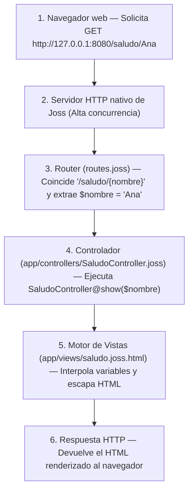
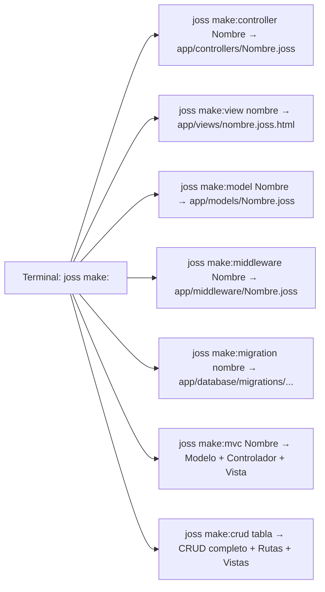

# Complete Web Project: MVC Architecture with the Native Stack

Previous: [Console project](PROYECTO_CONSOLA.md). Next: [Controllers and HTTP](CONTROLADORES.md).
Technical reference: [View engine](VISTAS.md), [Native server](SERVIDOR.md), [GranDB models](MODELOS.md).

---

## What Will You Build Here?

A **web application** is a program that runs on a server listening to network requests (usually from a browser or mobile application) and responds with interactive HTML pages or data in JSON format.

Unlike other languages where you need to install complex external servers (such as Apache, Nginx, or heavy Node.js packages), **Joss includes its own high-performance HTTP server, dynamic router, and HTML template engine**.

In this guided tutorial you will build your first web application based on the **MVC (Model - View - Controller)** architectural pattern:
1. Create the project structure using the `joss new` template generator (`joss new web`).
2. Understand the flow of a web request in Joss.
3. Learn the `joss make:<componente>` code generator system to create project pieces without writing them from scratch.
4. Configure the port in `env.joss` and define a route with dynamic parameters in `routes.joss`.
5. Generate and program a controller in `app/controllers/` with `joss make:controller`.
6. Generate and design a secure HTML view in `app/views/` with `joss make:view` and automatic escaping against XSS injections.
7. Start the server with `joss server start` and test the application in the browser.

---

## 1. The Flow of a Web Request in Joss

When a user types an address into their browser, the following sequence occurs:



---

## 2. Generate the Web Project and Learn the `joss make:*` Commands

Open your terminal and run the official generator (you can type `joss new saludo_web` or explicitly `joss new web saludo_web`):

```bash
joss new web saludo_web
cd saludo_web
```

This command will create the standard structure of a Joss web application:
- `main.joss`: Entry point of the project.
- `env.joss`: Configuration variables (port, database, secret keys).
- `routes.joss` and `api.joss`: The map of web URLs and API endpoints of the application.
- `app/controllers/`: Where controllers reside (organized into `web/`, `auth/`, `api/`).
- `app/models/`: Database models with GranDB.
- `app/views/`: Dynamic HTML templates (`.joss.html`).
- `public/`: Direct static files (CSS stylesheets, JS scripts, images).

### The `joss make:<componente>` Generator Design

Instead of creating files manually one by one, Joss provides the `joss make:<componente>` command family, which automatically generates classes and templates in the right folder following framework conventions:



| Command | What does it automatically create? | Usage example |
|---|---|---|
| `joss make:controller <Nombre>` | A controller in `app/controllers/<Nombre>.joss` (supports subfolders such as `web/SaludoController`) | `joss make:controller SaludoController` |
| `joss make:view <nombre>` | An HTML template in `app/views/<nombre>.joss.html` (supports subfolders such as `usuarios/perfil`) | `joss make:view saludo` |
| `joss make:model <Nombre>` | A GranDB model in `app/models/<Nombre>.joss` connected to its pluralized table | `joss make:model Producto` |
| `joss make:middleware <Nombre>` | An HTTP middleware in `app/middleware/<Nombre>.joss` | `joss make:middleware VerificarSesion` |
| `joss make:mvc <Nombre>` | The complete triad at once: Model + Controller (`<Nombre>Controller`) + View (`<nombre>/index`) | `joss make:mvc Producto` |
| `joss make:migration <nombre>` | A timestamped database migration in `app/database/migrations/` | `joss make:migration create_productos` |
| `joss make:crud <tabla>` | Inspects the database table and generates Model, Controller, Tailwind Views, and Routes (reverted with `joss remove:crud <tabla>`) | `joss make:crud productos` |

---

## 3. Configure the Server Port

Open the `env.joss` file at the root of the project. By default the template generates `PORT="80"`. To develop locally without administrator privileges, change it to a free port such as `"8080"`:

```joss
PORT="8080"
APP_NAME="Mi Web Joss"
```

> [!NOTE]
> `env.joss` is an environment configuration file that Joss loads automatically on startup; it is not an executable script to run with `joss run env.joss`.

---

## 4. Define the Dynamic Route

Open the `routes.joss` file and add the following definition:

<!-- joss-check: fragmento de routes.joss -->
```joss
Router::get("/saludo/{nombre}", "SaludoController@show")
```

### What Does This Line Mean?
- `Router::get(...)`: Indicates that we will respond to HTTP requests of type `GET` (the ones made by the browser when opening a link).
- `"/saludo/{nombre}"`: The URL pattern. `{nombre}` is a **dynamic segment**: any text the user types into that position of the URL will be captured.
- `"SaludoController@show"`: The target handler. Tells the router to instantiate the `SaludoController` class and execute its `show` method.

---

## 5. Create the Controller with `joss make:controller`

In your terminal, inside the `saludo_web` folder, run the controller generator:

```bash
joss make:controller SaludoController
```

You will see the confirmation in the console:

```text
Created: app/controllers/SaludoController.joss
```

Joss will have created the `app/controllers/SaludoController.joss` file with an initial structure ready to use:

<!-- joss-check: plantilla generada por joss make:controller -->
```joss
public class SaludoController {
    public func index(): mixed {
        return view("saludo/index")
    }
}
```

Now open `app/controllers/SaludoController.joss` and add or replace the method with `show(string $nombre)` to receive the parameter from our route:

<!-- joss-check: fragmento de controlador web -->
```joss
public class SaludoController {
    public func show(string $nombre) {
        var $nombreLimpio = trim($nombre)
        return view("saludo", {"nombre": $nombreLimpio})
    }
}
```

### Anatomy of the Controller:
1. `public class SaludoController`: Public class that Joss automatically discovers inside `app/` without needing an `import`.
2. `public func show(string $nombre)`: The method receives the dynamic parameter `{nombre}` captured by the route. In Joss, controller parameters must declare their type (`string $nombre`).
3. `var $nombreLimpio = trim($nombre)`: Trims any leading or trailing whitespace.
4. `return view("saludo", {"nombre": $nombreLimpio})`:
   - Calls the native function `view(...)`.
   - The first argument is the name of the template file (it will look for `app/views/saludo.joss.html`).
   - The second argument is an associative map with the data we want to inject into the HTML.

---

## 6. Generate and Design the HTML View with `joss make:view`

Generate the view file from your terminal by running:

```bash
joss make:view saludo
```

You will see the confirmation:

```text
Created: app/views/saludo.joss.html
```

By default, `joss make:view` creates a template connected to the master layout (`@extends('layouts.master')`). For this first self-contained example, open `app/views/saludo.joss.html` and replace its content with this complete HTML card:

```html
<!doctype html>
<html lang="es">
<head>
    <meta charset="utf-8">
    <meta name="viewport" content="width=device-width, initial-scale=1">
    <title>Saludo - Mi Web Joss</title>
    <style>
        body { font-family: system-ui, sans-serif; margin: 40px; background: #f8fafc; color: #1e293b; }
        .card { background: white; padding: 30px; border-radius: 12px; box-shadow: 0 4px 6px -1px rgb(0 0 0 / 0.1); max-width: 500px; }
        h1 { color: #0f766e; margin-top: 0; }
    </style>
</head>
<body>
    <div class="card">
        <h1>¡Hola, {{ $nombre }}!</h1>
        <p>Bienvenido a tu primera aplicación web construida con <strong>Joss</strong>.</p>
    </div>
</body>
</html>
```

### Native Security Against XSS Attacks:
Notice the `{{ $nombre }}` syntax:
- Joss's template engine **automatically escapes dangerous HTML characters** such as `<`, `>`, `"`, or `&`.
- If a malicious user tries to enter `<script>alert('hack')</script>` as a name, Joss will convert it into safe entities (`&lt;script&gt;...`), protecting your visitors from Cross-Site Scripting (XSS) vulnerabilities.

---

## 7. Start and Test the Server

In your terminal, located at the root of the `saludo_web` project, type:

```bash
joss server start
```

(Or its equivalent shortcut `joss server`). You will see the HTTP server confirmation message:

```text
[CLI] Ejecutando script de inicio (main.joss)...
[Joss Server] Servidor HTTP escuchando en http://127.0.0.1:8080
[Joss Server] Presiona 'q' o Ctrl+C para detener el servidor.
```

Open your web browser and visit:

`http://127.0.0.1:8080/saludo/Ana`

You will see the styled card greeting Ana. Now try changing the URL to:

`http://127.0.0.1:8080/saludo/Carlos`

The server will respond instantly with the new greeting.

To stop the server at any time, simply press the **`q`** key or `Ctrl + C` in your terminal.

---

## 8. Verification and Static Checking

Before deploying to production, you can audit the entire project with Joss's verification commands:

```bash
joss analyze main.joss
joss check .
```

---

## 9. Practical Exercises

### Level 1 — Quick Test
Pass a second piece of data from `SaludoController@show` to the view by adding `"rol": "Desarrollador Joss"` to the `view(...)` map and display it inside `saludo.joss.html` below the title using `<p>Rol: {{ $rol }}</p>`.

### Level 2 — Guided Exercise
1. Open `api.joss` (or `routes.joss`) and register a route `Router::get("/api/estado", "SaludoController@estado")`.
2. Add in `SaludoController` the method `public func estado()` that returns `Response::json({"ok": true, "servidor": "Joss HTTP"})`.
3. Visit `http://127.0.0.1:8080/api/estado` in your browser and check the JSON response.

### Level 3 — Challenge
1. Register a route with two dynamic parameters: `Router::get("/calcular/{a}/{b}", "SaludoController@sumar")`.
2. Implement `public func sumar(string $a, string $b)` in `SaludoController`, convert both parameters with `intval($a)` and `intval($b)`, calculate their sum, and render a view or JSON response with the operation details.

---

## Next Step

Now that you know the complete lifecycle of a web request, you can explore the advanced capabilities of the Joss web stack and the complete type system of the language:

Continue with: [Type system and coercion](SISTEMA_TIPOS.md), [HTTP and Controllers](CONTROLADORES.md), [Middlewares and Security](MIDDLEWARE.md), and [GranDB Models](MODELOS.md).