# Joss Documentation

This documentation describes the behavior of the current code. It is divided
into learning, guides, reference and internals so that a beginner can
move forward in order and an experienced developer can find concrete rules.

## Languages

- Español (canonical source): this directory.
- [English](README.md)
- [Português](../pt/README.md)

All 50 documents keep the same filename in every language so that relative links
work the same way. After editing the Spanish source, run
`go run ./tools/docsi18n -translate -sync` to update translations and the web
mirror; `go run ./tools/docsi18n -check` detects missing files, stale
translations, broken links or differences with JosSecurity.

## Learn Joss (Guided route from scratch)

If you have never programmed before or are learning Joss for the first time, follow this course in order. Each chapter introduces one concept at a time, starting from how to create and run your official project with `joss new console`, with line-by-line explanations, visible results and three levels of practice (*Quick test*, *Guided exercise* and *Challenge*).

```mermaid
flowchart LR
    C0["0. Primeros pasos (joss new console)"] --> C1["1. Fundamentos"]
    C1 --> C2["2. Control de flujo"]
    C2 --> C3["3. Colecciones"]
    C3 --> C4["4. Funciones"]
    C4 --> C5["5. Errores"]
    C5 --> C6["6. Clases y POO"]
    C6 --> C7["7. Concurrencia"]
    C7 --> C8["8. Proyecto Consola (joss build)"]
    C8 --> C9["9. Proyecto Web MVC (joss new / joss make:*)"]
```

0. [First steps: create your project with `joss new console`, understand `main.joss` and interact with `cin`](PRIMEROS_PASOS.md)
1. [Fundamental values, variables and operations](FUNDAMENTOS.md)
2. [Flow control: decisions and repetition loops](CONTROL_FLUJO.md)
3. [Collections: Arrays, Maps and Unicode text](COLECCIONES.md)
4. [Functions, scope, `guard`, `defer`, closures, `ref` and pipelines](FUNCIONES.md)
5. [Error handling, `JOSS-...` diagnostics and `try/catch` exceptions](ERRORES.md)
6. [Classes, objects, inheritance, interfaces, `record` and generics](CLASES.md)
7. [Concurrency, `async/await`, `Future` and channels (`channel`)](CONCURRENCIA.md)
8. [Practical console project with JSON persistence and `joss build`](PROYECTO_CONSOLA.md)
9. [Complete web project with `joss new` and native MVC architecture](PROYECTO_WEB.md)

The [glossary](GLOSARIO.md) explains all programming and Joss terms in everyday language, without requiring prior knowledge of another language. Once you complete the basic course, dive deeper into formal type rules in [Type system, inference and conversions](SISTEMA_TIPOS.md).

## Language and tools reference

- [Syntax, tokens and precedence](SINTAXIS.md)
- [EBNF grammar and AST nodes](GRAMATICA.md)
- [Functions](FUNCIONES.md), [recursion](RECURSION.md) and [types](SISTEMA_TIPOS.md)
- [Diagnostics](DIAGNOSTICOS.md) and [analyzer](ANALIZADOR.md)
- [Global functions](FUNCIONES_GLOBALES.md)
- [Native classes and services](MODULOS_NATIVOS.md)
- [Generated native catalog](CATALOGO_NATIVO.md)
- [CLI, formatter, linter and tests](CLI.md)
- [Mobile support: Android and iOS](MOBILE.md)
- [VS Code Extension](VSCODE_EXTENSION.md)
- [State and limits](ESTADO_IMPLEMENTACION.md)

## Create applications

- [Project structure](ESTRUCTURA_PROYECTO.md) and [configuration](CONFIGURACION.md)
- [Organization without imports](MODULOS_IMPORTS.md) and [plugins](PLUGINS.md)
- Web: [server](SERVIDOR.md), [HTTP/controllers](CONTROLADORES.md),
  [middleware](MIDDLEWARE.md), [views](VISTAS.md), [assets](ASSETS.md) and
  [WebSockets](WEBSOCKETS.md)
- Data: [models/GranDB](MODELOS.md), [Schema Builder](SCHEMA_BUILDER.md) and
  [migrations](MIGRACIONES.md)
- Application: [authentication](AUTENTICACION.md) and [SEO/sitemap](SEO_SITEMAP.md)

## Internals and maintenance

- [Language architecture](ARQUITECTURA.md)
- [Contribution Guide](CONTRIBUIR.md)
- [Documentation audit](DOCUMENTATION_AUDIT.md)
- [Joss Language Audit 2026](JOSS_LANGUAGE_AUDIT_2026.md)
- [Critical and Comparative Joss Review 2026](JOSS_LANGUAGE_REVIEW_2026.md)
- [Joss evolution 2026: phases 0 and 1](JOSS_EVOLUTION_PHASE_0_1_2026.md)
- [GranDB ORM Audit 2026](GRANDB_ORM_AUDIT_2026.md)
- [Technical audit of 2026](AUDITORIA_TECNICA_2026.md)
- [Runtime Optimization Audit](RUNTIME_OPTIMIZATION_AUDIT.md)
- [Historical news 3.6.7](NOVEDADES_367.md)

Historical documents preserve context and may describe the state at their
date. In the event of a discrepancy, the implementation, tests and
[Implementation status](ESTADO_IMPLEMENTACION.md) take precedence.
