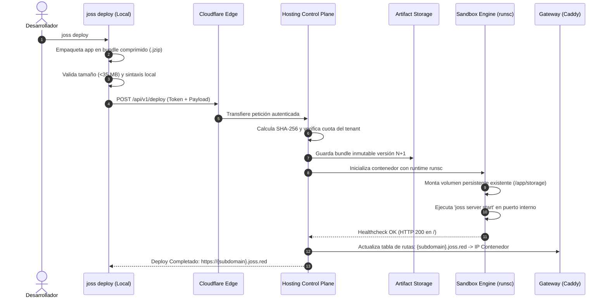
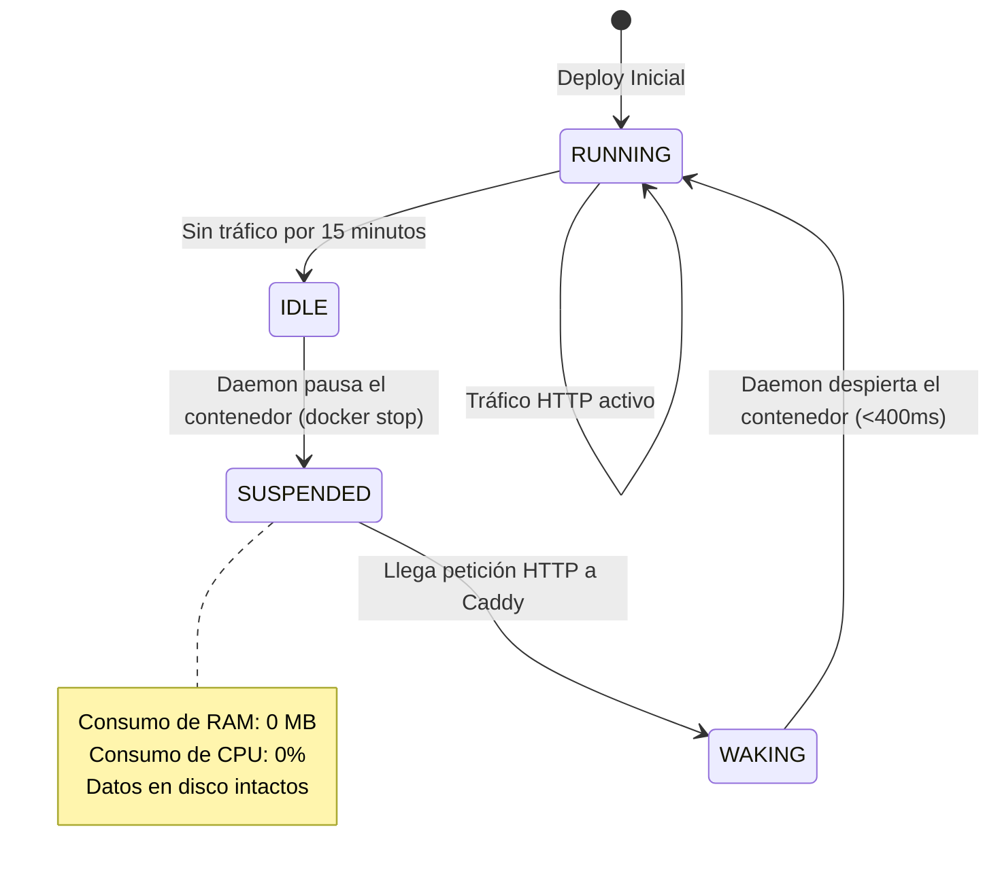

# Arquitectura del Sistema: Joss Free Hosting Platform

---

## 1. Topología General del Ecosistema

```text
                                       INTERNET
                                          │
                                          ▼
                            ┌───────────────────────────┐
                            │    CLOUDFLARE EDGE        │
                            │  - DNS Anycast (*.joss.red│
                            │  - Universal TLS 1.3      │
                            │  - WAF / Anti-DDoS        │
                            │  - CDN Cache de Assets    │
                            └─────────────┬─────────────┘
                                          │
                                Cloudflare Tunnel (Saliente)
                            (Zero open incoming ports on Host)
                                          │
                                          ▼
                            ┌───────────────────────────┐
                            │   HOSTING GATEWAY (VPS)   │
                            │  - Caddy Reverse Proxy    │
                            │  - Tenant Lookup Cache    │
                            │  - Wake-on-Request Buffer │
                            │  - Rate Limiter (IP/App)  │
                            └─────────────┬─────────────┘
                                          │
                        ┌─────────────────┴─────────────────┐
                        │                                   │
                        ▼                                   ▼
          ┌───────────────────────────┐       ┌───────────────────────────┐
          │     CONTROL PLANE API     │       │    PERSISTENT VOLUMES     │
          │  - POST /api/deploy       │       │  /data/tenants/{id}/data  │
          │  - GET  /api/logs/{id}    │       │  - database.sqlite        │
          │  - POST /api/kill/{id}    │       │  - uploads/               │
          │  - SQLite Manager DB      │       │  (Cuota: 64 MB per tenant)│
          └─────────────┬─────────────┘       └─────────────┬─────────────┘
                        │                                   │
                        ▼                                   │
          ┌───────────────────────────┐                     │
          │  CONTAINER DAEMON (gVisor)│                     │
          │  - Runtime: runsc         │                     │
          │  - cgroups v2 (64M RAM)   │                     │
          │  - Network isolation      │                     │
          └─────────────┬─────────────┘                     │
                        │                                   │
            ┌───────────┴───────────┐                       │
            ▼                       ▼                       ▼
    ┌───────────────┐       ┌───────────────┐       ┌───────────────┐
    │ Tenant A      │       │ Tenant B      │       │ Tenant N      │
    │ Root: ReadOnly│       │ Root: ReadOnly│       │ Root: ReadOnly│
    │ /tmp: 16M RAM │       │ /tmp: 16M RAM │       │ /tmp: 16M RAM │
    │ Mount: /data ◄┼───────┼───────┼───────┼───────┼───────────────┘
    └───────────────┘       └───────────────┘       └───────────────┘
```

---

## 2. Separación de Persistencia y Artefacto Inmutable

Para evitar que un nuevo despliegue borre la base de datos SQLite o corrompa archivos en ejecución:

```text
/
├── bin/
│   └── joss                    [Read-Only: Runtime Oficial ARM64]
├── app/
│   ├── main.joss               [Read-Only: Código del usuario]
│   ├── routes.joss             [Read-Only: Rutas y controladores]
│   ├── app/views/              [Read-Only: Plantillas HTML]
│   └── assets/                 [Read-Only: Estilos compilados]
├── tmp/                        [Tmpfs en RAM: 16 MB máximo, volátil]
└── app/storage/                [Persistent Volume Mount]
    ├── database.sqlite         [Base de datos SQLite persistente]
    ├── database.sqlite-wal     [Write-Ahead Log]
    └── uploads/                [Archivos subidos por los usuarios finales]
```

### Reglas de Montaje:
1. El directorio `/app` se monta como una imagen de solo lectura (**Read-Only OverlayFS**).
2. El directorio `/app/storage` se monta desde `/data/tenants/{tenant_id}/storage` en el host con opciones `nosuid, nodev, noexec`.
3. Ningún ejecutable puede correr desde `/app/storage` o `/tmp`.

---

## 3. Flujo Secuencial de Despliegue (Deploy Workflow)



---

## 4. Mecanismo de Scale-to-Zero y Wake-on-Request

Para hacer económicamente sostenible alojar cientos de aplicaciones en un servidor de $10 USD:



### Proceso de Activación (Wake-on-Request):
1. **Llegada del Request**: Llega un request a `miapp.joss.red`.
2. **Intercepción**: Caddy consulta su tabla local de estado. Si el contenedor está en estado `SUSPENDED`, retiene la conexión HTTP en buffer.
3. **Señal de Despertar**: Caddy envía un webhook interno al daemon: `POST /internal/wake/tenant-123`.
4. **Arranque Rápido**: El daemon ejecuta `docker start tenant-123`. Gracias a que el runtime Joss en Linux arranca en ~150 ms, el contenedor está listo en <350 ms.
5. **Reenvío**: Caddy envía la petición en cola al contenedor y devuelve la respuesta al usuario final sin que este experimente un error 502/504.
