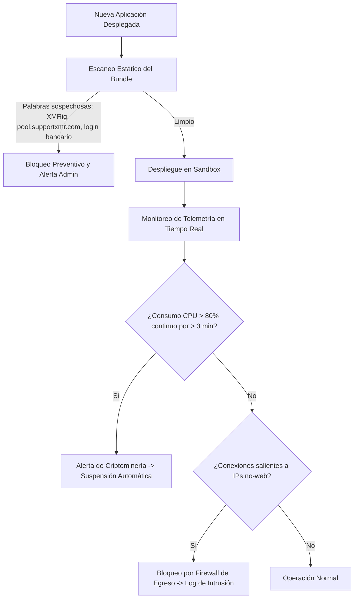

# Modelo de Amenazas (STRIDE) y Control de Abuso

---

## 1. Clasificación STRIDE para Entornos Multi-Tenant de Joss

| Categoría STRIDE | Amenaza Concreta en Joss Hosting | Vector Técnico | Contramedida de Ingeniería Obligatoria |
|---|---|---|---|
| **Spoofing (Suplantación)** | Un usuario despliega una app para robar sesiones de otra app `*.joss.red`. | Cookies de sesión configuradas para el dominio raíz en vez del subdominio específico. | **Host Isolation Estricto**: Cookies emitidas con directiva `SameSite=Lax; Domain=app1.joss.red`. El Gateway jamás comparte cookies entre subdominios. |
| **Tampering (Alteración)** | Un tenant modifica la base de datos SQLite o el código de otro tenant. | Ataque de directorio transversal `../../` o montaje compartido de `/data`. | **Namespaces independientes**: Cada contenedor tiene su propio mount bind `/data/tenants/{uuid}` con permisos Unix `0700` pertenecientes al UID único del tenant. |
| **Repudiation (Repudio)** | Un usuario despliega malware o phishing y afirma que no fue él. | Despliegues anónimos sin trazabilidad de IP o token. | **Registro Forense**: Cada deploy registra hash SHA-256 del bundle, IP de origen, token de usuario y timestamp inmutable en la base de datos de auditoría. |
| **Information Disclosure (Fuga)** | Un tenant lee secretos de entorno o claves de Cloudflare del host. | Lectura de `/proc/$PID/environ` o llamadas a sockets locales. | **gVisor Virtualized Procfs**: El sistema de archivos `/proc` en gVisor solo expone los procesos del contenedor virtual; el host es 100% invisible. |
| **Denial of Service (DoS)** | Un script satura CPU, RAM o la red para degradar a otros proyectos vecinos. | Bucle infinito `while(1)`, fork bomb o flood HTTP. | **cgroups v2 + CFS Quota**: Límite de 25% CPU, 96 MB RAM (OOM Killer) y `pids.max = 32`. Token-bucket rate limiting en Caddy. |
| **Elevation of Privilege** | Un exploit de kernel intenta escapar del sandbox para obtener root en el host. | Syscall vulnerables en el Kernel de Linux (`clone`, `unshare`, `ptrace`). | **gVisor (runsc)**: Las syscalls nunca tocan el kernel del host; son procesadas en memoria de usuario por el centinela de gVisor. |

---

## 2. Detección Proactiva de Abuso Económico

### Reglas de Detección en Caliente:
1. **Anti-Phishing**: En cada deploy se analiza el título HTML de las vistas. Si contiene palabras clave de alta sensibilidad (`paypal`, `banco`, `login`, `password`, `metamask`) en un subdominio no oficial, el despliegue requiere validación manual.
2. **Anti-Minería**: Joss no es un lenguaje diseñado para cálculo intensivo de hashing SHA-256/CryptoNight. Si un contenedor mantiene el 100% de su cuota de CPU durante más de 180 segundos ininterrumpidos sin recibir peticiones HTTP entrantes, el daemon lo suspende inmediatamente por sospecha de minería.
3. **Anti-Proxy / Scraper**: Reglas de egreso bloquean el tráfico hacia puertos que no sean 80, 443 o 53. Un usuario no puede utilizar Joss como proxy SOCKS5 o relé de spam.
