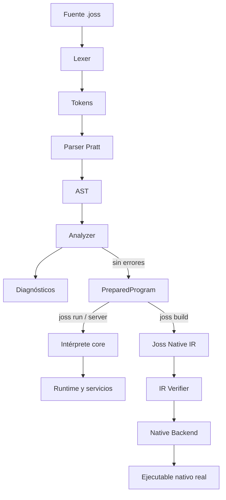

# Arquitetura da linguagem Joss

[Índice](README.md) · Antes: [estado](ESTADO_IMPLEMENTACION.md) · Depois: [contribuir](CONTRIBUIR.md)

## Pipeline real

```text
fuentes .joss
  → lexer (`pkg/parser/lexer.go`)
  → parser Pratt (`pkg/parser`)
  → AST (`pkg/parser/ast*.go`)
  → análisis semántico (`pkg/analyzer`)
    (collectDeclarations → projectScope → validateNominalContracts → analyzeSourceBodies)
  → diagnósticos (`pkg/diagnostics`)
  → PreparedProgram (Canónico)
  ┌───────────────────────┼───────────────────────┐
  ▼                       ▼                       ▼
`joss run`             `joss server`           `joss build`
Intérprete AST         Servidor HTTP           Joss Native IR (`pkg/ir`)
(`pkg/core`)           (`pkg/server`)            → IR Verifier (`ir.Verifier`)
                                                 → Native Backend (`pkg/backend/native`)
                                                 → Ejecutable Nativo (.exe, ELF, Mach-O)
```



`semanticanalyzer.LoadProject` preserva cada arquivo como uma `analyzer.SourceUnit` (incluindo `main.joss`, `routes.joss`, `api.joss` e todos os arquivos `.joss` sob `app/`); não concatena ASTs perdendo a origem. Primeiro registra declarações globais de funções, classes, interfaces e enums, depois valida contratos nominais e finalmente analisa cada método com um escopo léxico independente. As classes nativas provêm de `Runtime.RegisterNativeClasses`; os plugins fornecem seus índices de símbolos JP v2.

## Responsabilidades

| Pacote | Responsabilidade |
|---|---|
| `pkg/parser` | Tokens, lexer, precedências, parser e nós AST. |
| `pkg/typesystem` | Nomes canônicos, inferência, coerção explícita, métodos primitivos e compatibilidade de atribuição. |
| `pkg/analyzer` | Unidades-fonte, escopos, símbolos, inferência de expressões, assinaturas, fluxo alcançável e geração de `PreparedProgram`. Nunca importa `pkg/core`. |
| `pkg/diagnostics` | Modelo comum: código, severidade, mensagem, arquivo, intervalo, explicação e sugestão. |
| `pkg/core` | Adaptação de catálogos reais ao analisador, interpretador (`ExecutePrepared`) e primitivas integradas. |
| `pkg/runtime/errors` | Erro de runtime estruturado e frames de pilha Joss, sem dependências de framework. |
| `pkg/runtime/value` | Semântica de valores independente do evaluator, incluindo indexação Unicode. |
| `pkg/runtime/plan`, `pkg/runtime/frame` | Planos de callables, slots e representação etiquetada usados para acelerar resolução local; não formam bytecode portável. |
| `pkg/pluginruntime`, `pkg/pluginpkg` | Carregamento isolado, verificação e resolução de símbolos de plugins JP v2. |
| `pkg/bytecode` | Serialização comprimida do AST (formato `JOSSBC2Z` exclusivo para plugins `.jp`, nunca para binários nativos AOT). |
| `pkg/ir` | Joss Native IR canônico: CFG, blocos básicos, instruções SSA/3AC tipadas, lowerer a partir de `PreparedProgram` e verifier. |
| `pkg/backend/native` | Backend de compilação nativa: gerador de código de máquina real e emissão LLVM para executáveis autônomos. |
| `pkg/vm` | Compilador/VM experimental independentes. A CLI e `pkg/core` não os utilizam como rota padrão. |
| `cmd/joss` | CLI, análise de projeto, execução (`run`), servidor (`server start`), compilação nativa (`build`) com poda seletiva (`no<driver>`) e ferramentas. |
| `vscode-joss` | LSP/editor. Consome o catálogo gerado do núcleo. |

## Fontes da verdade

- Keywords e símbolos: `pkg/parser/token.go`; `parser.KeywordNames()` e `parser.SymbolDefinitions()` são as projeções para lexer, formatter e geradores.
- Tipos e compatibilidade: `pkg/typesystem`, incluindo classificações semânticas como `Type.IsNumeric()`.
- Métodos de primitivas: nome e retorno em `pkg/typesystem/primitive_methods.go`. `pkg/analyzer` projeta esses metadados e `pkg/core/primitives.go` preserva unicamente a implementação de runtime. Toda definição deve ficar coberta por `TestPrimitiveMethodCatalogHasRuntimeImplementations`.
- Built-ins globais: `pkg/core/builtins.go` declara uma única vez nome, domínio de dispatcher e retorno. O runtime despacha diretamente por esse descritor e rejeita nomes fora do catálogo.
- Classes/métodos nativos: chamadas a `registerNative` dentro de `Runtime.RegisterNativeClasses()`; seus retornos são tipados em `pkg/core/native_signatures.go`.
- Símbolos de plugins: `pluginpkg.SymbolIndex` incluído em cada `.jp`.
- Diagnósticos: `pkg/diagnostics.Diagnostic` e códigos emitidos por `pkg/analyzer`.
- Catálogo do VS Code: `vscode-joss/src/server/generated/languageCatalog.json`, gerado mediante `go run ./tools/cataloggen`.
- Catálogo nativo de documentação: `docs/CATALOGO_NATIVO.md`, gerado mediante `go run ./tools/docgen`.

O CI executa `go run ./tools/cataloggen --check` e `go run ./tools/docgen --check`; editar manualmente os catálogos gerados não é válido.

## Escopos e símbolos

- Cada função, método, `Init` e closure tem um escopo próprio.
- Os parâmetros pertencem unicamente ao seu callable.
- Os blocos de controle usam o escopo do callable para refletir o runtime atual.
- O binding de `foreach` pode ser reutilizado em outro laço; o runtime o trata como atribuição.
- As classes e funções top-level são resolvidas em nível de projeto.
- Os globais nativos e símbolos de plugins são injetados mediante `analyzer.Environment`.
- Uma função com nome não herda variáveis-fonte do caller nem variáveis top-level: recebe parâmetros, locais, `this` e bindings do host/plugin. Uma closure captura lexicamente.
- Os parâmetros exigem tipo explícito; `mixed` nunca é introduzido silenciosamente.
- Um parâmetro `ref` recebe um alias temporário para o binding mutável do caller. Analyzer e runtime exigem marcação bilateral, l-value, não-constância e tipo estritamente invariante.
- A visibilidade não tem padrão: parser, analyzer e runtime preservam e validam `public`, `private` e `protected`.

## Build e execução

O modo de desenvolvimento interpreta o `PreparedProgram` (`Runtime.ExecutePrepared`). Cada invocação de callable cria um frame léxico independente; não existe escopo dinâmico entre caller e callee. Isso evita que uma chamada recursiva leia ou sobrescreva locais do caller. O runtime limita a profundidade a 1024 frames por padrão e as closures escrevem unicamente sobre seu ambiente capturado. Os tipos de retorno anotados são validados no analyzer/runtime e o analyzer exige terminação exaustiva demonstrável.

Antes de executar um callable, `pkg/runtime/plan` pode atribuir slots a parâmetros
e locais. `frame_runtime.go` usa esses slots e preserva um fallback para bindings
que não cabem no plano. Metadados de classe, acessos e escopos são armazenados em cache; qualquer
mudança semântica deve comparar a rota rápida com a rota geral. Os controles
de laços buscam saltos diretos no AST planejado e hoje não atravessam todos
os ternários/match, um limite registrado na auditoria.

As referências seguras não expõem ponteiros de Go: `core.VariableReference` preserva o binding de valor/tipo/constância durante uma chamada e o evaluator desreferencia automaticamente. Uma referência não é um valor Joss armazenável nem cruza fronteiras async/plugin.

A compilação nativa oficial (`joss build`) transforma o `PreparedProgram` analisado e validado em **Joss Native IR** (`pkg/ir`), com CFG, basic blocks e instruções estritamente tipadas. Após a verificação formal (`ir.VerifyProgram`), o **Native Backend** (`pkg/backend/native`) gera executáveis nativos reais autocontidos (PE `.exe`, ELF, Mach-O) em `build/` sem serializar AST:
- **Programas CLI puros**: São compilados para código de máquina puro (~5.5 KB - 32 KB) sem `joss_host.dll` e sem trailer VFS (`JOSS_RUNNER_DATA`).
- **Aplicações com serviços web/DB**: Vinculam seletivamente `_joss_host_bridge` (aplicando poda automática por build tags `no<driver>` para excluir motores como SQLite, MySQL, PostgreSQL, SQL Server, Redis ou OCI quando o projeto não os utiliza) e selam o VFS criptografado com AES-256 (`env.enc`).

A árvore `pkg/vm` contém opcodes e uma VM experimental. Sua aritmética e seus
erros não definem a semântica publicada enquanto não estiver conectada ao pipeline
anterior. Do mesmo modo, JPBC só define execução de plugins. Ao documentar
“compilação”, indique qual das três representações está sendo usada.

## Regra de dependência

As camadas da linguagem (`parser`, `typesystem`, `diagnostics`, `analyzer`) não importam `core`. `core` adapta seus registros ao analisador. Essa direção evita que o verificador de tipos dependa de efeitos colaterais do servidor ou do banco de dados.

O servidor mantém seus adaptadores HTTP fora do interpretador: `request_data.go` traduz `net/http` para o mapa estável consumido por Joss e `rate_limiter.go` encapsula o estado de limitação. `handler.go` continua como orquestrador e não deve voltar a absorver essas responsabilidades.

## Fronteiras internas do evaluator

As chamadas preservam uma única rota avaliada. `call_arguments.go` transforma expressões-fonte e aplica binding posicional/nomeado/default/ref; `call_method.go` instala parâmetros, administra o frame, recursão, defers e contrato de retorno; `callable_dispatch.go` adapta closures, métodos ligados, plugins e funções Go a essa rota; `evaluator_call.go` apenas resolve uma chamada-fonte e o domínio do built-in. Os entry points públicos históricos delegam, não reimplementam regras.

Os operadores infix são coordenados em `evaluator_infix.go` porque a ordem observável —coalescência, pipeline, short-circuit, entrada, avaliação à direita e saída— deve permanecer explícita. Seus comportamentos vivem por domínio em `evaluator_control.go`, `evaluator_pipeline.go`, `evaluator_numeric.go`, `evaluator_stream.go` e `evaluator_update.go`. Não se deve voltar a adicionar um operador diretamente ao coordenador salvo se afetar a ordem de avaliação.

No analyzer, `infer_nominal.go` amplia `typesystem.Assignable` com classes/interfaces do projeto; `infer_narrowing.go` cria escopos refinados por `is` e comparações com null. Essas regras permanecem separadas do runtime: compartilham tipos e metadados, não execução nem estado.

## Terceira fase de arquitetura — setembro de 2026

O analyzer tem um pipeline semântico explícito: coleta de declarações, escopo de projeto, contratos nominais, corpos/callables e diagnósticos. As responsabilidades são separadas em arquivos do mesmo pacote para preservar o encapsulamento e evitar APIs públicas artificiais. `call_resolution.go` e `member_resolution.go` projetam funções, métodos, nativos, primitivos e plugins para a assinatura semântica de `Callable`; a execução continua em `core`.

Antes de alterar a infraestrutura foram adicionadas caracterizações de runtime (fork/reset/reuse), HTTP (503, CORS, sessões, CSRF e resposta) e publicação (ZIP, traversal, lockfile e registry). Esses testes já encontraram e corrigiram um caso real de estado residual em `Runtime.Free`. O handler e a CLI continuam sendo coordenadores grandes: a extração fica condicionada a completar WebSocket, mapeamento de resposta e mais casos de registry.

As regras negativas são mantidas: analyzer não importa core, parser não conhece runtime, server não redefine semântica, formatter não descarta trivia para reutilizar lexer e VM não define semântica publicada. `@json` e `NativeMethodDefinition` seguem como dívidas P1 até dispor de uma representação comum sustentável.

## Quarta fase de arquitetura — setembro de 2026

O ciclo de vida do runtime vive em `runtime_lifecycle.go`: construção, pool, aquisição, bindings do host e reset. `Runtime.Free` elimina todo estado por requisição/por execução e caches; não fecha `DB`, porque o pool SQL é um recurso externo compartilhado cujo proprietário é a aplicação. `Fork` copia mapas mutáveis, reinicia cursores/caches e compartilha unicamente AST/planos/configuração imutável, registro de plugins e recursos externos. Testes concorrentes e de isolamento protegem essas regras.

`MainHandler` adquire o fork e registra imediatamente uma limpeza única. A adaptação de resultados reside em `response_writer.go`; a decodificação de requisições continua em `request_data.go`, o rate limiting em `rate_limiter.go` e sessão/CSRF permanece no handler até completar seus backends. A fronteira publicada reconhece string, JSON, RAW, FILE, STREAM e REDIRECT; outros valores continuam para o fallback de arquivo/404.

`NativeMethodDefinition` é metadado semântico, não reflexão em runtime. Publica apenas nome, retorno e parâmetros confiáveis, distinguindo aridade desconhecida. Stack, Queue e Math são a migração inicial; as demais classes usam o adaptador legado. Todas são finalmente projetadas para `analyzer.Callable` e catálogos gerados.

`pkg/viewtemplate` possui a sintaxe mínima compartilhada de diretivas. O scanner reconhece intervalos, aspas e parênteses aninhados; runtime e linter compartilham a interpretação de `@json`. Renderização, acesso a arquivos e políticas de lint permanecem em seus domínios.

A autoridade é dividida explicitamente: verdade sintática no parser, verdade de tipos no typesystem/analyzer, verdade de execução no Interpreter/core e tooling como projeção. A VM só participa em um corpus diferencial declarado para funcionalidades suportadas; nunca define semântica publicada.

## Quinta fase de arquitetura — setembro de 2026

A quinta fase consolida ownership, concorrência segura, contratos de sessão e ciclo de vida de plugins e WebSockets:

- **Ownership de Plugins e Drivers Nativos**: O registro de plugins compartilha catálogos e ASTs tratados como imutáveis; cada `Runtime` implementa `PluginAwareHost` e mantém motores AST e namespaces vinculados à sua execução. Os drivers dinâmicos usam ownership contado: o runtime carregador possui o handle, cada `Fork()` o retém e cada `Free()` o libera. O último proprietário executa `FreeLibrary`/`dlclose`; `Unload()` rejeita um descarregamento explícito enquanto existirem borrowers e é serializado com as chamadas ativas.
- **Contratos de Sessão e Flash em Respostas**: `memory`, `file` e `redis` são os únicos backends aceitos; um nome desconhecido falha explicitamente. Cada requisição recebe um snapshot que clona recursivamente mapas e slices JSON para impedir aliasing antes de `saveSession`. Qualquer falha ao persistir flash cancela `Location` e produz HTTP 500.
- **Isolamento e Callbacks WebSocket**: A conexão executa atualmente `onMessage` e `onClose`; o handler recebe o socket seguido dos parâmetros de rota posicionais. `onConnect`, `onError` e uma variável `$params` ainda não fazem parte do contrato implementado. O servidor fornece um runtime forkeado por requisição, enquanto os testes protegem limpeza, isolamento de panic e mensageria concorrente.
- **Defesa do Pool de Runtimes**: `Runtime.Free()` usa `atomic.Bool.CompareAndSwap` para que apenas um caller possa limpar e devolver uma instância ao `sync.Pool`. A inicialização global de assets é serializada independentemente para que aquisições concorrentes não escrevam no singleton simultaneamente.
- **Expansão de Metadados Nativos**: Dez classes usam `NativeMethodDefinition` (`Stack`, `Queue`, `Math`, `JSON`, `Markdown`, `Str`, `UUID`, `Lang`, `Console`, `Zip`). A projeção publica nomes e retornos confiáveis; sua aridade continua explicitamente desconhecida até dispor de contratos comprovados.
- **Posicionamento Rune-Aware em View Templates**: O scanner e linter de diretivas (`pkg/viewtemplate`) computam colunas exatas contando runas UTF-8, garantindo consistência absoluta nos diagnósticos diante de caracteres multibyte.
