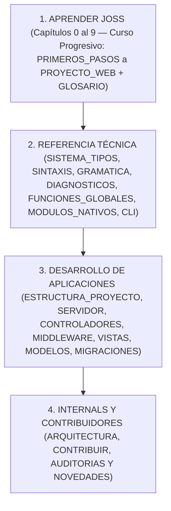

# Relatório de auditoria integral e reconstrução documental de Joss

Antes: [Contribuir para Joss](CONTRIBUIR.md). Depois: [Auditoria técnica de 2026](AUDITORIA_TECNICA_2026.md).
Índice geral: [Documentação de Joss](README.md).

---

## 1. Introdução e propósito da auditoria

O presente relatório documenta a auditoria exaustiva e a reconstrução profunda da documentação da linguagem de programação **Joss**.

O princípio orientador absoluto deste trabalho foi:

> **O código-fonte e seus testes executados são a única fonte da verdade.**

Toda a documentação foi contrastada com o comportamento real do analisador léxico (`pkg/parser/lexer.go`), o parser Pratt (`pkg/parser`), a árvore de sintaxe abstrata AST (`pkg/parser/ast*.go`), o sistema de tipos e inferência (`pkg/typesystem`), o analisador semântico (`pkg/analyzer`), o avaliador e motor de execução em Go (`pkg/core`), o compilador nativo (`pkg/ir`, `pkg/backend/native`), as classes e funções nativas registradas e a suíte de testes automatizados.

---

## 2. Diagnóstico do estado inicial e dívida documental

Ao iniciar a auditoria, detectou-se que a documentação existente apresentava lacunas tanto técnicas quanto pedagógicas em relação às capacidades reais do código:

### A. Lacuna pedagógica e de onboarding para iniciantes
- O ponto de entrada em `PRIMEROS_PASOS.md` ensinava a criar pastas manualmente com `mkdir` em vez de aproveitar o gerador oficial `joss new console mi-primer-joss`.
- A ordem do curso introduzia `FUNCIONES.md` antes de `COLECCIONES.md`, apesar de funções utilizar listas e operadores de desempacotamento (`...$numeros`), e colocava `ERRORES.md` depois de `CLASES.md`, embora as funções já exigissem compreender `throw`.
- Faltava explicar explicitamente a estrutura gerada por `joss new console` (`public class Main { Init main() { ... } }`), a diferença entre declarar uma variável pela primeira vez (`var $x = 1`) e reatribuí-la (`$x = 2`), e a diferença entre interpretar (`joss run`) e compilar para binário nativo (`joss build`).

### B. Funcionalidades implementadas no código incorporadas aos guias
Durante a inspeção linha por linha do código-fonte foram documentadas e integradas no percurso de aprendizagem e referência:
1. **O operador Pipeline (`|>`)**:
   - Implementado em `pkg/parser/parser.go` (precedência `PIPE_OP`), `pkg/parser/parser_expressions.go` e avaliado em `pkg/core/evaluator_pipeline.go`.
   - Permite compor funções da esquerda para a direita: `" ada " |> trim |> strtoupper`.
2. **Instruções `guard` e `defer`**:
   - `guard (condición) : { return ... }` validada estaticamente com `JOSS-FLOW-005` para retornos antecipados e *smart cast narrowing*.
   - `defer { ... }` para execução adiada em ordem LIFO ao finalizar o frame da função.
3. **Records imutáveis (`public record Nombre(...)`) e Classes Genéricas (`class Caja<T>`)**:
   - Validação nominal e imutabilidade automática de campos (`JOSS-CONST-001`).
4. **O operador Elvis (`?:`), coalescência nula (`??`), atribuição nula (`??=`) e navegação segura (`?->`)**:
   - Documentados com suas regras exatas de avaliação e estreitamento de tipos.
5. **Consumo de canais concorrentes mediante `foreach` e multiplexação com `select`**:
   - Padrões produtor-consumidor e geradores preguiçosos com `yield`.
6. **Descoberta unificada do projeto (`semanticanalyzer.LoadProject` e `ExecutePrepared`)**:
   - Tanto `joss analyze`, `joss run`, `joss server` quanto `joss build` carregam de maneira uniforme `main.joss`, `routes.joss`, `api.joss` e todos os subdiretórios de `app/` (incluindo `app/libs`) em um único `PreparedProgram`.

### C. Correções técnicas de precisão
- **Promoção numérica exata**: Corrigiu-se em `SISTEMA_TIPOS.md` que a única promoção numérica implícita entre tipos distintos é `int → decimal`; as misturas entre `int` e `float` ou `float` e `decimal` exigem conversão explícita (`JOSS-ARITH-003`).
- **Declaração obrigatória de variáveis**: Todos os exemplos da documentação foram atualizados para declarar variáveis com `var`, tipo explícito, `mixed` ou `const` antes de reatribuí-las, cumprindo com `JOSS-SYM-001` / `JOSS-DECL-007`.
- **Códigos de diagnóstico exatos**: Alinharam-se `CLASES.md` e `DIAGNOSTICOS.md` com `pkg/analyzer/validation_nominal.go` e `member_resolution.go` (`JOSS-DECL-003` para métodos duplicados, `JOSS-DECL-004` para conflitos nominais e descumprimento de interface, `JOSS-DECL-005` para métodos abstratos não implementados e `JOSS-DECL-006` para instanciação de classe abstrata ou transição de `let`).

---

## 3. Arquitetura documental do projeto (Separação Curso vs Referência)

A documentação foi estruturada diferenciando claramente o **Curso progressivo** da **Referência técnica formal**:



---

## 4. Pontos técnicos do motor registrados para referência

Durante a auditoria do código-fonte e a execução de testes, registraram-se os seguintes comportamentos do runtime que a documentação explica com honestidade técnica:

1. **Detecção de `break` / `continue` em blocos condicionais dentro de laços**:
   - O otimizador de planos de laço (`pkg/runtime/plan/callable.go`) inspeciona instruções diretas do corpo do laço (`BlockHasBreakOrContinue`). Se `break` ou `continue` forem aninhados dentro de um ternário em um laço de nível superior onde `hasControl` é falso, o salto não é interceptado por `executeLoopBodyProtected`.
2. **Comportamento não mutante de `array_pop` e `array_shift`**:
   - As funções globais `array_pop($arr)` e `array_shift($arr)` devolvem o último ou primeiro elemento sem reduzir o comprimento do slice original, diferentemente do método mutante `$arr->pop()`.
3. **Diferenças entre metadados publicados e retorno dinâmico em alguns built-ins**:
   - Certas funções herdadas (`boolval`, `json`, `microtime`, `strpos`, `base64_decode`, `array_merge`) têm assinaturas estáticas simplificadas em `builtins.go`, embora em tempo de execução devolvam tipos compostos ou booleanos em caso de falha.

---

## 5. Verificação formal e testes executados

Para garantir que nenhum documento apresente links quebrados, exemplos desatualizados ou inconsistências com o runtime, executa-se a suíte de validação completa:

1. **Verificação de catálogo, documentação nativa e internacionalização (i18n)**:
   ```bash
   go run ./tools/cataloggen --check
   go run ./tools/docgen --check
   go run ./tools/docsi18n --check
   ```
2. **Suíte de testes unitários e de integração**:
   ```bash
   go vet ./...
   go test ./...
   ```
3. **Verificação de contratos e navegação (`TestDocumentationNavigationAndPublicMirror` e `TestDocumentationContracts`)**:
   - Verificação de todos os links Markdown locais entre documentos.
   - Verificação de paridade byte a byte entre `docs/*.md` e `ejemplos/Joss-Red-JosSecurity/assets/docs/*.md`.
   - Execução e análise de todos os blocos etiquetados com `<!-- joss-run: ... -->`, `<!-- joss-check: ... -->` e `<!-- joss-error: ... -->`.

---

## 6. Conclusão

Com esta reconstrução, a documentação de Joss combina uma **rota pedagógica progressiva** (capaz de guiar do zero absoluto com `joss new console` até aplicações web e binários nativos com `joss build`) com uma **referência técnica rigorosa**, 100% sincronizada e verificada contra o código-fonte.
