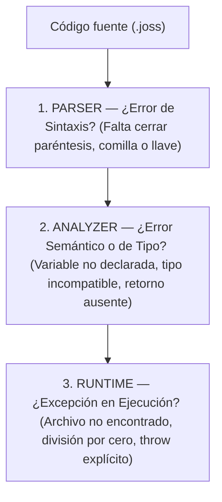

# Tratamento de erros, exceções e diagnóstico

Antes: [Funções, closures e referências](FUNCIONES.md). Depois: [Classes, objetos e herança](CLASES.md).
Referência técnica: [Diagnósticos estruturados](DIAGNOSTICOS.md), [Analisador semântico](ANALIZADOR.md).

---

## O que você vai aprender aqui?

Em um mundo ideal, os programas sempre receberiam os dados corretos, os discos rígidos nunca ficariam cheios e as conexões de rede jamais falhariam. No mundo real, os erros são inevitáveis:
- Um usuário digita letras onde se esperava um número de cartão.
- Um arquivo de configuração de que o programa precisa foi apagado por acidente.
- O servidor de banco de dados reinicia no meio de uma transação.

Um programa profissional não é aquele que nunca encontra problemas, mas sim aquele que **sabe antecipá-los, contê-los e se recuperar sem entrar em colapso**.

Neste guia você aprenderá:
1. As três fases temporais onde os erros são detectados: sintaxe, análise estática e tempo de execução (*runtime*).
2. Como ler e interpretar uma mensagem de diagnóstico estruturado do Joss.
3. O mecanismo de controle de exceções com **`try`**, **`catch`** e **`throw`**.
4. Quais informações a variável de erro capturada (o mapa `$error`) contém.
5. Por que as instruções `return`, `break` e `continue` dentro de um bloco `try` não sofrem interferência do `catch`.
6. Quando tratar erros mediante exceções vs quando verificar valores de retorno (`null`).

---

## 1. As três fases de um erro

Para solucionar um problema rapidamente, o primeiro passo é identificar em qual fase do ciclo de vida do programa ele ocorreu:



| Fase | Quando ocorre | Exemplo | Como é resolvido |
|---|---|---|---|
| **Sintaxe** | Durante a leitura inicial do texto | `print("Hola)` (aspas sem fechar) | Corrija a pontuação apontada pelo parser. |
| **Análise** | Durante a verificação estática prévia | `int $x = "texto"` (`JOSS-TYPE-001`) | Corrija a discrepância de tipos ou nomes antes de executar. |
| **Execução (Runtime)** | Enquanto o programa está rodando na memória | `$n / 0` ou uma falha de rede | É interceptado e gerenciado com blocos `try / catch`. |

---

## 2. Anatomia de uma mensagem de diagnóstico

Quando o Joss detecta um problema antes de executar, ele imprime um diagnóstico estruturado. Por exemplo:

```text
error[JOSS-TYPE-001] app.joss:15:5: Asignación incompatible: se esperaba 'int', se obtuvo 'string'.
  --> app.joss:15:5
   |
15 |     $edad = "veinte"
   |     ^^^^^
Sugerencia: Modifica el valor asignado o declara la variable como 'mixed'.
```

Cada parte da mensagem tem um propósito:
1. **Severidade (`error` ou `warning`)**:
   - `error`: Problema crítico. O Joss se recusará a executar o programa para evitar comportamentos imprevisíveis.
   - `warning`: Aviso informativo (como uma variável declarada que nunca foi usada). O programa pode ser executado, mas recomenda-se limpá-lo.
2. **Código estável (`JOSS-TYPE-001`)**: Um identificador único que permite buscar a causa exata e exemplos na [Referência de diagnósticos](DIAGNOSTICOS.md).
3. **Localização (`app.joss:15:5`)**: O arquivo exato, número da linha (`15`) e coluna (`5`) onde a discrepância foi detectada.
4. **Explicação e Sugestão**: Uma descrição em linguagem natural de qual regra foi quebrada e como repará-la.

---

## 3. Tratamento de exceções: `try`, `catch` e `throw`

Uma **exceção** é um sinal de alarme que interrompe o fluxo normal do programa quando ocorre uma situação imprevista que o código atual não consegue resolver por si mesmo.

- **`throw`**: Lança o alarme (a exceção).
- **`try`**: Delimita uma zona protegida de código onde suspeitamos que algo possa falhar.
- **`catch ($error)`**: É a brigada de emergência. Se algo explodir dentro do bloco `try`, a execução salta imediatamente para o bloco `catch` para mitigar o problema:

<!-- joss-run: ["No se pudo continuar: faltan datos"] -->
```joss
try {
    throw "faltan datos"
} catch ($error) {
    print("No se pudo continuar: " . $error)
}
```

Saída no terminal:

```text
No se pudo continuar: faltan datos
```

### O que acontece neste exemplo?
1. O computador entra no bloco `try`.
2. Executa `throw "faltan datos"`. Nesse instante, a execução normal é interrompida.
3. O controle salta diretamente para o bloco `catch`.
4. A mensagem `"faltan datos"` fica depositada na variável `$error`.
5. O bloco `catch` imprime o aviso.
6. O programa não trava; ele continua executando as linhas posteriores ao `catch`.

---

## 4. Inspeção avançada do objeto de erro no `catch`

Quando o próprio motor de execução do Joss gera um erro interno (chamado `JossError`, como um estouro aritmético ou um índice fora de intervalo), a variável `$e` do `catch` recebe em tempo de execução um **mapa associativo** com informações técnicas detalhadas:

```joss
try {
    var $arr = [1, 2]
    print($arr[99]) // Índice fuera de rango
} catch ($e) {
    print("Mensaje: " . $e["message"])
    print("Tipo: " . $e["type"])
    print("Archivo: " . $e["file"])
    print("Línea: " . $e["line"])
}
```

### Campos disponíveis no mapa de erro interno:
- `$e["message"]`: A mensagem descritiva da falha.
- `$e["type"]`: A categoria interna do erro (por exemplo, `"IndexOutOfRange"` ou `"ArithmeticFault"`).
- `$e["file"]`: O caminho para o arquivo fonte onde a falha se originou.
- `$e["line"]`: O número exato da linha.
- `$e["error"]`: A representação textual completa do erro.

### Exceções estruturadas com mapas ou instâncias de classe

Você também pode lançar um mapa associativo com seus próprios campos de contexto, ou então uma instância de uma classe personalizada (veremos como construir classes em detalhes no próximo capítulo, [Classes, objetos e herança](CLASES.md)):

<!-- joss-run: ["Campo: email", "Motivo: Formato inválido"] -->
```joss
public class ErrorValidacion {
    Init(public string $campo, public string $motivo) {}
}

try {
    throw new ErrorValidacion("email", "Formato inválido")
} catch ($e) {
    print("Campo: " . $e->campo)
    print("Motivo: " . $e->motivo)
}
```

Saída no terminal:

```text
Campo: email
Motivo: Formato inválido
```

---

## 5. Garantia de fluxo: `return` e laços dentro de `try`

Em muitas linguagens, colocar instruções de controle dentro de um bloco protegido pode causar comportamentos inesperados. No Joss:

- Se você executar `return $valor` dentro de um bloco `try`, a função retornará imediatamente e o bloco `catch` **não intervirá**.
- Se você executar `break` ou `continue` dentro de um `try` que está em um laço, o ciclo será interrompido ou avançará normalmente sem que o `catch` confunda o salto com uma exceção.

O Joss distingue internamente os sinais de controle de fluxo dos erros reais de usuário, garantindo que suas cláusulas de guarda funcionem de forma 100% previsível.

---

## 6. Exceções vs Verificação de retornos

Nem todos os problemas devem ser tratados com `try / catch`. Na biblioteca padrão do Joss, muitas operações devolvem um valor especial (`null` ou `false`) quando uma consulta simplesmente não encontra resultados.

Por exemplo, ler um arquivo que não existe:

<!-- joss-run: ["No se pudo leer el archivo"] -->
```joss
var $contenido = file_get_contents("archivo-que-no-existe.txt")
($contenido == null) ? {
    print("No se pudo leer el archivo")
} : {
    print($contenido)
}
```

Saída no terminal:

```text
No se pudo leer el archivo
```

- `file_get_contents(...)`: Devolve o texto do arquivo se ele existir, ou `null` se não pôde ser lido. Não lança uma exceção destrutiva; permite verificar o resultado com um ternário simples.
- `file_put_contents(...)`: Devolve `true` se o arquivo foi gravado em disco ou `false` se houve falha de permissões.

### Quando usar cada abordagem?
- **Use verificação de retorno (`$res == null`)**: Quando a ausência do dado for uma possibilidade normal da aplicação (um usuário que busca um produto que não existe no catálogo).
- **Use `throw` e `try / catch`**: Quando a falha representar uma condição crítica ou anormal da qual o código local não consegue se recuperar (perdeu-se a conexão com o servidor de pagamentos no meio da cobrança, ou faltam variáveis de ambiente essenciais para inicializar).

---

## 7. Antipadrões: O que você NÃO deve fazer

> [!CAUTION]
> **Nunca silencie erros com um `catch` vazio**:

```joss
// MALO: Esconde bugs catastróficos
try {
    iniciarBaseDeDatos()
} catch ($e) {}
```

> Se o banco de dados não pôde iniciar, o programa continuará rodando às cegas e falhará de forma incompreensível dez linhas mais adiante. No mínimo, registre o erro no console com `print($e)` ou cancele a execução.

---

## 8. Exercícios práticos

### Nível 1 — Teste rápido
Escreva um bloco `try / catch ($err)` onde dentro do `try` você lance a exceção `throw "Conexión rechazada"`. No `catch`, imprima `"Alerta: " . $err`.

### Nível 2 — Exercício guiado
1. Escreva uma função `public func registrarEdad(int $edad): string`.
2. Se `$edad < 0`, lance uma exceção: `throw "La edad no puede ser negativa"`.
3. Se `$edad < 18`, lance: `throw "Debe ser mayor de edad para registrarse"`.
4. Se for válida, retorne `"Registro exitoso"`.
5. Chame a função dentro de um bloco `try / catch`, testando com `-5`, `15` e `25`, e imprima o resultado ou a mensagem de erro capturada.

### Nível 3 — Desafio
Crie uma função `public func dividirSeguro(int $numerador, int $denominador): int` que:
1. Use um bloco `try / catch ($e)` para realizar a operação `$numerador / $denominador`.
2. Se ocorrer um erro aritmético (como dividir por `0`), capture o mapa `$e`, imprima `"Fallo detectado: " . $e["type"]` e retorne `0`.
3. Teste chamá-la com `dividirSeguro(20, 4)` e `dividirSeguro(20, 0)`.

---

## Próximo passo

Agora que você sabe como organizar funções, manipular coleções e proteger seu programa contra falhas, está pronto para empacotar dados e comportamentos juntos mediante a Programação Orientada a Objetos.

Continue com: [Classes, objetos, métodos e herança](CLASES.md).