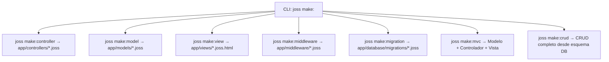

# Estrutura de projetos

[Índice](README.md)

## Web

`joss new web mi_app` e `joss new mi_app` criam o template web real do pacote `pkg/template/files`.

As quatro variantes de `joss new` são validadas no CI: web e console devem passar pelo parser e analisador sem erros; console além disso deve executar; package e plugin devem compilar para um JP v2 assinado, verificável, com bytecode decodificável e índice de símbolos.

```text
mi_app/
├── main.joss
├── env.joss
├── routes.joss
├── api.joss
├── joss.yaml
├── AGENTS.md                 # Guía y sintaxis para asistentes de IA
├── config/
├── app/
│   ├── controllers/          # Subcarpetas por dominio (web/, auth/, api/)
│   │   ├── web/
│   │   ├── auth/
│   │   └── api/
│   ├── models/               # Modelos GranDB (auth/, etc.)
│   │   └── auth/
│   ├── services/             # Servicios en segundo plano e integraciones
│   ├── middleware/           # Middleware de peticiones
│   ├── libs/                 # Librerías y utilidades del proyecto
│   └── database/migrations/
├── assets/
├── public/
├── storage/
├── package.json
└── README.md
```

O template também pode incluir rotas, arquivos de autenticação, recursos frontend e coleções de API. A lista exata pode crescer; o gerador e seus testes são a referência executável.

`main.joss` é obrigatório para `joss server start`. `env.joss` contém a configuração de ambiente do projeto (`PORT="80"` por padrão no template web) e não é código executável com `joss run`.

## Descoberta unificada do projeto (`PreparedProgram`)

Tanto `joss analyze`, `joss check`, `joss run`, `joss server` quanto `joss build` utilizam o carregador unificado `semanticanalyzer.LoadProject("main.joss", "app")`, que descobre e integra em um único `PreparedProgram`:
- O ponto de entrada (`main.joss`).
- Os arquivos de rotas na raiz (`routes.joss` e `api.joss`, se existirem).
- Todos os arquivos `.joss` recursivamente sob `app/` (incluindo `controllers/`, `models/`, `services/`, `middleware/`, `libs/` e `database/`).

O interpretador (`Runtime.ExecutePrepared`), o servidor HTTP e o compilador nativo registram todas as classes, interfaces, enums e funções diretamente a partir desse `PreparedProgram` canônico sem reescanear nem omitir subdiretórios de `app/`.

## Console

`joss new console mi_cli` cria `main.joss`, configuração, controladores, modelos, bibliotecas e migrações; não cria rotas, views, `public/` nem assets web.

```bash
cd mi_cli
joss run main.joss
```

## Pacote / Plugin

`joss new package mi_plugin` (ou `joss new plugin mi_plugin`) cria:

```text
mi_plugin/
├── joss.yaml
├── README.md
└── src/plugin.joss
```

Compile-o com `joss build package .`. Consulte [Plugins](PLUGINS.md).

## Convenções efetivas e geradores (`joss make:*`)

- Controladores: `app/controllers/NameController.joss` (ou subpastas `web/`, `auth/`, `api/`), gerados com `joss make:controller NameController` (ou `joss make:controller web/NameController`).
- Modelos: `app/models/Name.joss` (`extends Model`), gerados com `joss make:model Name`.
- Views: `app/views/name.joss.html` ou `.html`, geradas com `joss make:view name` (ou `joss make:view carpeta/vista`).
- Middlewares: `app/middleware/Name.joss`, gerados com `joss make:middleware Name`.
- Tríade MVC completa: `joss make:mvc Name` gera simultaneamente o modelo (`app/models/Name.joss`), o controlador (`app/controllers/NameController.joss`) e a view (`app/views/name/index.joss.html`).
- Migrações: timestamp, nome descritivo e extensão `.joss` em `app/database/migrations/`, geradas com `joss make:migration create_tabla`.
- Módulo CRUD relacional: `joss make:crud tabla` inspeciona a tabela existente e gera modelo, controlador, views e rotas; `joss remove:crud tabla` reverte esses artefatos.
- Sintaxe gerada: `func`, `::` para estáticos e `->` para instâncias.



Os geradores são validados com um teste que cria projetos web e console e passa todos os seus arquivos `.joss` pelo parser e pelo analisador semântico.