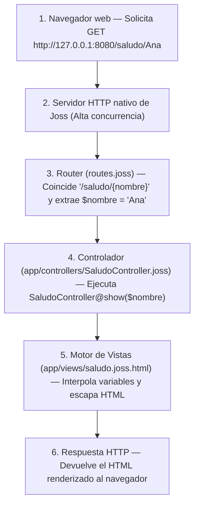
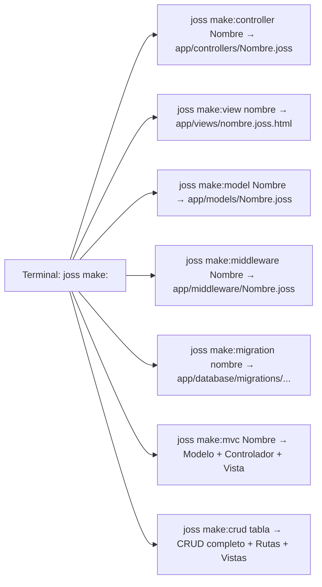

# Projeto web completo: Arquitetura MVC com a stack nativa

Antes: [Projeto de console](PROYECTO_CONSOLA.md). Depois: [Controladores e HTTP](CONTROLADORES.md).
Referência técnica: [Motor de views](VISTAS.md), [Servidor nativo](SERVIDOR.md), [Modelos GranDB](MODELOS.md).

---

## O que você vai construir aqui?

Uma **aplicação web** é um programa que roda em um servidor escutando requisições de rede (geralmente de um navegador ou aplicação móvel) e responde com páginas HTML interativas ou dados em formato JSON.

Ao contrário de outras linguagens onde você precisa instalar servidores externos complexos (como Apache, Nginx ou pacotes pesados do Node.js), **o Joss inclui seu próprio servidor HTTP de alto desempenho, roteador dinâmico e motor de templates HTML**.

Neste tutorial guiado você construirá sua primeira aplicação web baseada no padrão arquitetural **MVC (Model - View - Controller)**:
1. Criar a estrutura do projeto usando o gerador de templates `joss new` (`joss new web`).
2. Compreender o fluxo de uma requisição web no Joss.
3. Conhecer o sistema de geradores de código `joss make:<componente>` para criar peças do projeto sem fazê-lo do zero.
4. Configurar a porta em `env.joss` e definir uma rota com parâmetros dinâmicos em `routes.joss`.
5. Gerar e programar um controlador em `app/controllers/` com `joss make:controller`.
6. Gerar e projetar uma view HTML segura em `app/views/` com `joss make:view` e escape automático contra injeções XSS.
7. Iniciar o servidor com `joss server start` e testar a aplicação no navegador.

---

## 1. O fluxo de uma requisição web no Joss

Quando um usuário digita um endereço em seu navegador, ocorre a seguinte sequência:



---

## 2. Gerar o projeto web e conhecer os comandos `joss make:*`

Abra seu terminal e execute o gerador oficial (você pode digitar `joss new saludo_web` ou explicitamente `joss new web saludo_web`):

```bash
joss new web saludo_web
cd saludo_web
```

Este comando criará a estrutura padrão de uma aplicação web Joss:
- `main.joss`: Ponto de entrada do projeto.
- `env.joss`: Variáveis de configuração (porta, banco de dados, chaves secretas).
- `routes.joss` e `api.joss`: O mapa de URLs web e endpoints de API da aplicação.
- `app/controllers/`: Onde residem os controladores (organizados em `web/`, `auth/`, `api/`).
- `app/models/`: Modelos de banco de dados com GranDB.
- `app/views/`: Templates HTML dinâmicos (`.joss.html`).
- `public/`: Arquivos estáticos diretos (folhas de estilo CSS, scripts JS, imagens).

### O design de geradores `joss make:<componente>`

Em vez de criar arquivos manualmente um por um, o Joss fornece a família de comandos `joss make:<componente>`, que gera automaticamente as classes e templates na pasta correta seguindo as convenções do framework:



| Comando | O que cria automaticamente? | Exemplo de uso |
|---|---|---|
| `joss make:controller <Nombre>` | Um controlador em `app/controllers/<Nombre>.joss` (suporta subpastas como `web/SaludoController`) | `joss make:controller SaludoController` |
| `joss make:view <nombre>` | Um template HTML em `app/views/<nombre>.joss.html` (suporta subpastas como `usuarios/perfil`) | `joss make:view saludo` |
| `joss make:model <Nombre>` | Um modelo GranDB em `app/models/<Nombre>.joss` conectado à sua tabela pluralizada | `joss make:model Producto` |
| `joss make:middleware <Nombre>` | Um middleware HTTP em `app/middleware/<Nombre>.joss` | `joss make:middleware VerificarSesion` |
| `joss make:mvc <Nombre>` | A tríade completa de uma só vez: Modelo + Controlador (`<Nombre>Controller`) + View (`<nombre>/index`) | `joss make:mvc Producto` |
| `joss make:migration <nombre>` | Uma migração de banco de dados com data/hora em `app/database/migrations/` | `joss make:migration create_productos` |
| `joss make:crud <tabla>` | Inspeciona a tabela no banco de dados e gera Modelo, Controlador, Views Tailwind e Rotas (reverte-se com `joss remove:crud <tabla>`) | `joss make:crud productos` |

---

## 3. Configurar a porta do servidor

Abra o arquivo `env.joss` na raiz do projeto. Por padrão o template gera `PORT="80"`. Para desenvolver localmente sem permissões de administrador, altere-a para uma porta livre como `"8080"`:

```joss
PORT="8080"
APP_NAME="Mi Web Joss"
```

> [!NOTE]
> `env.joss` é um arquivo de configuração de ambiente que o Joss carrega automaticamente ao iniciar; não é um script executável para rodar com `joss run env.joss`.

---

## 4. Definir a rota dinâmica

Abra o arquivo `routes.joss` e adicione a seguinte definição:

<!-- joss-check: fragmento de routes.joss -->
```joss
Router::get("/saludo/{nombre}", "SaludoController@show")
```

### O que significa esta linha?
- `Router::get(...)`: Indica que responderemos a requisições HTTP do tipo `GET` (aquelas que o navegador faz ao abrir um link).
- `"/saludo/{nombre}"`: O padrão da URL. `{nombre}` é um **segmento dinâmico**: qualquer texto que o usuário digitar nessa posição da URL será capturado.
- `"SaludoController@show"`: O destinatário. Indica ao roteador que deve instanciar a classe `SaludoController` e executar seu método `show`.

---

## 5. Criar o controlador com `joss make:controller`

Em seu terminal, dentro da pasta `saludo_web`, execute o gerador de controladores:

```bash
joss make:controller SaludoController
```

Você verá a confirmação no console:

```text
Created: app/controllers/SaludoController.joss
```

O Joss terá criado o arquivo `app/controllers/SaludoController.joss` com uma estrutura inicial pronta para uso:

<!-- joss-check: plantilla generada por joss make:controller -->
```joss
public class SaludoController {
    public func index(): mixed {
        return view("saludo/index")
    }
}
```

Agora abra `app/controllers/SaludoController.joss` e adicione ou substitua o método por `show(string $nombre)` para receber o parâmetro da nossa rota:

<!-- joss-check: fragmento de controlador web -->
```joss
public class SaludoController {
    public func show(string $nombre) {
        var $nombreLimpio = trim($nombre)
        return view("saludo", {"nombre": $nombreLimpio})
    }
}
```

### Anatomia do controlador:
1. `public class SaludoController`: Classe pública que o Joss descobre automaticamente dentro de `app/` sem necessidade de `import`.
2. `public func show(string $nombre)`: O método recebe o parâmetro dinâmico `{nombre}` capturado pela rota. No Joss, os parâmetros do controlador devem declarar seu tipo (`string $nombre`).
3. `var $nombreLimpio = trim($nombre)`: Limpa possíveis espaços em branco nas extremidades.
4. `return view("saludo", {"nombre": $nombreLimpio})`:
   - Chama a função nativa `view(...)`.
   - O primeiro argumento é o nome do arquivo de template (procurará `app/views/saludo.joss.html`).
   - O segundo argumento é um mapa associativo com os dados que queremos injetar dentro do HTML.

---

## 6. Gerar e projetar a view HTML com `joss make:view`

Gere o arquivo de view pelo seu terminal executando:

```bash
joss make:view saludo
```

Você verá a confirmação:

```text
Created: app/views/saludo.joss.html
```

Por padrão, `joss make:view` cria um template conectado ao layout mestre (`@extends('layouts.master')`). Para este primeiro exemplo autocontido, abra `app/views/saludo.joss.html` e substitua seu conteúdo por este cartão HTML completo:

```html
<!doctype html>
<html lang="es">
<head>
    <meta charset="utf-8">
    <meta name="viewport" content="width=device-width, initial-scale=1">
    <title>Saludo - Mi Web Joss</title>
    <style>
        body { font-family: system-ui, sans-serif; margin: 40px; background: #f8fafc; color: #1e293b; }
        .card { background: white; padding: 30px; border-radius: 12px; box-shadow: 0 4px 6px -1px rgb(0 0 0 / 0.1); max-width: 500px; }
        h1 { color: #0f766e; margin-top: 0; }
    </style>
</head>
<body>
    <div class="card">
        <h1>¡Hola, {{ $nombre }}!</h1>
        <p>Bienvenido a tu primera aplicación web construida con <strong>Joss</strong>.</p>
    </div>
</body>
</html>
```

### Segurança nativa contra ataques XSS:
Note a sintaxe `{{ $nombre }}`:
- O motor de templates do Joss **escapa automaticamente caracteres HTML perigosos** como `<`, `>`, `"` ou `&`.
- Se um usuário mal-intencionado tentar inserir como nome `<script>alert('hack')</script>`, o Joss o converterá para entidades seguras (`&lt;script&gt;...`), protegendo seus visitantes contra vulnerabilidades de Cross-Site Scripting (XSS).

---

## 7. Iniciar e testar o servidor

Em seu terminal, localizado na raiz do projeto `saludo_web`, digite:

```bash
joss server start
```

(Ou seu atalho equivalente `joss server`). Você verá a mensagem de confirmação do servidor HTTP:

```text
[CLI] Ejecutando script de inicio (main.joss)...
[Joss Server] Servidor HTTP escuchando en http://127.0.0.1:8080
[Joss Server] Presiona 'q' o Ctrl+C para detener el servidor.
```

Abra seu navegador web e visite:

`http://127.0.0.1:8080/saludo/Ana`

Você verá o cartão estilizado saudando Ana. Agora tente alterar a URL para:

`http://127.0.0.1:8080/saludo/Carlos`

O servidor responderá instantaneamente com a nova saudação.

Para parar o servidor a qualquer momento, pressione simplesmente a tecla **`q`** ou `Ctrl + C` em seu terminal.

---

## 8. Verificação e checagem estática

Antes de implantar em produção, você pode auditar todo o projeto com os comandos de verificação do Joss:

```bash
joss analyze main.joss
joss check .
```

---

## 9. Exercícios práticos

### Nível 1 — Teste rápido
Passe um segundo dado de `SaludoController@show` para a view adicionando `"rol": "Desarrollador Joss"` ao mapa de `view(...)` e mostre-o dentro de `saludo.joss.html` abaixo do título usando `<p>Rol: {{ $rol }}</p>`.

### Nível 2 — Exercício guiado
1. Abra `api.joss` (ou `routes.joss`) e registre uma rota `Router::get("/api/estado", "SaludoController@estado")`.
2. Adicione em `SaludoController` o método `public func estado()` que retorne `Response::json({"ok": true, "servidor": "Joss HTTP"})`.
3. Visite `http://127.0.0.1:8080/api/estado` em seu navegador e verifique a resposta JSON.

### Nível 3 — Desafio
1. Registre uma rota com dois parâmetros dinâmicos: `Router::get("/calcular/{a}/{b}", "SaludoController@sumar")`.
2. Implemente `public func sumar(string $a, string $b)` em `SaludoController`, converta ambos os parâmetros com `intval($a)` e `intval($b)`, calcule sua soma e renderize uma view ou resposta JSON com o detalhe da operação.

---

## Próximo passo

Agora que você conhece o ciclo completo de uma requisição web, pode explorar os recursos avançados da stack web do Joss e o sistema de tipos completo da linguagem:

Continue com: [Sistema de tipos e coerção](SISTEMA_TIPOS.md), [HTTP e Controladores](CONTROLADORES.md), [Middlewares e Segurança](MIDDLEWARE.md) e [Modelos GranDB](MODELOS.md).