# Documentação do Joss

Esta documentação descreve o comportamento do código atual. Está dividida
em aprendizado, guias, referência e internos para que uma pessoa iniciante possa
avançar em ordem e uma pessoa experiente encontre regras concretas.

## Idiomas

- Español (fonte canônica): este diretório.
- [English](../en/README.md)
- [Português](README.md)

Os 50 documentos mantêm o mesmo nome em cada idioma para que os links
relativos funcionem igual. Depois de editar o espanhol, execute
`go run ./tools/docsi18n -translate -sync` para atualizar traduções e o espelho
web; `go run ./tools/docsi18n -check` detecta arquivos ausentes, traduções
desatualizadas, links quebrados ou diferenças com JosSecurity.

## Aprender Joss (Rota guiada do zero)

Se você nunca programou ou está aprendendo Joss pela primeira vez, siga este curso em ordem. Cada capítulo introduz um conceito por vez, partindo de como criar e executar seu projeto oficial com `joss new console`, com explicações linha por linha, resultados visíveis e três níveis de prática (*Teste rápido*, *Exercício guiado* e *Desafio*).

```mermaid
flowchart LR
    C0["0. Primeros pasos (joss new console)"] --> C1["1. Fundamentos"]
    C1 --> C2["2. Control de flujo"]
    C2 --> C3["3. Colecciones"]
    C3 --> C4["4. Funciones"]
    C4 --> C5["5. Errores"]
    C5 --> C6["6. Clases y POO"]
    C6 --> C7["7. Concurrencia"]
    C7 --> C8["8. Proyecto Consola (joss build)"]
    C8 --> C9["9. Proyecto Web MVC (joss new / joss make:*)"]
```

0. [Primeiros passos: criar seu projeto com `joss new console`, entender `main.joss` e dialogar com `cin`](PRIMEROS_PASOS.md)
1. [Valores, variáveis e operações fundamentais](FUNDAMENTOS.md)
2. [Controle de fluxo: decisões e laços de repetição](CONTROL_FLUJO.md)
3. [Coleções: Arrays, Maps e texto Unicode](COLECCIONES.md)
4. [Funções, escopo (scope), `guard`, `defer`, closures, `ref` e pipelines](FUNCIONES.md)
5. [Tratamento de erros, diagnósticos `JOSS-...` e exceções `try/catch`](ERRORES.md)
6. [Classes, objetos, herança, interfaces, `record` e genéricos](CLASES.md)
7. [Concorrência, `async/await`, `Future` e canais (`channel`)](CONCURRENCIA.md)
8. [Projeto prático de console com persistência JSON e `joss build`](PROYECTO_CONSOLA.md)
9. [Projeto web completo com `joss new` e arquitetura MVC nativa](PROYECTO_WEB.md)

O [glossário](GLOSARIO.md) explica todos os termos de programação e do Joss em linguagem cotidiana, sem exigir que você conheça outra linguagem. Depois de concluir o curso básico, aprofunde-se nas regras formais de tipos em [Sistema de tipos, inferência e conversões](SISTEMA_TIPOS.md).

## Referência da linguagem e ferramentas

- [Sintaxe, tokens e precedência](SINTAXIS.md)
- [Gramática EBNF e nós AST](GRAMATICA.md)
- [Funções](FUNCIONES.md), [recursão](RECURSION.md) e [tipos](SISTEMA_TIPOS.md)
- [Diagnósticos](DIAGNOSTICOS.md) e [analisador](ANALIZADOR.md)
- [Funções globais](FUNCIONES_GLOBALES.md)
- [Classes nativas e serviços](MODULOS_NATIVOS.md)
- [Catálogo nativo gerado](CATALOGO_NATIVO.md)
- [CLI, formatador, linter e testes](CLI.md)
- [Suporte móvel: Android e iOS](MOBILE.md)
- [Extensão do VS Code](VSCODE_EXTENSION.md)
- [Estado e limites](ESTADO_IMPLEMENTACION.md)

## Criar aplicações

- [Estrutura de projetos](ESTRUCTURA_PROYECTO.md) e [configuração](CONFIGURACION.md)
- [Organização sem imports](MODULOS_IMPORTS.md) e [plugins](PLUGINS.md)
- Web: [servidor](SERVIDOR.md), [HTTP/controladores](CONTROLADORES.md),
  [middleware](MIDDLEWARE.md), [views](VISTAS.md), [assets](ASSETS.md) e
  [WebSockets](WEBSOCKETS.md)
- Dados: [modelos/GranDB](MODELOS.md), [Schema Builder](SCHEMA_BUILDER.md) e
  [migrações](MIGRACIONES.md)
- Aplicação: [autenticação](AUTENTICACION.md) e [SEO/sitemap](SEO_SITEMAP.md)

## Internos e manutenção

- [Arquitetura da linguagem](ARQUITECTURA.md)
- [Guia de contribuição](CONTRIBUIR.md)
- [Auditoria de documentação](DOCUMENTATION_AUDIT.md)
- [Auditoria da linguagem Joss 2026](JOSS_LANGUAGE_AUDIT_2026.md)
- [Avaliação crítica e comparativa do Joss 2026](JOSS_LANGUAGE_REVIEW_2026.md)
- [Evolução do Joss 2026: fases 0 e 1](JOSS_EVOLUTION_PHASE_0_1_2026.md)
- [Auditoria do ORM GranDB 2026](GRANDB_ORM_AUDIT_2026.md)
- [Auditoria técnica de 2026](AUDITORIA_TECNICA_2026.md)
- [Auditoria de otimização runtime](RUNTIME_OPTIMIZATION_AUDIT.md)
- [Novidades históricas 3.6.7](NOVEDADES_367.md)

Os documentos históricos preservam o contexto e podem descrever o estado de sua
data. Diante de uma diferença, prevalecem a implementação, os testes e
[Estado de implementação](ESTADO_IMPLEMENTACION.md).
